# Telas do IFAgenda

Capturas de todas as telas do sistema, citadas no Capítulo 4 do TCC (Seção "Telas do sistema").

As imagens foram feitas em 14/11/2026, em 1280×800, com o sistema executado localmente em um ambiente separado do de desenvolvimento. Os dados vêm da importação da planilha de horários do campus, na versão sugerida e mais enxuta (`planilha_example_sugerida_corrigida.xlsx`, semestre 2026/2). Por isso, as salas, os cursos, as disciplinas e as turmas são reais. **Os nomes e e-mails de pessoas foram substituídos por pseudônimos** ("Docente 001", `docente001@exemplo.edu.br`), e o administrador é fictício.

As solicitações que aparecem nas telas foram feitas pela própria interface, no Lab. 1 - Info, na semana de 16 a 20/11/2026:

| Solicitação | Docente | Data e horário | Resultado |
|---|---|---|---|
| 1 | Docente 001 | 18/11, 09:20 às 11:00 | Aprovada |
| 2 | Docente 002 | 19/11, 07:20 às 09:00 | Rejeitada, com motivo |
| 3 | Docente 003 | 20/11, 13:20 às 15:00 | Alternativa sugerida (20/11, 09:20 às 11:00) |
| 4 | Docente 004 | 16/11, 07:20 às 08:10 | Pendente |
| — | Docente 001 | 25/11, 11:00 às 14:10 | Recusada antes do envio: horário ocupado por uma aula |

Também foi publicado um comunicado para todos os usuários.

Cada tela abaixo indica a rota e quem tem acesso. O acesso depende das permissões do perfil do usuário. O superadministrador vê todas as telas.

## Sumário

- [Telas públicas](#telas-públicas)
- [Painel e notificações](#painel-e-notificações)
- [Agenda](#agenda)
- [Ensalamento e importação da planilha](#ensalamento-e-importação-da-planilha)
- [Cadastros acadêmicos](#cadastros-acadêmicos)
- [Relatórios](#relatórios)
- [Comunicados](#comunicados)
- [Administração](#administração)
- [Configurações e ajuda](#configurações-e-ajuda)

## Telas públicas

### Calendário público (`calendario-publico.png`)
**Rota:** `/` · **Acesso:** qualquer pessoa, sem login

Consulta da ocupação dos espaços por semestre, sala, docente, curso ou nível, em um período de datas. A grade mostra as aulas do ensalamento e os agendamentos aprovados, sem e-mails nem descrições. O botão de calendário exporta o resultado em arquivo `.ics`.

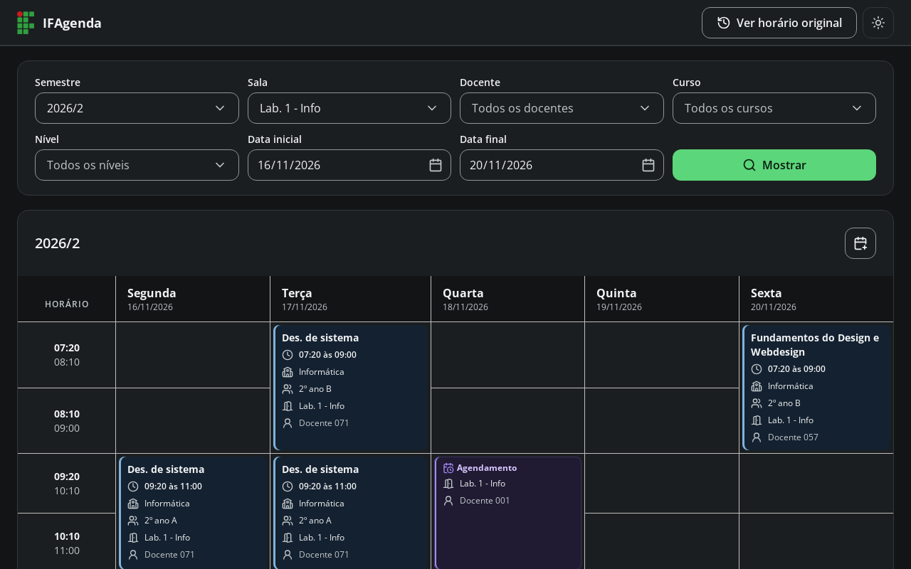

### Horário original (`horario-original.png`)
**Rota:** `/horario-original/` · **Acesso:** qualquer pessoa, sem login

A grade semanal como veio da planilha de horários, sem os agendamentos e sem as alterações feitas depois no sistema.

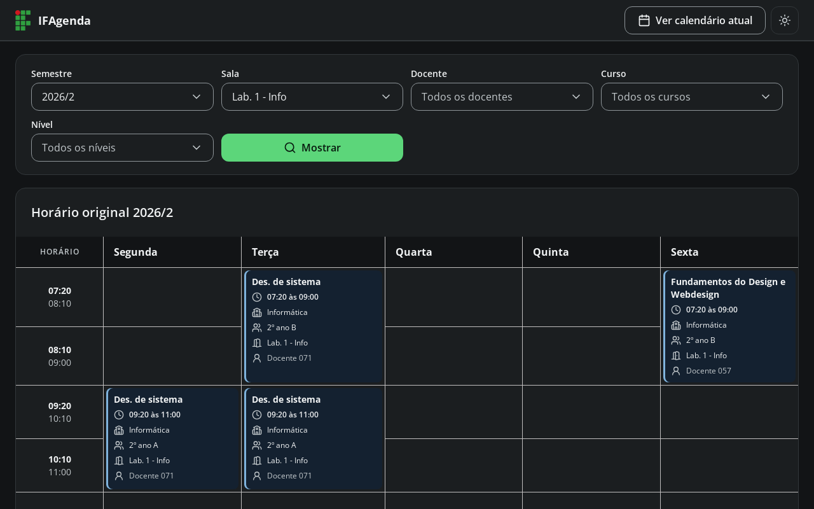

### Entrar (`login.png`)
**Rota:** `/contas/login/` · **Acesso:** qualquer pessoa

Login com o e-mail institucional e a senha, com a opção de manter a sessão e o link para recuperar a senha.

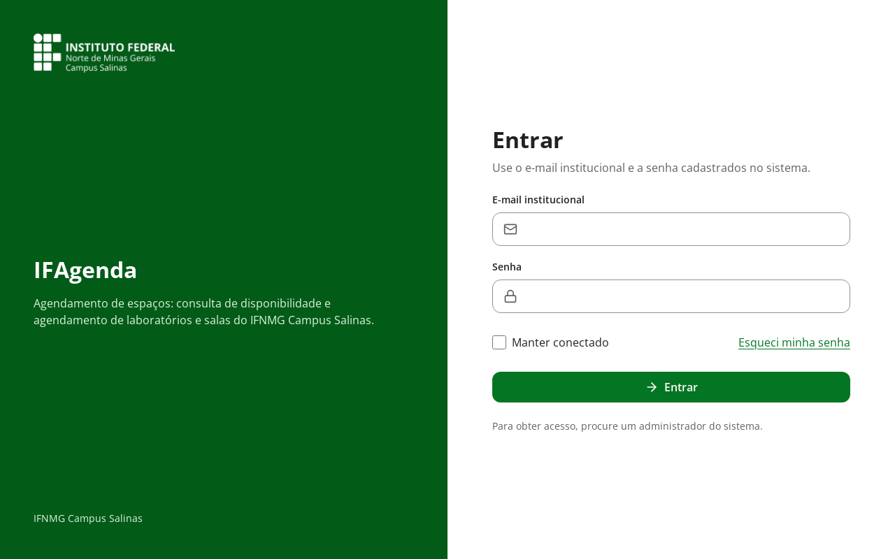

### Recuperar senha (`recuperar-senha.png`)
**Rota:** `/contas/senha/recuperar/` · **Acesso:** qualquer pessoa

Envia um link para definir uma nova senha. A resposta é a mesma para qualquer e-mail, para não revelar quem está cadastrado.

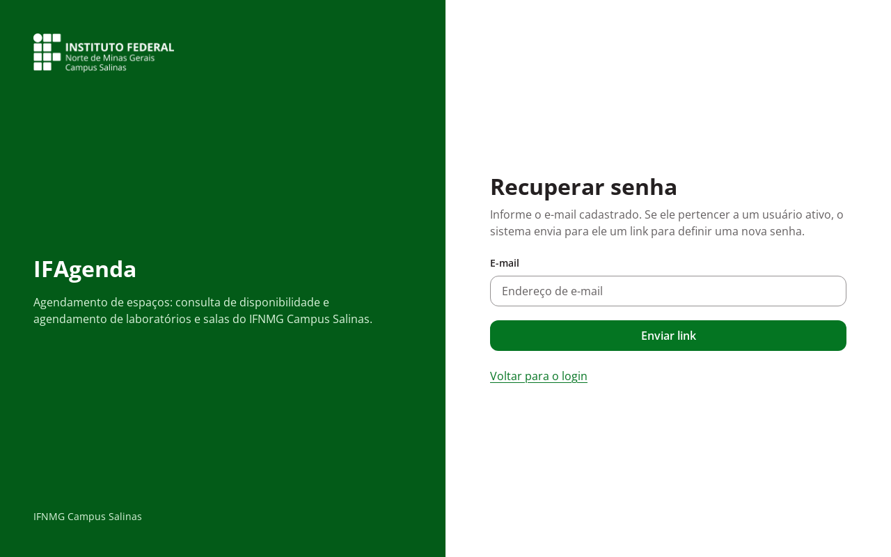

## Painel e notificações

### Painel (`painel.png`)
**Rota:** `/painel/` · **Acesso:** quem analisa solicitações ou gerencia o ensalamento

Resumo do semestre: solicitações pendentes, solicitações aguardando resposta, aulas sem espaço, importações abertas, espaços mais ocupados no dia e as próximas solicitações para decidir.

### Notificações no sino (`notificacoes-sino.png`)
**Rota:** ícone do sino, em qualquer tela · **Acesso:** usuário autenticado

As notificações chegam em tempo real, sem recarregar a página. Aqui, o administrador recebeu as novas solicitações e o comunicado publicado.

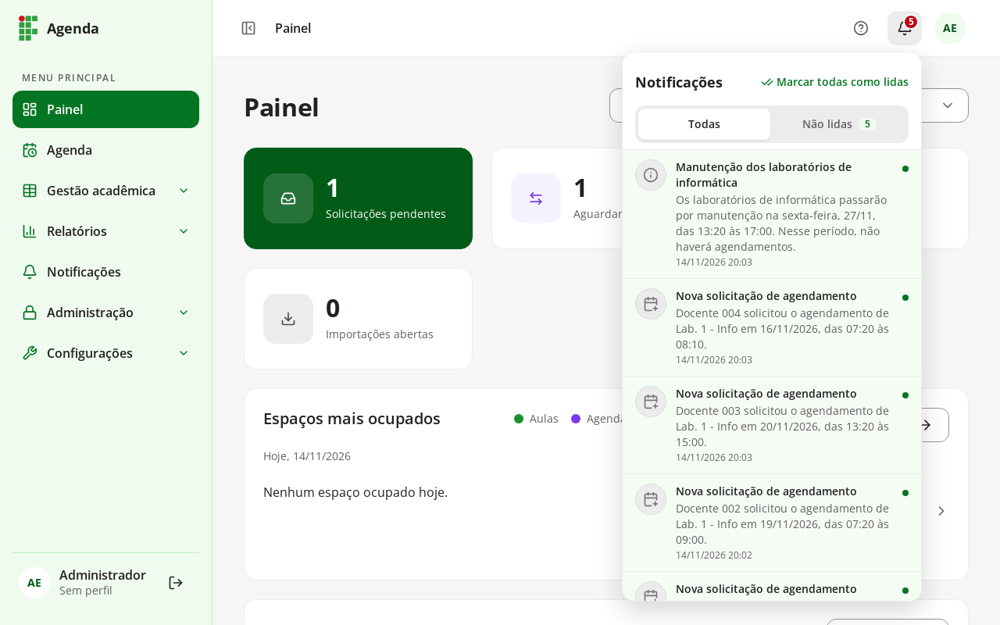

### Notificações do docente (`notificacoes-sino-docente.png`)
**Rota:** ícone do sino · **Acesso:** usuário autenticado

O mesmo sino para um docente: o aviso de que a sua solicitação foi aprovada e o comunicado.

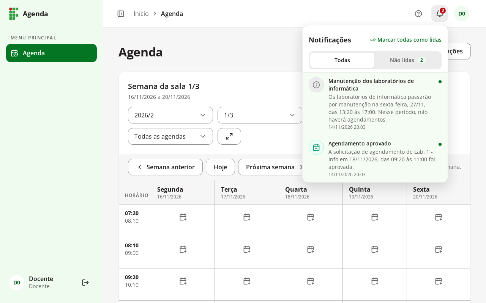

## Agenda

### Agenda (`agenda.png`)
**Rota:** `/agenda/` · **Acesso:** usuários que consultam a agenda

Semana de uma sala, com as aulas do ensalamento e os agendamentos, vista pelo administrador. Cada faixa livre tem um atalho para solicitar o horário.

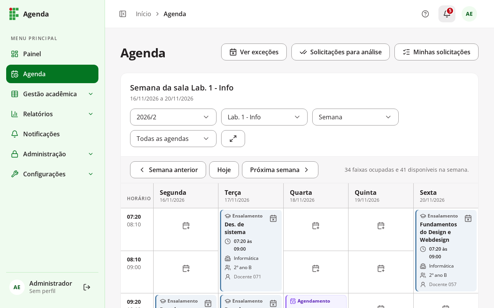

### Agenda do docente (`agenda-docente.png`)
**Rota:** `/agenda/` · **Acesso:** usuários com permissão para solicitar

A agenda vista por um docente. Cada horário livre da grade é clicável. Ao passar o mouse, aparece "Solicitar agendamento" (aqui, quarta-feira, 25/11, às 09:20).

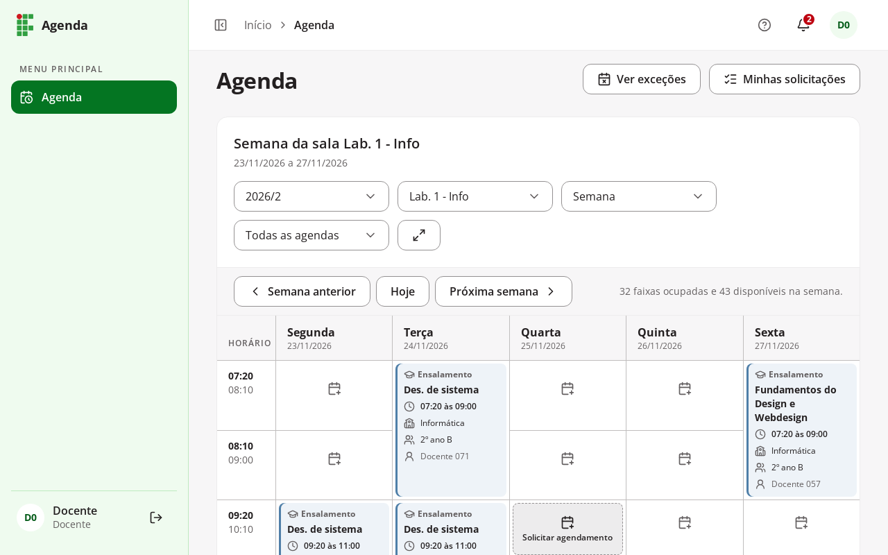

### Solicitar agendamento (`solicitar-agendamento.png`)
**Rota:** clique em um horário livre da agenda (abre `/agenda/solicitar/` em uma janela sobre a grade) · **Acesso:** usuários com permissão para solicitar

O formulário abre com o espaço, a data e o horário clicados já preenchidos. O docente pode estender o fim (aqui, até 11:00) e informa a descrição e a quantidade de alunos. Curso, disciplina e turma são opcionais.

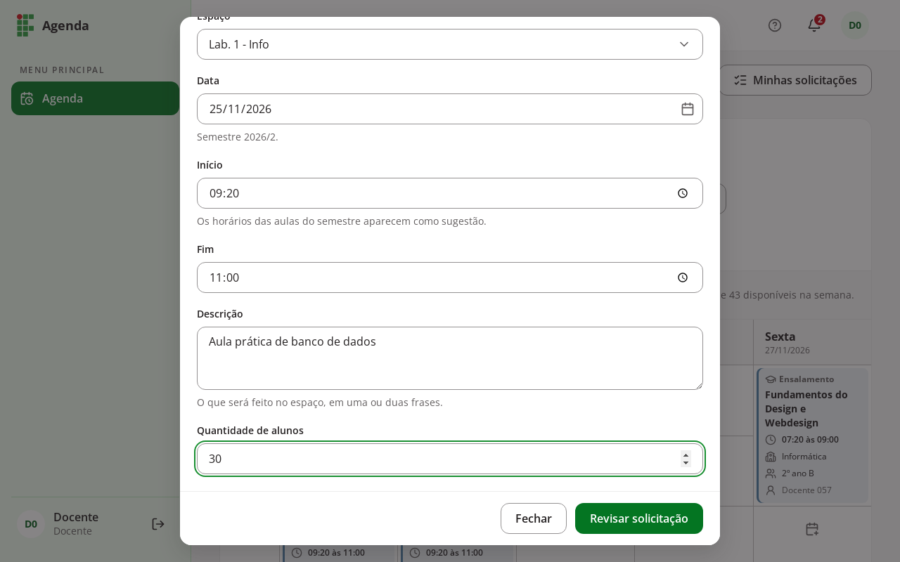

### Revisão da solicitação (`solicitar-agendamento-revisao.png`)
**Rota:** janela da solicitação, sobre a agenda · **Acesso:** usuários com permissão para solicitar

Antes de enviar, o sistema mostra um resumo da solicitação para conferência.

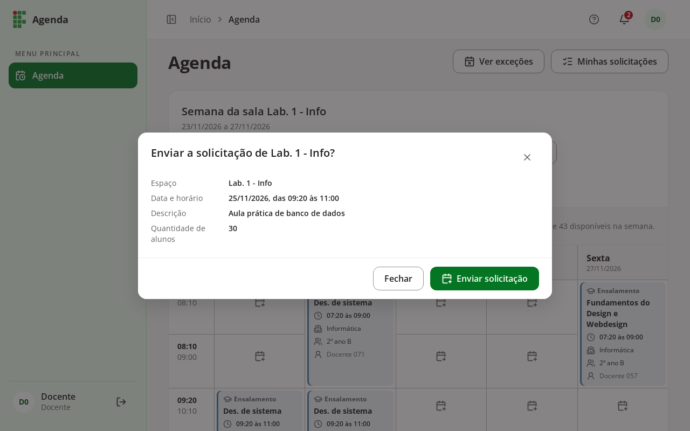

### Conflito de horário (`solicitar-agendamento-conflito.png`)
**Rota:** janela da solicitação, sobre a agenda · **Acesso:** usuários com permissão para solicitar

Aqui o docente clicou no horário livre das 11:00 e estendeu o fim até 14:10, por cima de uma aula. A solicitação não é enviada, e o sistema mostra qual aula ocupa o espaço.

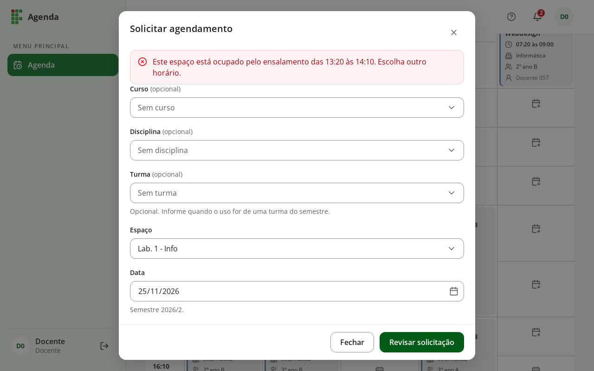

### Minhas solicitações (`minhas-solicitacoes.png`)
**Rota:** `/agenda/minhas-solicitacoes/` · **Acesso:** quem solicitou

Lista das solicitações do próprio usuário, com a situação de cada uma.

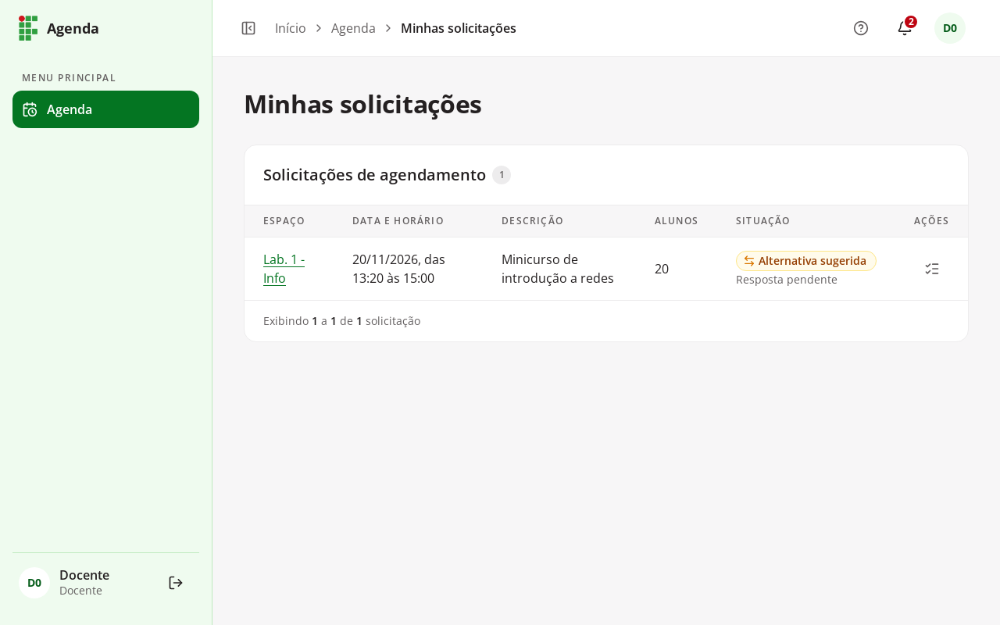

### Alternativa sugerida (`minha-solicitacao-alternativa.png`)
**Rota:** `/agenda/minhas-solicitacoes/<id>/` · **Acesso:** quem solicitou

Quando o analista sugere outro horário, o solicitante vê a proposta e a mensagem, e pode aceitar ou recusar.

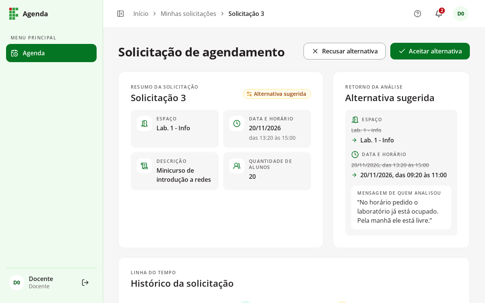

### Solicitações para análise (`solicitacoes-para-analise.png`)
**Rota:** `/agenda/solicitacoes/` · **Acesso:** quem analisa solicitações

Solicitações que aguardam decisão, com o solicitante, o espaço, a data, a descrição e a situação.

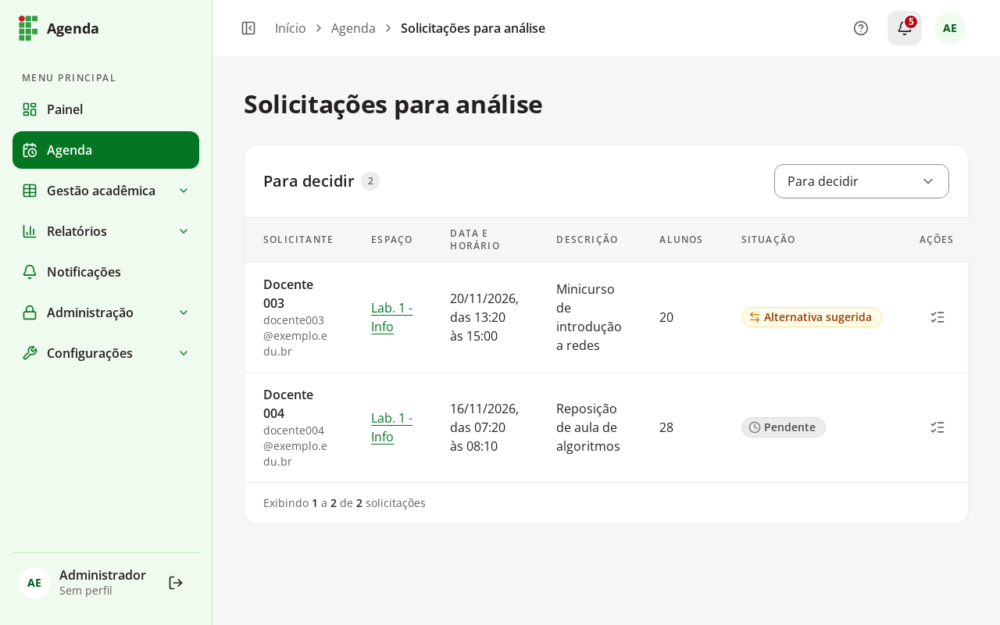

### Analisar solicitação (`analisar-solicitacao.png`)
**Rota:** `/agenda/solicitacoes/<id>/` · **Acesso:** quem analisa solicitações

Detalhe de uma solicitação pendente, com as ações de rejeitar, sugerir alternativa e aprovar, e o histórico.

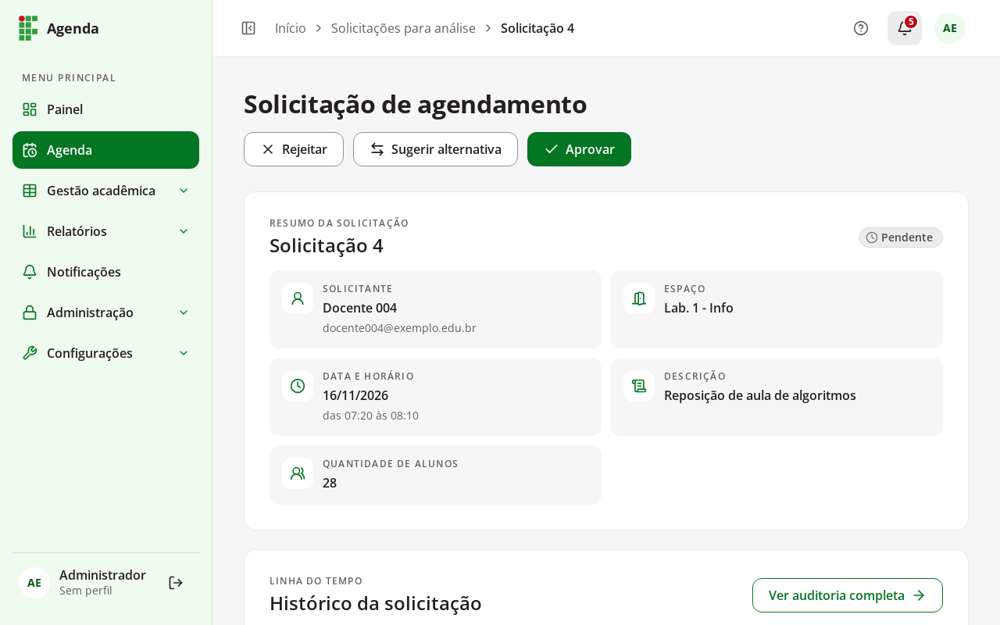

### Aprovar solicitação (`analisar-solicitacao-aprovar.png`)
**Rota:** `/agenda/solicitacoes/<id>/` · **Acesso:** quem analisa solicitações

Confirmação da aprovação. O agendamento só é criado se o horário continuar livre.

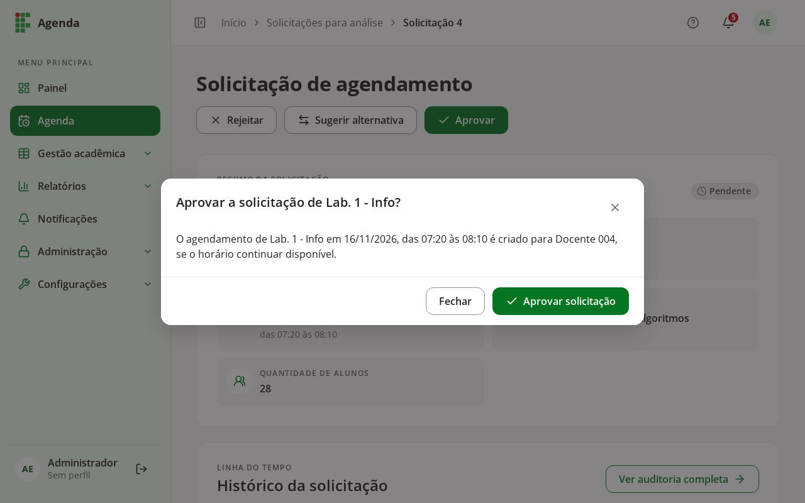

### Sugerir alternativa (`analisar-solicitacao-sugerir-alternativa.png`)
**Rota:** `/agenda/solicitacoes/<id>/` · **Acesso:** quem analisa solicitações

O analista propõe outro espaço, data ou horário, com uma mensagem opcional para o solicitante.

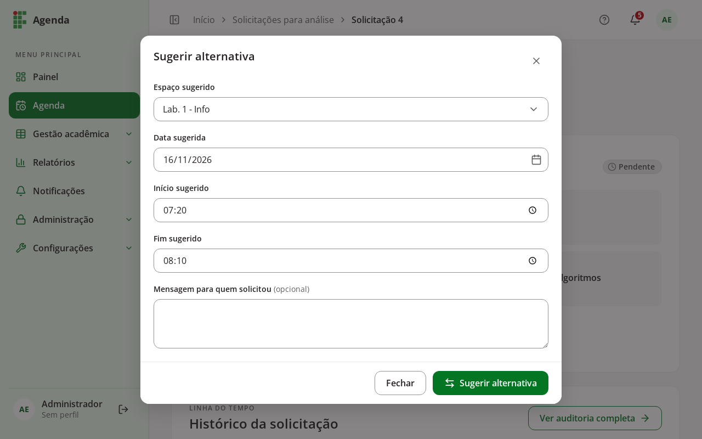

### Solicitação aprovada (`solicitacao-aprovada.png`)
**Rota:** `/agenda/solicitacoes/<id>/` · **Acesso:** quem analisa solicitações

Solicitação já aprovada, com a opção de cancelar o agendamento e o histórico da solicitação.

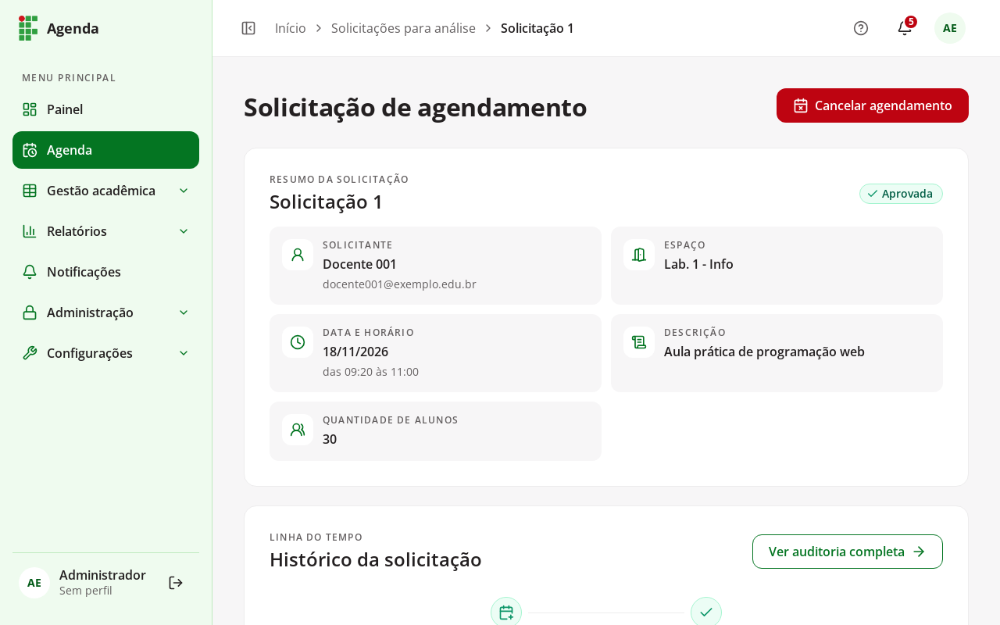

### Criar solicitação para outro usuário (`criar-solicitacao-para-outro-usuario.png`)
**Rota:** `/agenda/criar/` · **Acesso:** quem tem permissão para criar em nome de outro

Registro de uma solicitação em nome de outro usuário, por exemplo quando o docente pede o horário pessoalmente.

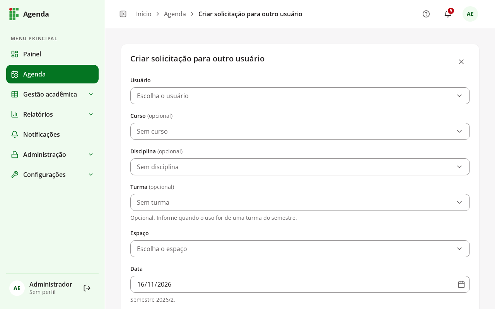

## Ensalamento e importação da planilha

### Ensalamento (`ensalamento.png`)
**Rota:** `/ensalamento/` · **Acesso:** quem consulta ou gerencia o ensalamento

Grade semanal das aulas de uma sala no semestre, com acesso às exceções, às importações e ao cadastro de aulas.

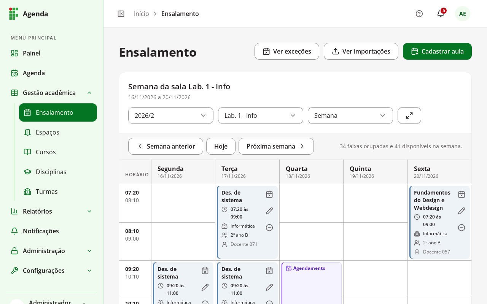

### Cadastrar aula (`ensalamento-cadastrar-aula.png`)
**Rota:** `/ensalamento/recorrencias/criar/` · **Acesso:** quem gerencia o ensalamento

Cadastro de uma aula recorrente: turma, disciplina, docentes, espaço, primeira e última aula, dia e horário.

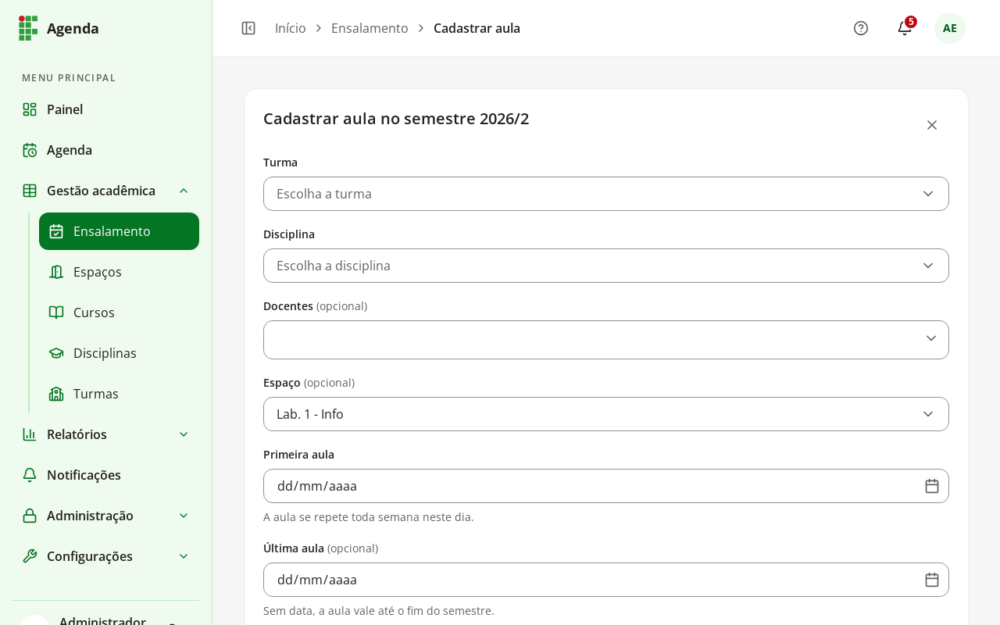

### Exceções do ensalamento (`ensalamento-excecoes.png`)
**Rota:** `/ensalamento/excecoes/` · **Acesso:** quem consulta o ensalamento

Lista das ocorrências de aula canceladas em datas específicas. Neste ambiente, nenhuma foi registrada.

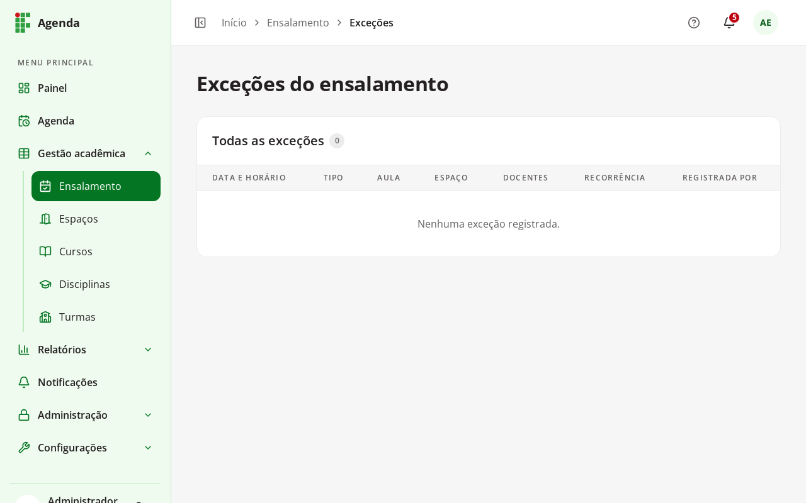

### Importações de ensalamento (`importacoes-ensalamento.png`)
**Rota:** `/ensalamento/importacoes/` · **Acesso:** quem importa o ensalamento

Histórico das importações da planilha, com a situação e o resultado de cada uma.

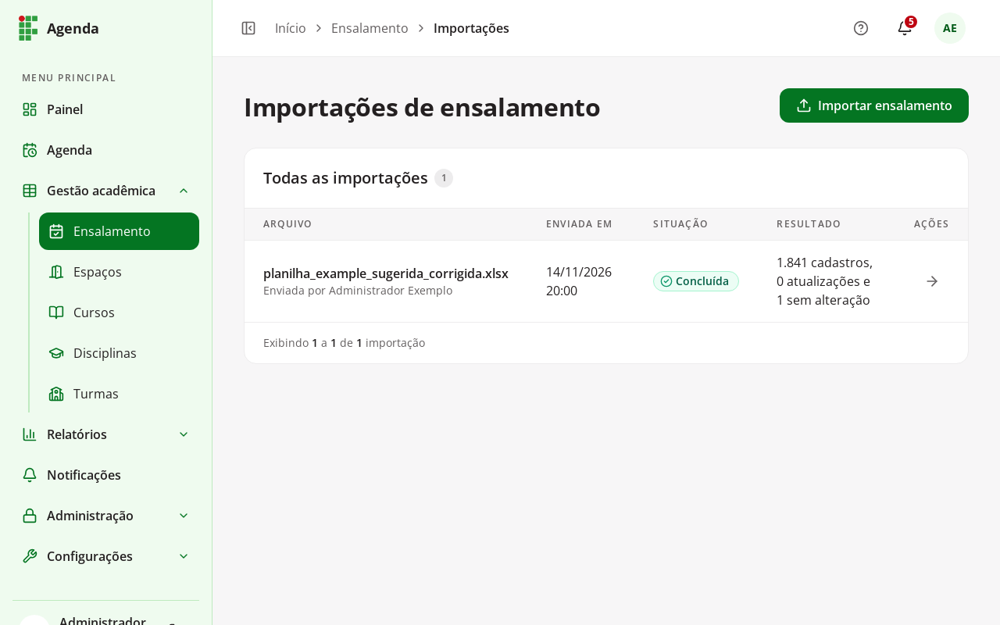

### Importar ensalamento (`importacao-ensalamento-nova.png`)
**Rota:** `/ensalamento/importacoes/nova/` · **Acesso:** quem importa o ensalamento

Envio da planilha em XLSX, com o semestre e o período letivo.

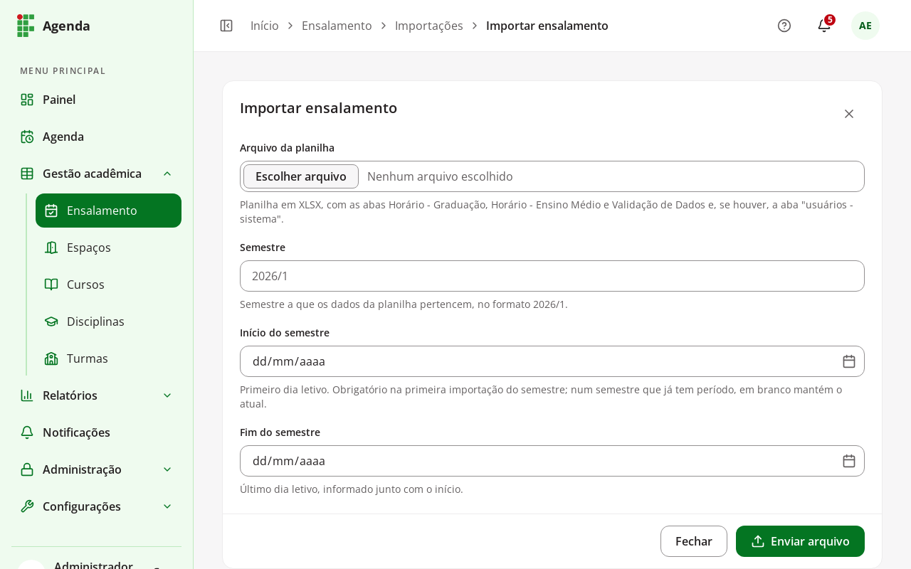

### Detalhe da importação (`importacao-ensalamento-detalhe.png`)
**Rota:** `/ensalamento/importacoes/<id>/` · **Acesso:** quem importa o ensalamento

Resultado da importação concluída (1.841 cadastros, 0 atualizações e 1 sem alteração), os espaços cadastrados e cada linha do arquivo com o que foi feito.

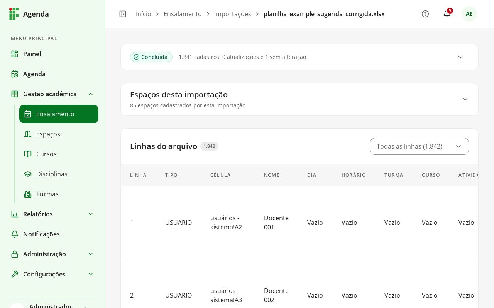

## Cadastros acadêmicos

### Espaços (`espacos.png`)
**Rota:** `/espacos/` · **Acesso:** quem gerencia espaços

Espaços cadastrados (85 nesta importação), com os outros nomes usados na planilha, a origem e a situação.

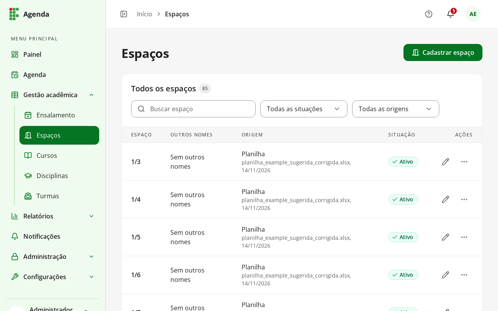

### Editar espaço (`espaco-editar.png`)
**Rota:** `/espacos/<id>/editar/` · **Acesso:** quem gerencia espaços

Nome do espaço e outros nomes pelos quais ele aparece na planilha.

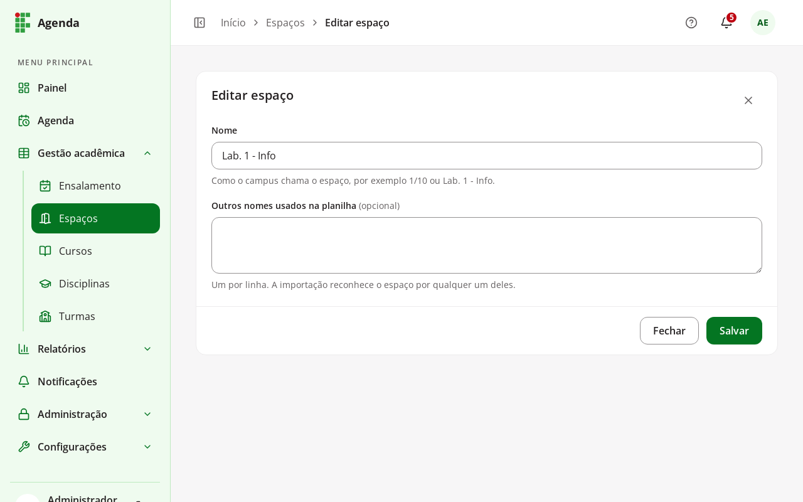

### Cursos (`cursos.png`)
**Rota:** `/cursos/` · **Acesso:** quem gerencia cursos

Cursos, com a etapa de ensino e a quantidade de turmas.

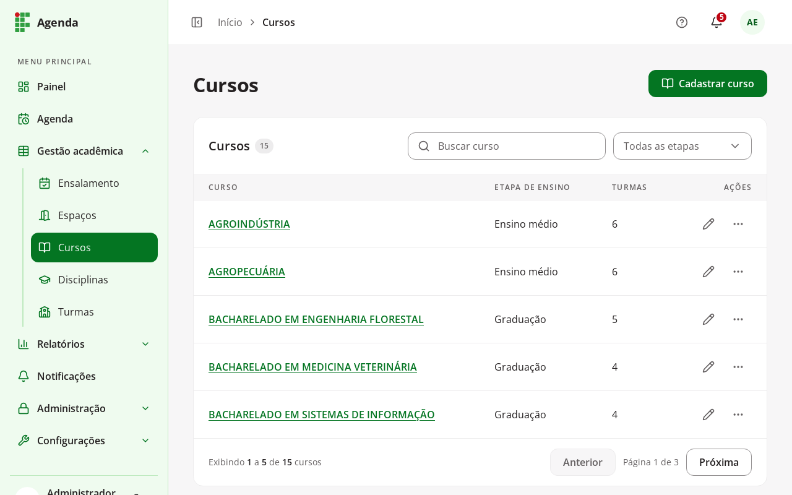

### Disciplinas (`disciplinas.png`)
**Rota:** `/disciplinas/` · **Acesso:** quem gerencia disciplinas

Disciplinas, com a quantidade de ofertas e de aulas.

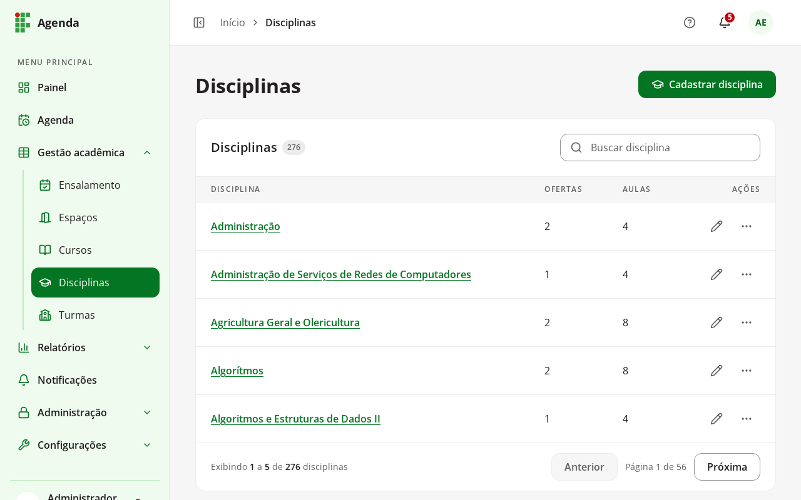

### Turmas (`turmas.png`)
**Rota:** `/turmas/` · **Acesso:** quem gerencia turmas

Turmas de cada curso, com a etapa de ensino, as ofertas e as aulas.

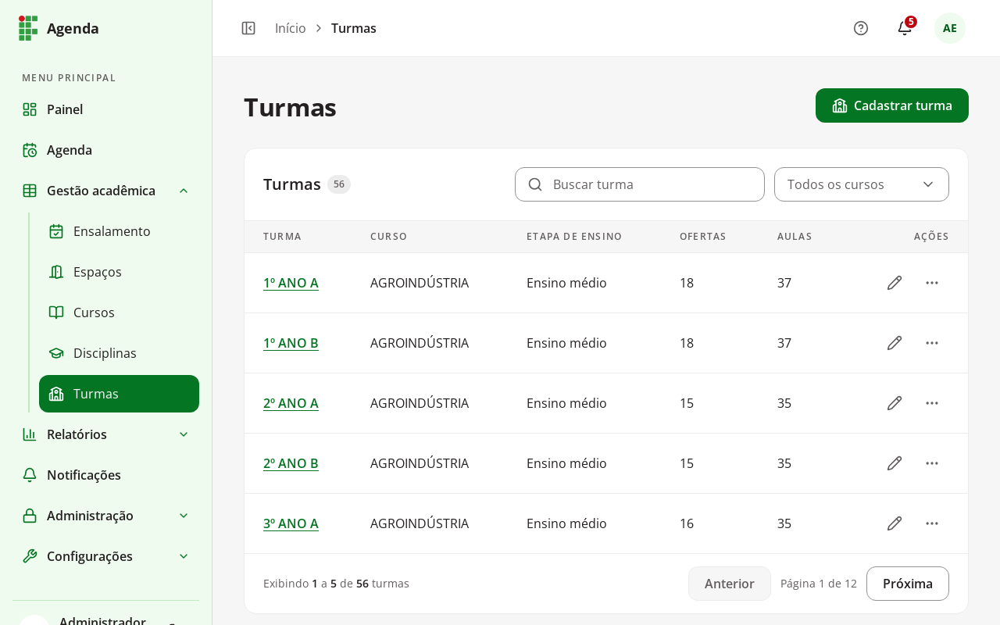

## Relatórios

### Mapa de calor (`mapa-de-calor.png`)
**Rota:** `/relatorios/mapa-de-calor/` · **Acesso:** quem consulta relatórios

Ocupação média dos espaços por dia e faixa de horário no semestre, com os indicadores de ocupação e os horários de pico.

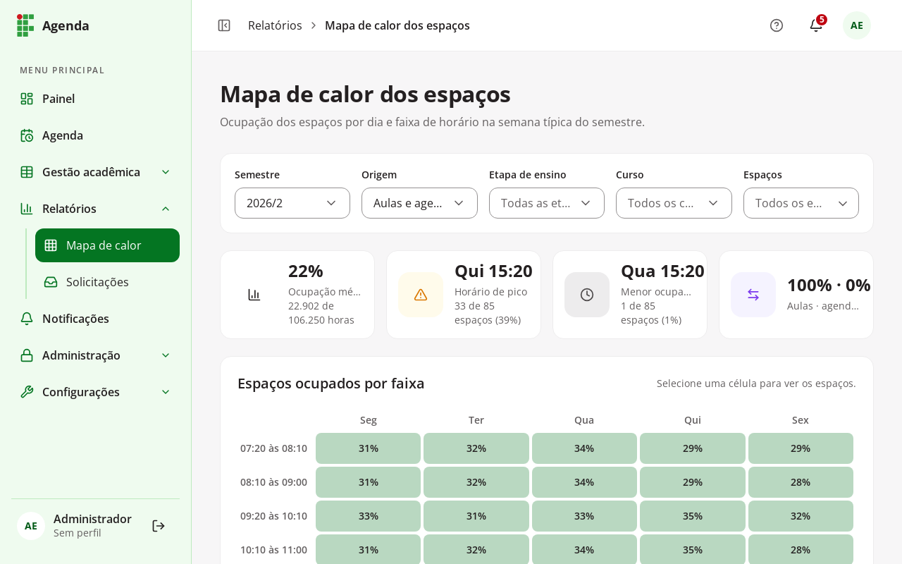

### Detalhe do mapa de calor (`mapa-de-calor-detalhe.png`)
**Rota:** `/relatorios/mapa-de-calor/<dia>/<faixa>/` · **Acesso:** quem consulta relatórios

Espaços ocupados em uma célula do mapa (aqui, quarta-feira das 13:20 às 14:10) e em quantas semanas.

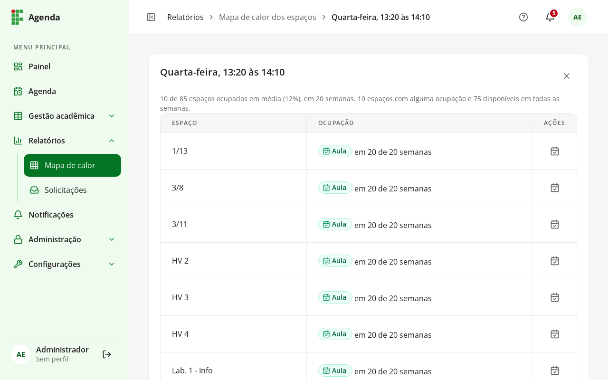

### Relatório de solicitações (`relatorio-solicitacoes.png`)
**Rota:** `/relatorios/solicitacoes/` · **Acesso:** quem consulta relatórios

Indicadores das solicitações do semestre: total, taxa de aprovação, tempo até a decisão e pendentes, além das solicitações por semana.

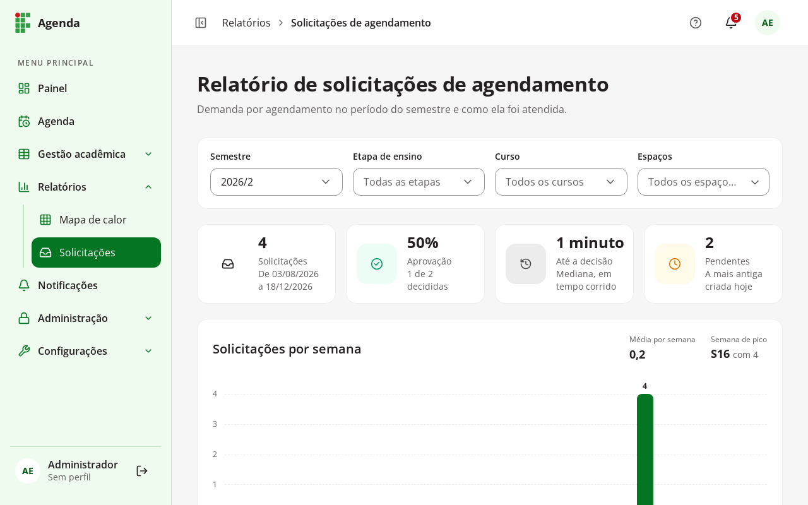

## Comunicados

### Notificações publicadas (`notificacoes.png`)
**Rota:** `/notificacoes/` · **Acesso:** quem publica comunicados

Comunicados publicados para todos os usuários, com o tipo, a quantidade de destinatários e quem publicou.

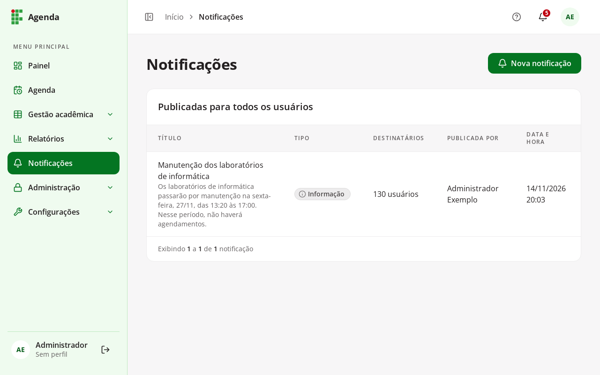

### Nova notificação (`notificacao-nova.png`)
**Rota:** `/notificacoes/nova/` · **Acesso:** quem publica comunicados

Criação de um comunicado com título, mensagem, tipo e destinatários (todos, um perfil ou usuários escolhidos), seguida de uma revisão.

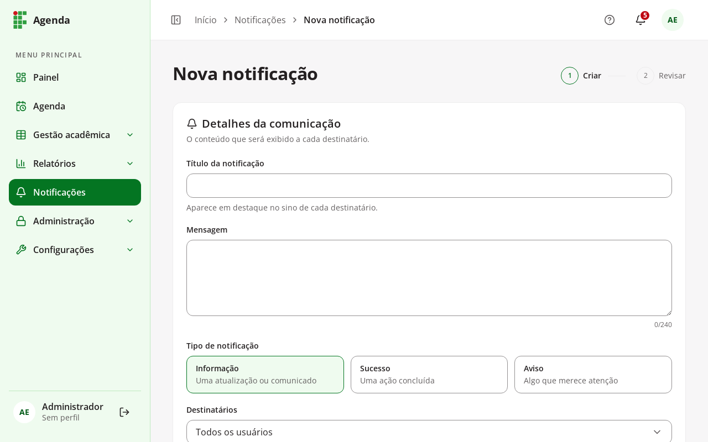

## Administração

### Usuários (`usuarios.png`)
**Rota:** `/usuarios/` · **Acesso:** quem gerencia usuários

Usuários cadastrados, com o perfil e a situação, e acesso às importações em lote.

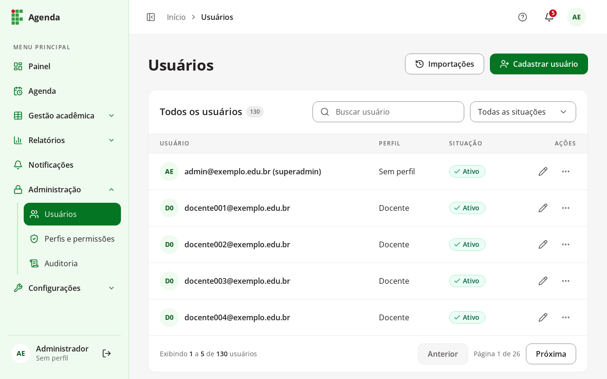

### Cadastrar usuário (`usuario-novo.png`)
**Rota:** `/usuarios/novo/` · **Acesso:** quem gerencia usuários

Cadastro individual com nome, e-mail, nome de usuário e perfil. O usuário recebe por e-mail o link para definir a senha.

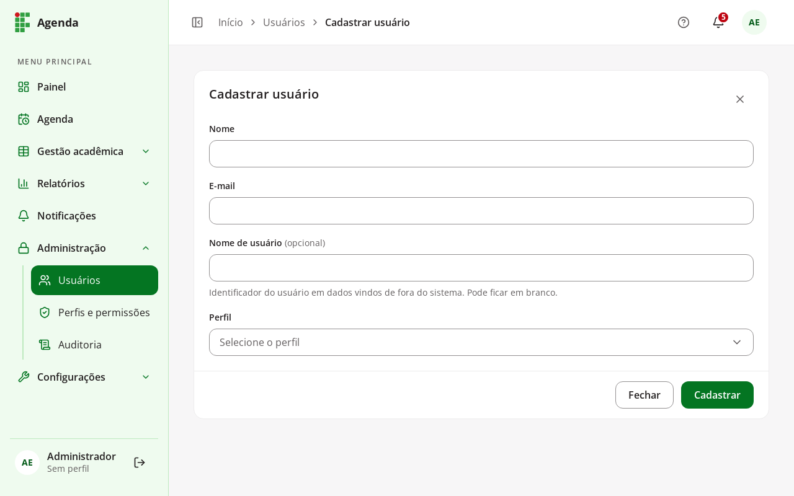

### Importações de usuários (`importacoes-usuarios.png`)
**Rota:** `/usuarios/importacoes/` · **Acesso:** quem gerencia usuários

Importação de usuários em lote por arquivo CSV, com o modelo para download.

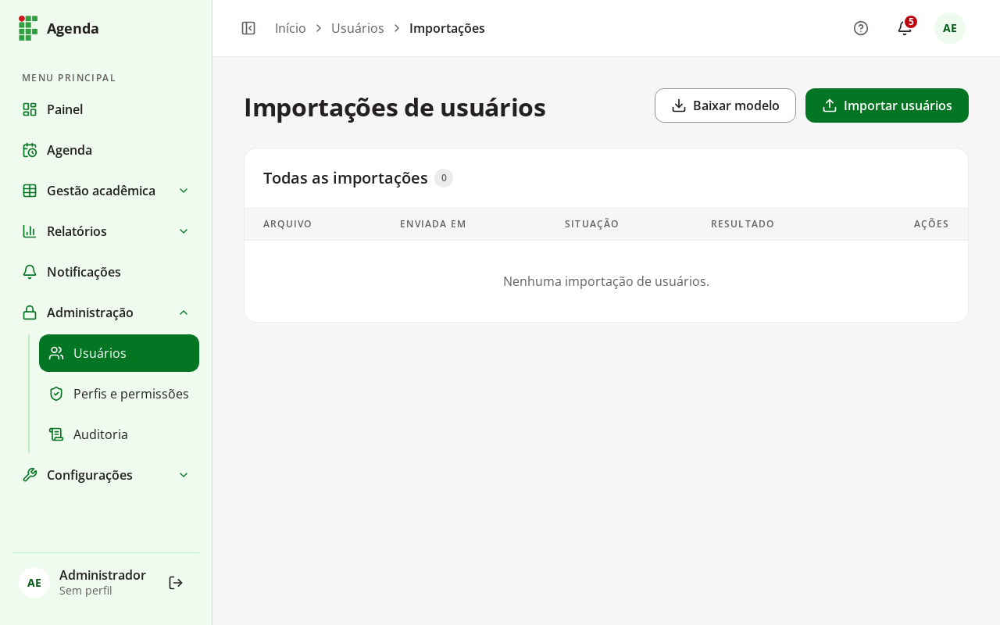

### Perfis (`perfis.png`)
**Rota:** `/perfis/` · **Acesso:** superadministrador

Perfis de acesso, com a quantidade de usuários vinculados.

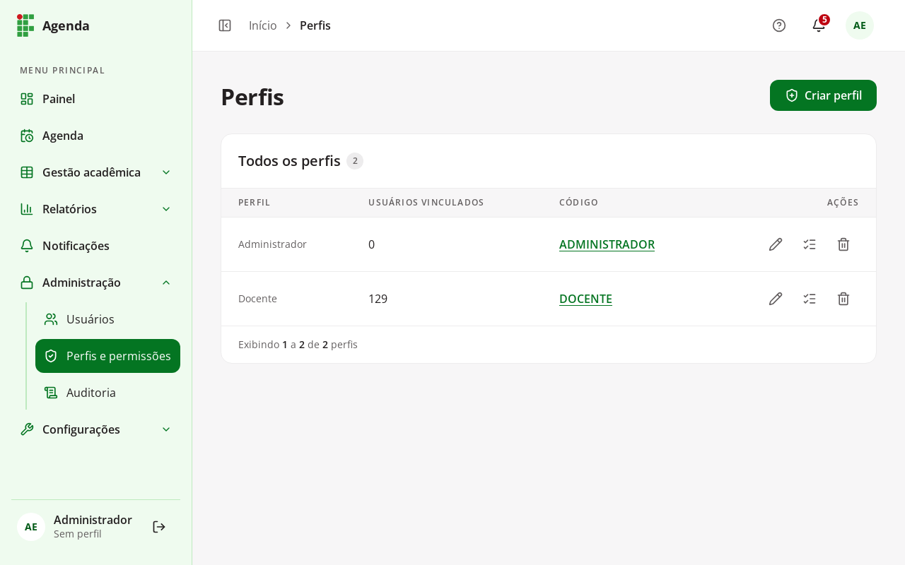

### Permissões do perfil (`perfil-permissoes.png`)
**Rota:** `/perfis/<id>/permissoes/` · **Acesso:** superadministrador

Escolha das permissões de um perfil, agrupadas por módulo (aqui, o perfil Docente). Um perfil pode receber 41 das 47 permissões do sistema; as outras 6, de perfis e configurações, ficam reservadas ao superadministrador.

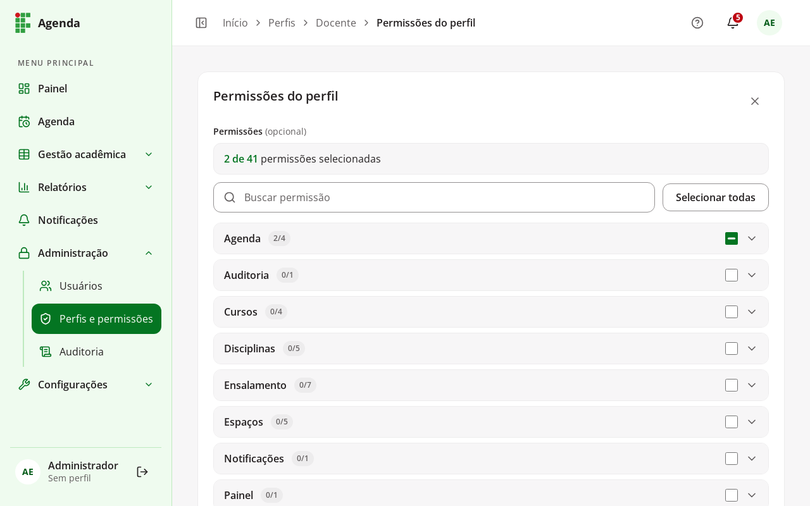

### Auditoria (`auditoria.png`)
**Rota:** `/auditoria/` · **Acesso:** quem consulta a auditoria

Registro das ações feitas no sistema, com filtros por usuário, ação, módulo, origem e período.

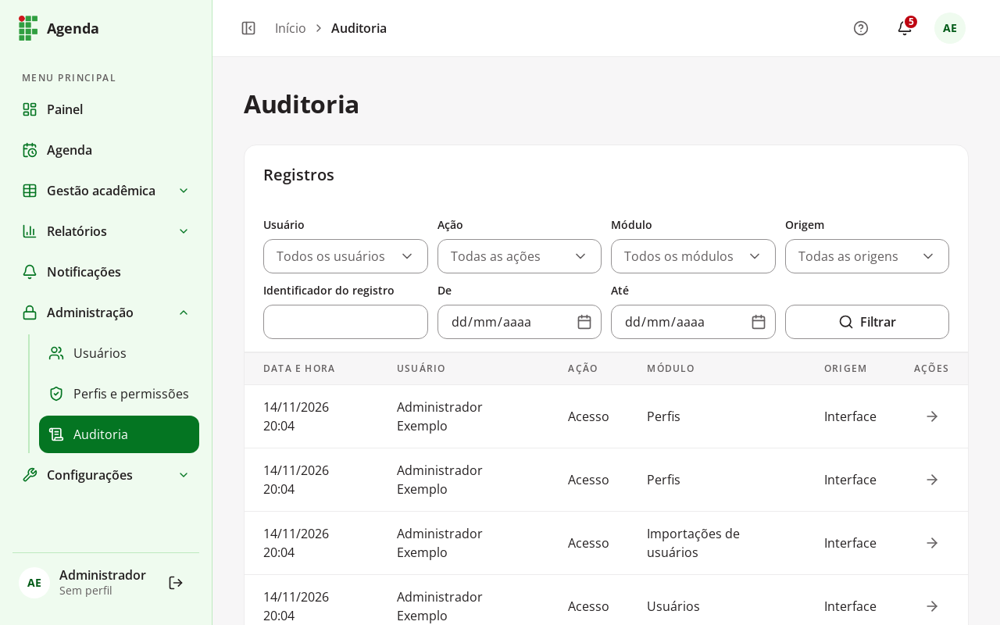

### Registro de auditoria (`auditoria-registro.png`)
**Rota:** `/auditoria/<id>/` · **Acesso:** quem consulta a auditoria

Detalhe de um registro: usuário, ação, módulo, data, rota acessada e informações de rede.

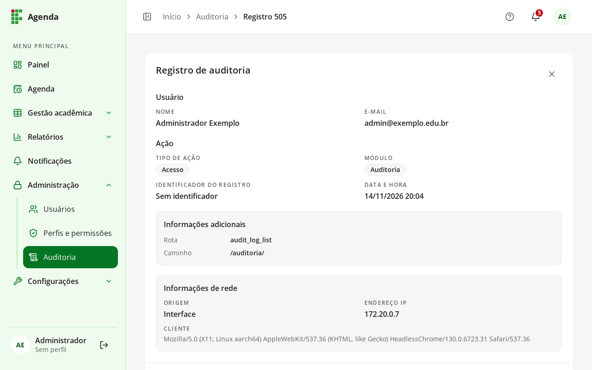

## Configurações e ajuda

### Servidor de e-mail (`configuracao-email.png`)
**Rota:** `/configuracoes/email/` · **Acesso:** superadministrador

Cadastro do servidor de envio de e-mails. Enquanto não houver servidor, os e-mails ficam pendentes na fila (129 neste ambiente, dos usuários importados).

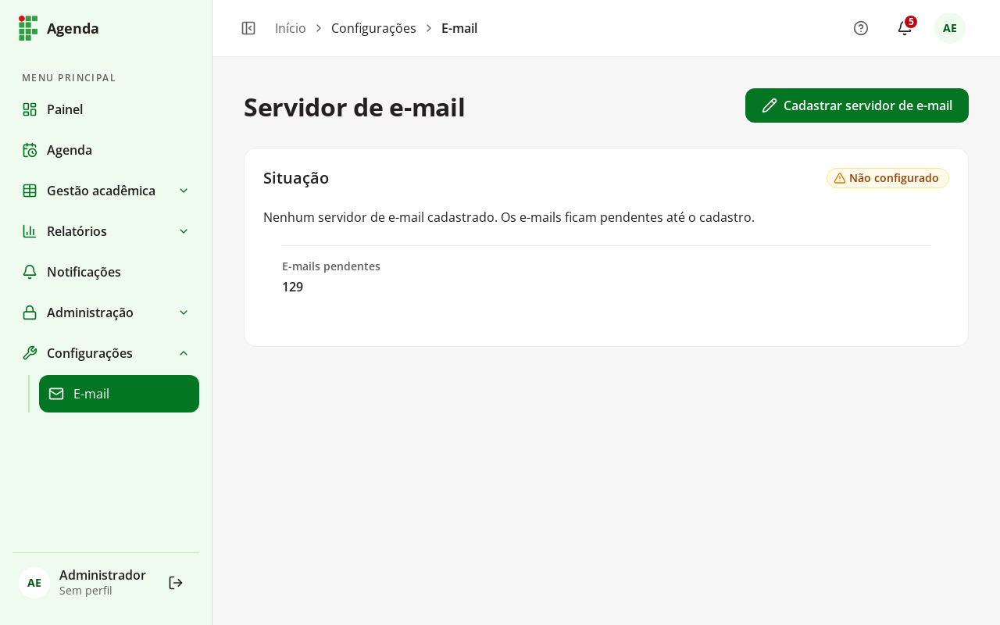

### Central de ajuda (`central-de-ajuda.png`)
**Rota:** `/ajuda/` · **Acesso:** usuário autenticado

Tutoriais passo a passo de cada funcionalidade, mostrando só o que o perfil do usuário pode usar.

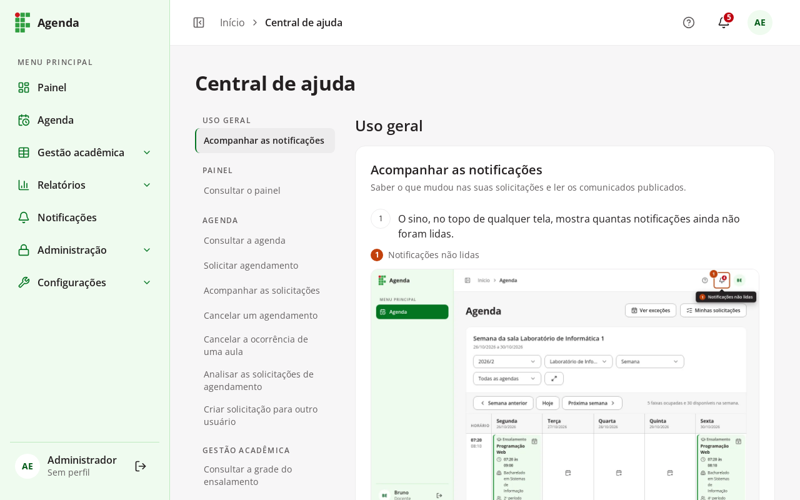
