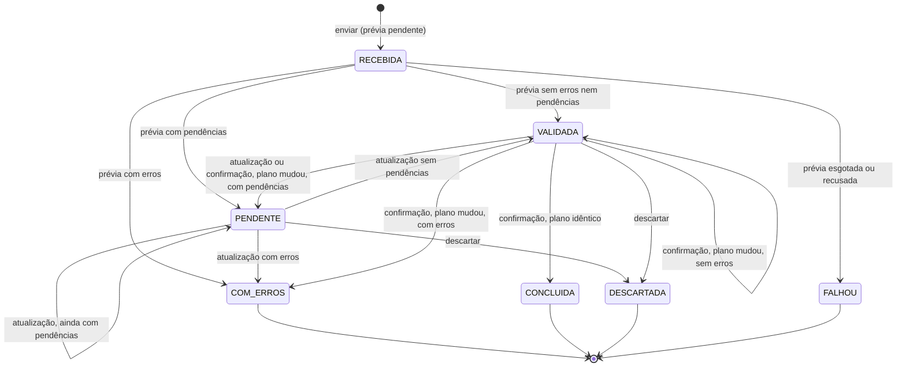

# Motor de importação

O app `imports` implementa o ciclo de vida comum das importações de planilha. Há duas importações específicas:

| Definição | `kind` | Fonte | Limites | Documento |
|---|---|---|---|---|
| `accounts.imports.UserImport` | `USUARIO` | CSV | `IMPORT_MAX_ROWS` (1000) e `IMPORT_MAX_FILE_SIZE` (1 MiB) | [usuários](../funcionalidades/autenticacao-e-usuarios.md#importação-de-usuários) |
| `schedule.imports.SpaceAllocationImport` | `ENSALAMENTO` | XLSX em grade | 5000 linhas e 10 MiB, declarados na definição | [ensalamento](../funcionalidades/ensalamento.md#importação-da-planilha) |

Implementação: `imports/models.py`, `imports/execution.py`, `imports/worker.py` e `imports/views.py`.

## Contrato da definição

Uma importação específica herda de `imports.definitions.ImportDefinition` e é registrada em `imports/registry.py` pelo `AppConfig.ready` do app dono.

| Membro | Uso |
|---|---|
| `kind`, `audit_resource`, `columns`, `identifier` | Tipo gravado em `Import.kind`, módulo da auditoria, colunas esperadas e coluna identificadora (repetição vira erro da linha) |
| `source()` | Fonte de leitura. Padrão `CsvSource` (`imports/reader.py`); o ensalamento usa `WorkbookSource` (`imports/workbook.py`) |
| `upload_fields`, `clean_upload`, `upload_display` | Campos do formulário de envio gravados como colunas lógicas (o semestre e o período do ensalamento) |
| `sheets`, `optional_sheets` | Abas obrigatórias e opcionais da fonte em grade |
| `execution(importation)` | Contexto em volta da execução inteira |
| `lock(rows, executor)` | Trava o que a execução vai ler, antes da primeira linha |
| `execute_row(values, executor)` | Executa a linha com as operações reais do domínio e devolve um `RowPlan` |
| `finish(executor)` | Etapa final opcional, depois das linhas |
| `check_file(executor)` | Erros do arquivo inteiro |
| `check_confirmation(importation, executor)` | Verificação própria antes de confirmar |
| `max_rows`, `max_file_size`, `has_template` | Limites próprios e modelo para baixar |

`RowPlan` guarda `action`, `target`, `changes`, `warnings`, `errors`, `pending` e `created`. `RowError` guarda coluna, código e mensagem.

## Leitura do arquivo

Um arquivo recusado na leitura não cria importação nem entra no histórico. O erro aparece só no formulário de envio.

CSV (`imports/reader.py`):

- UTF-8, com ou sem BOM, separador `;`. Um cabeçalho separado por `,` é recusado com a orientação de usar `;`.
- Os cabeçalhos são comparados sem acento e sem caixa. Coluna desconhecida, repetida ou ausente recusa o arquivo. Uma coluna com `required=False` precisa estar no cabeçalho e pode ter células vazias.
- Arquivo sem linhas de dados, acima do tamanho ou acima do número de linhas é recusado.
- Identificador repetido vira erro em todas as linhas envolvidas.

XLSX (`imports/workbook.py`): fórmulas não são recalculadas. Vale o valor em cache na planilha, e uma fórmula sem valor chega vazia. A definição percorre as células e lança `FileRejected` quando a estrutura não permite a leitura.

## Situação e operação pendente

A importação tem dois campos independentes:

- `status`: a situação, único estado de negócio.
- `operation`: a execução que o `import_worker` ainda vai fazer (`PREVIA`, `ATUALIZACAO`, `CONFIRMACAO` ou nenhuma).

Pedir uma operação não muda a situação. "Em processamento" é um selo calculado de `operation`. A `CheckConstraint` `import_operation_matches_status` impede no banco as combinações inválidas:

| `operation` | Situações permitidas |
|---|---|
| nenhuma | qualquer uma, exceto `RECEBIDA` |
| `PREVIA` | `RECEBIDA` |
| `ATUALIZACAO` | `VALIDADA`, `PENDENTE` |
| `CONFIRMACAO` | `VALIDADA` |

O aviso de demora não é estado: a tela o calcula de `requested_at` e `IMPORT_STALE_AFTER`.

## Situações

| Código | Rótulo | Significado | Final |
|---|---|---|---|
| `RECEBIDA` | Recebida | Arquivo aceito, prévia ainda não gerada. Não pode ser confirmada, descartada nem excluída | Não |
| `VALIDADA` | Validada | Prévia sem erros nem pendências. Pode ser confirmada ou descartada | Não |
| `PENDENTE` | Precisa de decisão | Prévia sem erros, com pendências que dependem de decisão. Pode ter a prévia atualizada ou ser descartada | Não |
| `COM_ERROS` | Com erros | Prévia com erros de linha ou de arquivo | Sim |
| `CONCLUIDA` | Concluída | Confirmada e aplicada | Sim |
| `DESCARTADA` | Descartada | Descartada sem aplicar nada | Sim |
| `FALHOU` | Falhou | A prévia nunca foi gerada: esgotou as tentativas ou foi recusada na execução | Sim |

Os códigos ficam em `Import.Status` e as operações em `Import.Operation` (`imports/models.py`).



Pedir atualização ou confirmação não aparece no diagrama porque só cria a operação pendente.

## Transições

| Evento | De | Quem | Condição | Para | Efeito |
|---|---|---|---|---|---|
| Enviar | (nenhum) | usuário | leitura aceita | `RECEBIDA`, com `PREVIA` | Grava a importação e as linhas com os valores lidos e os erros da leitura |
| Prévia executada | `RECEBIDA` | worker | | `VALIDADA`, `PENDENTE` ou `COM_ERROS` | Executa e desfaz as linhas, grava o plano e audita |
| Pedir atualização | `VALIDADA`, `PENDENTE` | usuário | sem operação pendente | a mesma, com `ATUALIZACAO` | |
| Atualização executada | `VALIDADA`, `PENDENTE` | worker | | pelo novo plano | Reexecuta e desfaz. Não é auditada |
| Pedir confirmação | `VALIDADA` | usuário | sem operação pendente e `check_confirmation` aceita | `VALIDADA`, com `CONFIRMACAO` | A recusa da verificação volta como mensagem |
| Pedir confirmação | `PENDENTE` | usuário | | (sem mudança) | Recusado com `ImportNeedsDecision` |
| Confirmação executada | `VALIDADA` | worker | plano idêntico | `CONCLUIDA` | Aplica todas as linhas, grava o registro criado de cada linha, quem confirmou e quando |
| Confirmação executada | `VALIDADA` | worker | plano diferente | `VALIDADA`, `PENDENTE` ou `COM_ERROS` | Nada é aplicado. O novo plano substitui o anterior, `revalidation_count` soma 1, resultado `DIVERGENCIA` |
| Confirmação recusada | `VALIDADA` | worker | `check_confirmation` recusa ou quem pediu está inativo | (sem mudança) | Resultado `RECUSADA`, com a mensagem |
| Operação esgotada | `RECEBIDA` | worker | tentativas no limite | `FALHOU` | Auditoria de falha |
| Operação esgotada | `VALIDADA`, `PENDENTE` | worker | tentativas no limite | (sem mudança) | Plano anterior mantido. Resultado `FALHA_ATUALIZACAO` ou `FALHA_CONFIRMACAO`, com auditoria |
| Descartar | `VALIDADA`, `PENDENTE` | usuário | sem operação pendente | `DESCARTADA` | Grava quem descartou e quando |
| Excluir | `COM_ERROS`, `DESCARTADA`, `FALHOU` | usuário | permissão de exclusão | (excluída) | Auditoria com o arquivo e a situação |
| Qualquer ação | com operação pendente | usuário | | (sem mudança) | Recusado na hora com `ImportBusy` |
| Confirmar ou descartar | situação final | usuário | | (sem mudança) | Recusado com `ImportNotPending` |

Qualquer usuário com a permissão da importação confirma ou descarta, independentemente de quem enviou. A execução usa as permissões de quem pediu a operação, no momento em que roda.

## Onde cada evento acontece

| Evento | Código | Tela |
|---|---|---|
| Enviar | `Import.objects.request_preview(definition, rows, file_name, executor)` | `ImportUploadView` (modal) |
| Pedir atualização | `Import.request_refresh(executor)` | decisões de espaço e "Tentar novamente" do ensalamento |
| Pedir confirmação | `Import.request_confirmation(definition, executor)` | `ImportConfirmView` |
| Executar | `Import.execute_pending(definition)`, chamado por `imports/worker.py` | `import_worker`, comando `process_imports` |
| Descartar | `Import.discard(definition, executor)` | `ImportDiscardView` |
| Acompanhar | `ImportStatusView`, rota `<prefixo>_status` | quadro de processamento do detalhe, por polling |

As views genéricas ficam em `imports/views.py` e são especializadas pelos apps (`accounts/views.py`, `schedule/views.py`). O worker nunca grava a situação diretamente: chama `execute_pending`, que confere a pré-condição sob trava. Não há biblioteca de máquina de estados nem de filas: a fila é a própria tabela, e o worker encontra a definição pelo `kind` em `imports/registry.py`.

## Worker

```text
transação 1 (reserva)
  importação com operação pendente e next_attempt_at vencido, select_for_update(skip_locked)
  tentativas no limite? esgota e termina
  attempts += 1; next_attempt_at = agora + intervalo
commit

transação 2 (execução)
  SET lock_timeout = IMPORT_LOCK_TIMEOUT
  ator: quem pediu, origem INTERFACE
  execute_pending: trava com skip_locked, confere a operação, executa e encerra a operação
commit

erro inesperado     -> transação 3: grava last_error; esgota no limite
ValidationError      -> transação 3: encerra sem nova tentativa
```

`IMPORT_LOCK_TIMEOUT` limita a espera por uma trava, não a duração da execução. O comando chama `close_old_connections` antes de cada ciclo.

## Prévia: executar e desfazer

A prévia executa as operações reais do domínio e desfaz tudo no fim:

```text
transação do worker, com a importação RECEBIDA travada
  savepoint do domínio
    definition.lock
    para cada linha: savepoint próprio -> definition.execute_row -> plano da linha
    definition.finish
    definition.check_file
  rollback do savepoint do domínio
  grava o plano nas ImportRow, a situação e o fim da operação
commit
```

- Cada linha roda num savepoint próprio. A recusa de uma linha, inclusive por erro do banco, não interrompe as seguintes, e a prévia mostra todos os erros.
- Erros que só o banco detecta (unicidade, continuidade administrativa) aparecem já na prévia, porque o código é o mesmo da confirmação.
- As linhas rodam na ordem da leitura. O ensalamento usa isso para executar em fases: usuários da aba opcional, catálogos de salas e docentes, atividades.
- `finish` só deve considerar o que as linhas mantidas fizeram. Um erro do banco nela sobe como erro inesperado da execução, não como erro de linha.
- A definição pode guardar em memória, durante uma execução, os registros que leu ou criou, desde que descarte a memória no fim e que o criado por uma linha desfeita deixe de valer para as seguintes.

## Confirmação: plano idêntico

Entre a prévia e a confirmação outra pessoa pode ter mudado os dados. A confirmação reexecuta tudo a partir dos valores gravados, com as permissões de quem confirma:

```text
transação do worker
  trava a importação (skip_locked) e confere VALIDADA com CONFIRMACAO pendente
  check_confirmation
  savepoint
  reexecuta as linhas e as verificações do arquivo
  plano idêntico e sem erros?
    sim -> mantém o savepoint e marca CONCLUIDA
    não -> desfaz o savepoint, grava o novo plano e marca VALIDADA, PENDENTE ou COM_ERROS
commit
```

Plano idêntico é a igualdade, em todas as linhas, de ação, alvo, mudanças, avisos e pares (coluna, código) dos erros, e dos códigos dos erros do arquivo. A comparação é `comparable()` em `imports/execution.py`. Mensagens, valores lidos e a chave do registro criado ficam de fora. Os valores comparados são canônicos (o código do perfil, não o nome). Não há expiração: uma importação `VALIDADA` antiga só é confirmada se o plano ainda for exato.

## Garantias

- **Tudo ou nada.** A confirmação aplica todas as linhas numa transação.
- **Sem confirmação dupla.** O segundo pedido encontra a operação pendente (`ImportBusy`). O commit que aplica marca `CONCLUIDA` e encerra a operação.
- **Execução única.** A reserva usa `skip_locked` e adia a próxima tentativa, e a execução trava de novo com `skip_locked`.
- **Ações sem espera.** Com operação pendente ou com a trava do worker ocupada (`nowait`), confirmar, atualizar, descartar, excluir e decidir espaço são recusados na hora.
- **Importações concorrentes.** Duas importações que atingem os mesmos registros são serializadas pelas travas de `definition.lock`. A segunda diverge e gera nova prévia.
- **Sem efeitos externos na prévia.** A definição não envia e-mail, não grava arquivo nem chama serviço externo durante a execução. O que precisa acontecer depois vai para o outbox na mesma transação e é desfeito junto.
- **Queda do worker.** O PostgreSQL desfaz a execução e solta as travas. A importação continua com a operação pendente e a tentativa contada, e é executada de novo quando a próxima tentativa vencer.
- **Erro inesperado** (banco fora do ar, defeito, espera de trava acima do limite): tentado de novo até `IMPORT_MAX_ATTEMPTS`. Esgotado, a prévia vai a `FALHOU`; atualização e confirmação mantêm a situação e o plano.

## Dados gravados

| Campo de `Import` | Quando muda |
|---|---|
| `status` | Nas transições, sempre no worker, exceto envio e descarte |
| `created_by`, `created_at` | No envio |
| `resolved_by`, `resolved_at` | Na confirmação concluída e no descarte |
| `revalidation_count` | Em cada confirmação que diverge |
| `file_errors` | Na prévia e em cada execução que substitui o plano |
| `operation`, `requested_by`, `requested_at` | No pedido; `operation` volta a nenhuma no commit do resultado |
| `attempts`, `next_attempt_at` | Na reserva; zerados no fim da operação |
| `last_error` | Em cada erro inesperado; não aparece na tela |
| `outcome`, `outcome_message` | No fim de uma operação que não terminou como pedida; limpos no próximo pedido |

Cada `ImportRow` guarda os valores lidos e o plano (`action`, `target`, `changes`, `warnings`, `errors`, `pending`). No envio, `errors` tem só os erros da leitura, que a prévia recebe de volta. O plano é substituído a cada execução, sem histórico. `created_object` só é preenchido na conclusão, porque a chave gerada na prévia some no rollback.

## Fora desta versão

- Progresso e cancelamento de uma execução em andamento: a execução é uma transação e nada fica visível a outra conexão antes do commit.
- Aviso em tempo real do fim da operação: o detalhe usa polling, adotado quando a camada do Channels só existia em memória e não atravessava os processos `web` e `import_worker`; sem `DJANGO_REDIS_URL` a camada continua assim (ver [tempo real](visao-geral.md#tempo-real)).
- Atualizar a prévia de uma importação `COM_ERROS` ou reenviá-la: corrige-se enviando outro arquivo, que cria outra importação.

## Testes

| Arquivo | Cobre |
|---|---|
| `imports/tests/test_models.py` | Transições, pendências, atualização, verificação própria, divergência, erro inesperado, situações finais, confirmações simultâneas e plano determinístico, com uma importação de teste sobre `auth.Group` (`imports/tests/definitions.py`) |
| `imports/tests/test_worker.py` | Restrição do banco, reserva, queda entre reserva e execução, tentativas, recusas sem nova tentativa, solicitante desativado, `lock_timeout`, comando e concorrência |
| `imports/tests/test_reader.py`, `test_sources.py` | Leitura CSV e XLSX |
| `imports/tests/worker.py` | Auxiliares que pedem a operação e rodam o worker, usados pelos testes das importações específicas |
| `accounts/tests/test_user_import.py`, `test_user_import_views.py` | Regras e telas da importação de usuários |
| `schedule/tests/test_import*.py`, `test_space_import.py`, `test_spreadsheet.py` | Importação do ensalamento |
