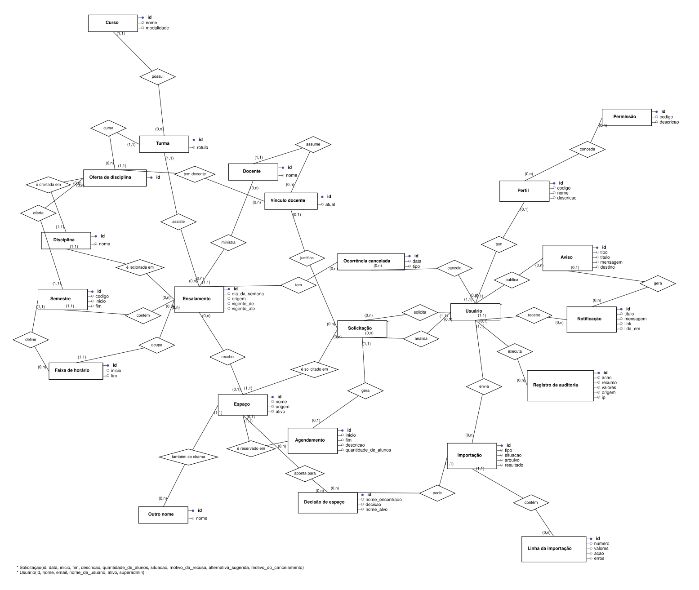
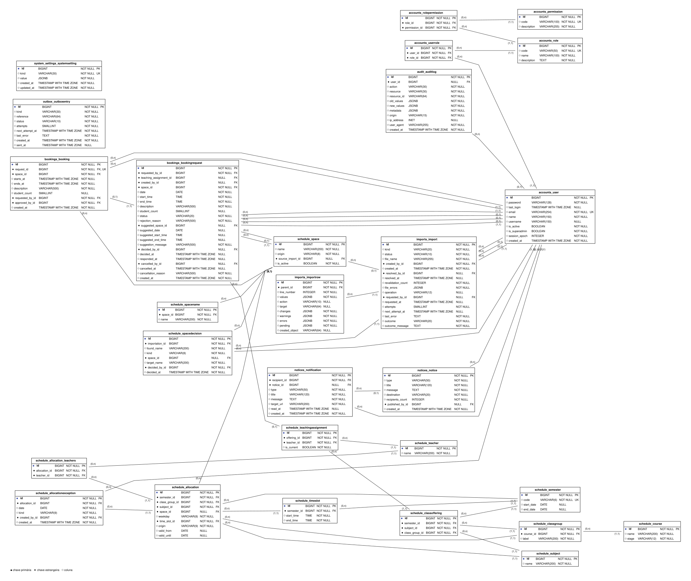

# Diagramas

| Diagrama | Fonte | Imagens |
|---|---|---|
| DER conceitual | `der-conceitual.dot` | [`der-conceitual.svg`](der-conceitual.svg), `der-conceitual.png` |
| DER físico | `der-fisico.dot` | [`der-fisico.svg`](der-fisico.svg), `der-fisico.png` |
| Restrições do físico | [`restricoes.md`](restricoes.md) | |

Os dois diagramas seguem o padrão do brModelo e mostram o modelo inteiro numa figura só.

- **Conceitual:** notação de Peter Chen. Entidade em retângulo, relacionamento em losango, atributos em círculos ao lado da entidade (preenchido no identificador) e cardinalidade (mín,máx) junto de cada entidade. Uma entidade com muitos atributos leva `*`, e os atributos dela ficam listados no rodapé.
- **Físico:** todas as tabelas das apps do projeto, com cada coluna, o tipo no PostgreSQL, `NULL`/`NOT NULL` e as marcações `PK`, `FK` e `UK`. Cada FK é uma linha com a cardinalidade nos dois lados.
- **Restrições:** o SQL das constraints e dos índices que o diagrama não mostra (exclusão, únicos com `LOWER`, índices parciais, checks).





## Regenerar

```bash
make er-diagram
make er-images
```

- `make er-diagram` roda o comando `export_er_diagram` e grava os `.dot` e o `restricoes.md`. O físico sai dos models. O conceitual sai de `CONCEPTUAL_ENTITIES` e `CONCEPTUAL_RELATIONSHIPS`, no próprio comando: é ali que se muda uma entidade, um atributo ou um relacionamento.
- `make er-images` renderiza os `.dot` em SVG e PNG com o Graphviz do serviço `diagrams` (perfil `tools` do `compose.yaml`, estágio `diagrams` do `Dockerfile`).
- Não edite os arquivos gerados à mão. Para o texto do TCC, prefira o SVG, porque é vetorial.
