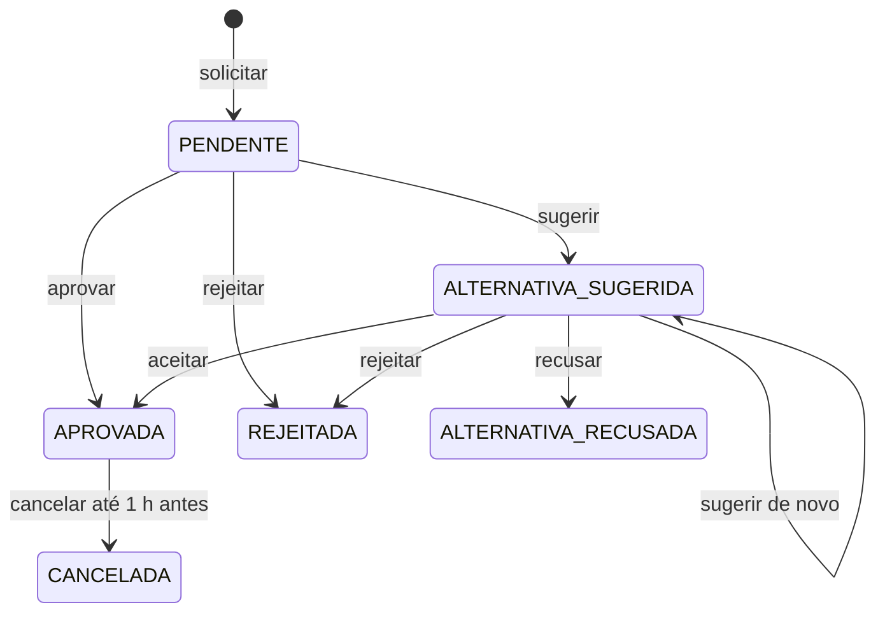

# Agenda

Uso eventual de um espaço numa data: quem tem `AGENDA.SOLICITAR` pede, quem tem `AGENDA.ANALISAR` aprova, rejeita ou sugere outra opção. Implementação: app `bookings`. Regras em [regras de negócio](../regras/regras-de-negocio.md#agenda).

## Conceitos

| Conceito | Model | Observação |
|---|---|---|
| Solicitação de agendamento | `BookingRequest` | Pedido com espaço, data, início, fim, descrição (até 500 caracteres), quantidade de alunos (1 a 999) e vínculo acadêmico (`teaching_assignment`). Guarda a decisão, a alternativa sugerida (`suggested_*`) e o cancelamento |
| Agendamento | `Booking` | Uso aprovado, com `starts_at` e `ends_at`. Existe enquanto vale: é excluído no cancelamento |

O ensalamento não é alterado pela Agenda. São três conceitos em tabelas separadas: alocação, solicitação e agendamento.

## Telas

| Tela | Rota | Permissão |
|---|---|---|
| Grade da Agenda | `/agenda/` | `AGENDA.VISUALIZAR` |
| Solicitar agendamento | `/agenda/solicitar/` | `AGENDA.SOLICITAR` |
| Criar solicitação para outro usuário | `/agenda/criar/` | `AGENDA.CRIAR` |
| Minhas solicitações e detalhe | `/agenda/minhas-solicitacoes/`, `/<pk>/` | `AGENDA.SOLICITAR` |
| Aceitar ou recusar a alternativa | `/agenda/minhas-solicitacoes/<pk>/aceitar/`, `/recusar/` | `AGENDA.SOLICITAR` |
| Cancelar o próprio agendamento | `/agenda/minhas-solicitacoes/<pk>/cancelar/` | `AGENDA.SOLICITAR` |
| Solicitações para análise e detalhe | `/agenda/solicitacoes/`, `/<pk>/` | `AGENDA.ANALISAR` |
| Aprovar, rejeitar, sugerir alternativa, cancelar | `/agenda/solicitacoes/<pk>/aprovar/`, `/rejeitar/`, `/sugerir/`, `/cancelar/` | `AGENDA.ANALISAR` |
| Cancelar ocorrência de aula | `/agenda/ocorrencias/cancelar/` | `AGENDA.VISUALIZAR` e ser docente da aula ou ter `ENSALAMENTO.CANCELAR_OCORRENCIA` |
| Exceções do ensalamento | `/agenda/excecoes/` | `AGENDA.VISUALIZAR` |

### Grade da Agenda

- Mesma Grade do ensalamento (semana ou mês), com as aulas e os agendamentos aprovados. Lista só espaços ativos.
- Filtro "Minha agenda": mostra só os agendamentos que o usuário solicitou e as aulas em que é docente; as demais ocupações aparecem como faixa ocupada, sem detalhes.
- No fim de semana, abre na semana seguinte.
- Clicar numa faixa abre "Solicitar agendamento" com espaço, data e horário preenchidos. Abre direto "Criar solicitação para outro usuário" para o superadmin e para quem tem `AGENDA.CRIAR` sem `AGENDA.SOLICITAR` (`bookings.views.creates_directly`).
- Quem solicitou aparece no card só para quem tem `AGENDA.ANALISAR`.

## Fluxo

1. **Solicitar** (`BookingRequest.objects.prepare` e `submit`): o curso, a disciplina e a turma são opcionais e vêm de todos os vínculos atuais do semestre da data, de qualquer docente. A data precisa ser de segunda a sexta (`check_weekday`); o calendário do campo já desabilita sábado e domingo. O primeiro envio mostra a revisão sem gravar; a confirmação grava a solicitação `PENDENTE` e notifica quem analisa. Nenhum horário é reservado nesse momento.
2. **Analisar**: quem tem `AGENDA.ANALISAR`
   - aprova (`approve`): confere o conflito de novo, trava o espaço e cria o `Booking` com o horário original;
   - rejeita (`reject`): motivo obrigatório;
   - sugere alternativa (`suggest`): outro espaço, data (de segunda a sexta) ou horário, disponível no momento, com mensagem opcional. A alternativa não reserva o horário.
3. **Responder à alternativa** (só quem solicitou): aceitar (`accept_suggestion`) confere a disponibilidade de novo e cria o `Booking` com os dados sugeridos; recusar (`decline_suggestion`) encerra sem agendamento.
4. **Cancelar** (`cancel`): agendamento aprovado, até 1 hora antes do início, por quem solicitou ou por quem analisa. Motivo opcional. Exclui o `Booking`, o que libera o espaço em todas as leituras de ocupação.

Uma ação que o estado atual não admite é recusada com `InvalidTransition`.

## Criar para outro usuário

`/agenda/criar/` (`BookingOnBehalfCreateView`): quem tem `AGENDA.CRIAR` escolhe o usuário e, se quiser, o curso, a disciplina e a turma, nessa ordem. A lista de usuários são os ativos com `AGENDA.SOLICITAR` (`User.objects.with_permission`). A solicitação fica `PENDENTE` em nome do usuário escolhido (`requested_by`), com quem criou em `created_by`, e segue o mesmo fluxo de análise.

## Notificações

Geradas na transação de cada transição (`bookings/notifications.py`):

| Evento | Quem recebe |
|---|---|
| Solicitação criada | Todos os usuários ativos com `AGENDA.ANALISAR`, exceto quem solicitou |
| Aprovada, rejeitada, alternativa sugerida | Quem solicitou |
| Alternativa aceita ou recusada | Quem sugeriu, se ainda tiver `AGENDA.ANALISAR`; senão, todos que analisam |
| Cancelada por quem solicitou | Quem decidiu (mesma regra acima) |
| Cancelada por quem analisa | Quem solicitou |

## Testes

`bookings/tests/`: `test_models.py`, `test_request_views.py`, `test_review_views.py`, `test_on_behalf_request.py`, `test_academic_request.py`, `test_agenda_grid.py`, `test_notifications.py`, `test_audit.py`.
