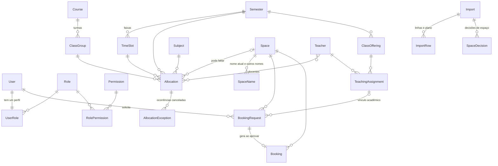

# Visão geral do sistema

O IFAgenda controla a ocupação dos espaços físicos do IFNMG – Campus Salinas. Foi desenvolvido como TCC do Bacharelado em Sistemas de Informação. O escopo e os requisitos vêm do texto do TCC em `sources/TCC_REVISADO (1).pdf`; os princípios derivados dele estão em [Princípios do TCC](#princípios-do-tcc).

A ocupação tem duas origens:

- **Ensalamento:** aulas regulares de cada semestre, importadas da planilha institucional de horários e ajustadas no sistema (cancelamento de uma ocorrência, alteração, criação e encerramento de recorrências).
- **Agenda:** uso eventual de um espaço numa data, pedido por solicitação de agendamento e aprovado por quem analisa.

As duas aparecem juntas na Grade autenticada e no calendário público, que não exige login.

## Usuários

| Quem | Como é definido | O que faz |
|---|---|---|
| Visitante | sem login | Consulta o calendário público (`/`) e o horário original (`/horario-original/`) |
| Usuário autenticado | perfil com permissões | Faz o que as permissões do perfil liberam. Solicitar agendamento depende só de `AGENDA.SOLICITAR`. Cancelar ocorrências das próprias aulas depende de ser o docente da aula |
| Superadmin | atributo `User.is_superadmin` | Tem todas as permissões, inclusive as reservadas `PERFIL.*`, sem precisar de perfil. É controlado só por comando de gerenciamento |

Os perfis são cadastrados pelo superadmin na tela de perfis. A carga inicial cria `ADMINISTRADOR` e `DOCENTE` como exemplo, mas eles são perfis comuns: o código não dá a nenhum perfil acesso pelo nome.

O detalhamento está em [permissões](../regras/permissoes.md).

## Funcionalidades

| Módulo | Rota inicial | Documento |
|---|---|---|
| Autenticação, usuários e perfis | `/contas/login/`, `/usuarios/`, `/perfis/` | [autenticacao-e-usuarios.md](../funcionalidades/autenticacao-e-usuarios.md) |
| Ensalamento (Grade, importação, recorrências) | `/ensalamento/` | [ensalamento.md](../funcionalidades/ensalamento.md) |
| Espaços | `/espacos/` | [espacos.md](../funcionalidades/espacos.md) |
| Disciplinas e turmas | `/disciplinas/`, `/turmas/` | [disciplinas-e-turmas.md](../funcionalidades/disciplinas-e-turmas.md) |
| Agenda | `/agenda/` | [agenda.md](../funcionalidades/agenda.md) |
| Calendário público | `/`, `/horario-original/` | [calendario-publico.md](../funcionalidades/calendario-publico.md) |
| Painel e relatórios | `/painel/`, `/relatorios/...` | [painel-e-relatorios.md](../funcionalidades/painel-e-relatorios.md) |
| Notificações | sino no cabeçalho, `/notificacoes/` | [notificacoes.md](../funcionalidades/notificacoes.md) |
| Auditoria | `/auditoria/` | [auditoria.md](../funcionalidades/auditoria.md) |
| E-mails e servidor SMTP | `/configuracoes/email/` | [emails.md](../funcionalidades/emails.md) |

Depois do login, `/inicio/` redireciona para o primeiro item do menu liberado ao usuário (`ui/navigation.py`). Sem nenhum item liberado, mostra o aviso de acesso restrito.

## Tecnologias

| Camada | Tecnologia | Versão (fonte) |
|---|---|---|
| Linguagem | Python | 3.13 (`Dockerfile`) |
| Framework | Django | 5.2.17 (`requirements.txt`) |
| Autenticação | django-allauth | 65.19.4 |
| Banco de dados | PostgreSQL, com a extensão `btree_gist` | 17 (`compose.yaml`) |
| Driver | psycopg (binary) | 3.3.5 |
| Interface | templates do Django, Tailwind CSS 4.3.3, htmx (arquivo local), ícones Lucide e fonte Open Sans locais | `package.json`, `ui/static/` |
| Interações htmx no servidor | django-htmx | 1.29.0 |
| Tempo real | Django Channels com `RedisChannelLayer` (em memória sem `DJANGO_REDIS_URL`), servido pelo Daphne | channels 4.3.2, channels-redis 4.3.0, daphne 4.2.3 |
| Planilhas XLSX | openpyxl | 3.1.5 |
| Cifra da senha SMTP | cryptography (Fernet) | 50.0.1 |
| Cache das telas públicas e camada do Channels | Redis | `redis:8-alpine`, cliente redis 8.1.0 |
| Compilação do CSS | Node.js, só no container `tailwind` | 22.23.2 |

Não há API REST, front-end separado nem `django.contrib.admin`.

## Entidades principais

| Grupo | Models | App |
|---|---|---|
| Contas | `User`, `Role`, `Permission`, `UserRole`, `RolePermission` | `accounts` |
| Ensalamento | `Semester`, `TimeSlot`, `Space`, `SpaceName`, `Teacher`, `Course`, `ClassGroup`, `Subject`, `Allocation`, `AllocationException`, `ClassOffering`, `TeachingAssignment`, `SpaceDecision` | `schedule` |
| Agenda | `BookingRequest`, `Booking` | `bookings` |
| Importação | `Import`, `ImportRow` | `imports` |
| Suporte | `AuditLog` (`audit`), `OutboxEntry` (`outbox`), `Notice` e `Notification` (`notices`), `SystemSetting` (`system_settings`) | |

Pontos que orientam a leitura do modelo:

- `Allocation` é a regra semanal (semestre, turma, disciplina, dia, faixa). A ocorrência numa data é calculada, nunca gravada. Ver [ensalamento](../funcionalidades/ensalamento.md).
- `Teacher` não tem chave estrangeira para `User`. A correspondência é `Teacher.name` igual a `User.username`, sem diferenciar a caixa.
- `ClassOffering` liga disciplina e turma num semestre. `TeachingAssignment` liga o docente à oferta, com `is_current` separando o vínculo atual do histórico.
- `BookingRequest` guarda o pedido e a decisão. `Booking` existe só enquanto o agendamento aprovado vale, e é excluído no cancelamento.

## Limites da aplicação

- Um único campus. As configurações (`SystemSetting`) são globais.
- Aulas e agendamentos só de segunda a sexta (`Weekday` não tem sábado nem domingo). O agendamento é avulso, numa data, sem recorrência.
- A planilha institucional é a fonte do ensalamento. Não há integração em tempo real com sistemas externos (princípio P10).
- A importação do ensalamento não detecta conflito de espaço nem de docente. O choque aparece só na Grade e no painel.
- Interface só em português, com textos e visual verificados por testes do app `ui`.
- O repositório tem só o ambiente de desenvolvimento. Ver [deploy](../operacao/deploy.md).

## Princípios do TCC

Princípios tirados do texto do TCC, citados pelo código e pelas convenções pela numeração. Entre parênteses, os requisitos não funcionais (RNF) e as seções do TCC. Em caso de divergência, prevalece o TCC.

| # | Princípio |
|---|---|
| P1 | Aplicação web em Python com Django, PostgreSQL e templates do Django com Tailwind CSS (3.3.1) |
| P2 | Padrão MTV com separação entre dados, lógica e apresentação; as regras de negócio ficam nos models (2.3.6, RNF06) |
| P3 | Acesso ao banco só pelo ORM; mudanças de esquema só por migrations (2.3.7, 3.3.1) |
| P4 | Manutenibilidade e reaproveitamento de código, sem duplicar lógica (RNF06) |
| P5 | Controle de acesso por papéis (RBAC) e proteção contra CSRF, XSS e injeção de SQL (RNF01, RNF02) |
| P6 | Tempo de resposta adequado nas consultas de disponibilidade, inclusive em pico de uso (RNF03) |
| P7 | Acesso por navegador, sem instalação; usabilidade para docentes com familiaridade tecnológica variada; termos do campus como "laboratório", "reserva" e "disponível" (RNF04, RNF05) |
| P8 | Consistência visual entre as telas (RNF05) |
| P9 | Testes unitários e de integração das regras de negócio centrais. Validação com usuários e homologação institucional não estão previstas no TCC (3.3.1) |
| P10 | Autonomia em relação à infraestrutura de horários do campus: a planilha institucional é importada por ação administrativa, sem consulta em tempo real a sistemas externos (RNF07) |
| P11 | Modelagem em UML: casos de uso do TCC 1, diagramas de classes e de sequência no TCC 2 (3.3) |
| P12 | Escopo nos requisitos funcionais (Tabela 2) e não funcionais (Tabela 3) do TCC. A implantação definitiva na infraestrutura do campus fica com a direção e os setores envolvidos (3.3.1) |
