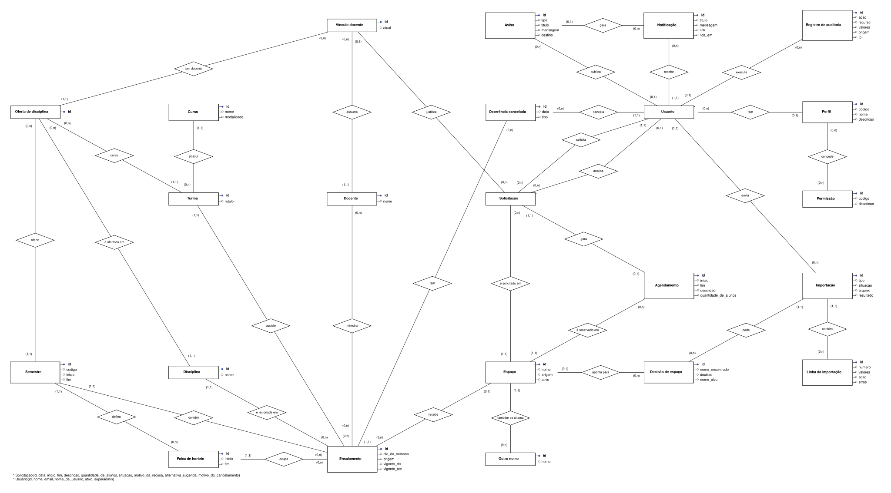
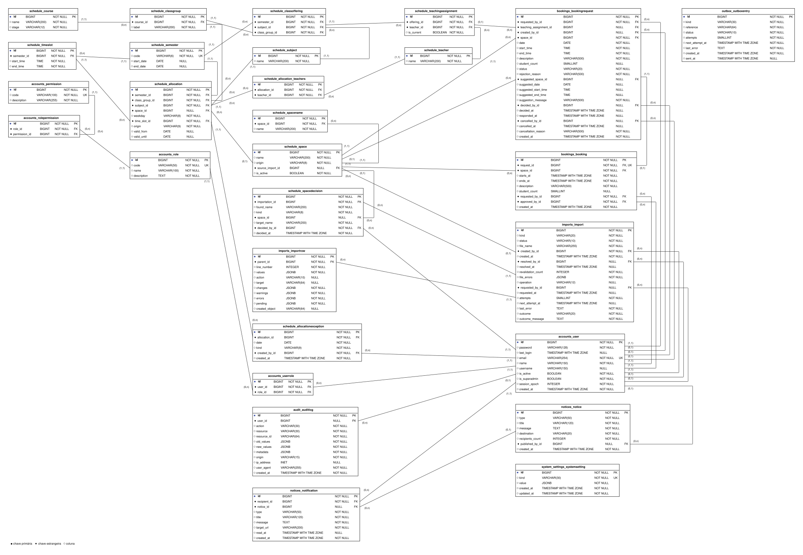

# Diagramas

| Diagrama | Fonte | Imagens |
|---|---|---|
| DER conceitual | `der-conceitual.dot` | [`der-conceitual.svg`](der-conceitual.svg), `der-conceitual.png`, `der-conceitual.pdf` |
| DER físico | `der-fisico.dot` | [`der-fisico.svg`](der-fisico.svg), `der-fisico.png`, `der-fisico.pdf` |
| Restrições do físico | [`restricoes.md`](restricoes.md) | |

Os dois diagramas seguem o padrão do brModelo e mostram o modelo inteiro numa figura só.

- **Conceitual:** notação de Peter Chen. Entidade em retângulo, relacionamento em losango, atributos em círculos ao lado da entidade (preenchido no identificador) e cardinalidade (mín,máx) junto de cada entidade. Uma entidade com muitos atributos leva `*`, e os atributos dela ficam listados no rodapé.
- **Físico:** todas as tabelas das apps do projeto, com cada coluna, o tipo no PostgreSQL, `NULL`/`NOT NULL` e as marcações `PK`, `FK` e `UK`. As tabelas ficam em colunas fixas (`PHYSICAL_COLUMNS`, no comando), escolhidas para que nenhuma linha atravesse uma tabela nem cruze outra linha. Cada FK é uma linha ortogonal que sai da altura da sua coluna, sobe ou desce numa trilha só dela no vão entre as colunas e entra na tabela referenciada na horizontal, com a cardinalidade nos dois lados; entre tabelas da mesma coluna, a linha contorna a coluna por fora (pela esquerda quando está em `PHYSICAL_LEFT_BRACKETS`). Uma tabela nova precisa entrar em `PHYSICAL_COLUMNS`, senão o comando para com erro.
- **Restrições:** o SQL das constraints e dos índices que o diagrama não mostra (exclusão, únicos com `LOWER`, índices parciais, checks).





## Regenerar

```bash
make er-diagram
make er-images
```

- `make er-diagram` roda o comando `export_er_diagram` e grava os `.dot` e o `restricoes.md`. O físico sai dos models. O conceitual sai de `CONCEPTUAL_ENTITIES` e `CONCEPTUAL_RELATIONSHIPS`, no próprio comando: é ali que se muda uma entidade, um atributo ou um relacionamento.
- `make er-images` renderiza os `.dot` em SVG, PNG e PDF com o Graphviz do serviço `diagrams` (perfil `tools` do `compose.yaml`, estágio `diagrams` do `Dockerfile`).
- Não edite os arquivos gerados à mão. Para o texto do TCC, use o PDF, que é vetorial.
