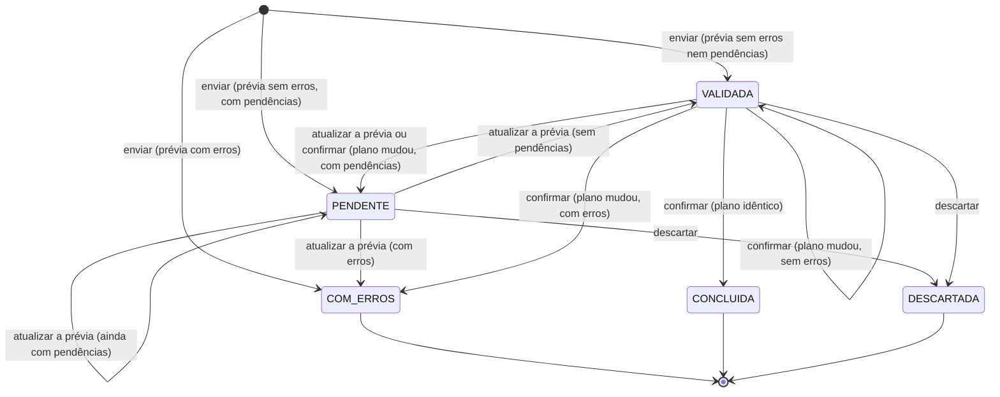

# Máquina de estados da importação

Este documento descreve o ciclo de vida de uma importação de planilha no app `imports`: os estados, os eventos que mudam o estado, as condições de cada transição e as garantias de consistência. As regras vêm da spec `openspec/specs/importacao-planilhas/spec.md` e do `design.md` da Change arquivada `2026-09-19-importar-usuarios-por-planilha`.

## O que é uma importação

Uma importação é o registro de um arquivo CSV que **chegou à prévia**. Um arquivo recusado antes disso (codificação, cabeçalho, limite de linhas ou de tamanho) não vira importação e não aparece no histórico. O erro aparece só no formulário de envio.

O estado vale para a importação inteira. As linhas não têm estado próprio: cada uma guarda os valores lidos e o **plano** (ação, alvo, mudanças, avisos e erros).

## Estados

| Código | Rótulo | Significado | Final |
|---|---|---|---|
| `VALIDADA` | Validada | A prévia não tem erros nem pendências e pode ser confirmada ou descartada | Não |
| `PENDENTE` | Precisa de decisão | A prévia não tem erros, mas tem pendências que dependem de decisão de usuário. Pode ter a prévia atualizada ou ser descartada, e não pode ser confirmada nem excluída | Não |
| `COM_ERROS` | Com erros | A prévia tem erros de linha ou de arquivo e não pode ser confirmada | Sim |
| `CONCLUIDA` | Concluída | A importação foi confirmada e aplicada | Sim |
| `DESCARTADA` | Descartada | A importação foi descartada sem aplicar nada | Sim |

Os códigos ficam em `Import.Status` (`imports/models.py`).

## Diagrama



## Transições

| Evento | De | Condição | Para | Efeito |
|---|---|---|---|---|
| Enviar | (nenhum) | Prévia sem erros de linha nem de arquivo e sem pendências | `VALIDADA` | Grava a importação e o plano das linhas. Nada é aplicado ao domínio |
| Enviar | (nenhum) | Prévia sem erros, com pelo menos uma pendência | `PENDENTE` | Grava a importação, o plano e as pendências. Nada é aplicado ao domínio |
| Atualizar a prévia | `PENDENTE` ou `VALIDADA` | Nenhuma | `VALIDADA`, `PENDENTE` ou `COM_ERROS`, conforme o novo plano | Reexecuta as linhas gravadas e desfaz tudo. O novo plano substitui o anterior. Não conta como prévia refeita e não é auditada |
| Confirmar | `VALIDADA` | A verificação própria da importação específica recusa o executor | (sem mudança) | Recusado com a mensagem da verificação, antes de reexecutar |
| Confirmar | `PENDENTE` | Nenhuma | (sem mudança) | Recusado com `ImportNeedsDecision` |
| Descartar | `PENDENTE` | Nenhuma | `DESCARTADA` | Grava quem descartou e quando. Nada é aplicado |
| Enviar | (nenhum) | Prévia com pelo menos um erro | `COM_ERROS` | Grava a importação, o plano e os erros |
| Confirmar | `VALIDADA` | O novo plano é idêntico ao gravado | `CONCLUIDA` | Aplica todas as linhas, grava o registro criado de cada cadastro e quem confirmou e quando |
| Confirmar | `VALIDADA` | O novo plano é diferente, sem erros | `VALIDADA` | Nada é aplicado. O novo plano substitui o anterior, e `revalidation_count` aumenta em 1 |
| Confirmar | `VALIDADA` | O novo plano é diferente, com erros | `COM_ERROS` | Nada é aplicado. O novo plano e os erros substituem os anteriores, e `revalidation_count` aumenta em 1 |
| Descartar | `VALIDADA` | Nenhuma | `DESCARTADA` | Grava quem descartou e quando. Nada é aplicado |
| Confirmar ou descartar | `COM_ERROS`, `CONCLUIDA` ou `DESCARTADA` | Nenhuma | (sem mudança) | Recusado com `ImportNotPending`, sem alterar nada |

Qualquer usuário com a permissão da importação (`USUARIO.IMPORTAR`, no caso de usuários) pode confirmar ou descartar, qualquer que seja quem enviou. Não há regra de autoria.

## Onde cada evento acontece

| Evento | Código | Tela |
|---|---|---|
| Enviar | `Import.objects.preview(definition, rows, file_name, executor)` | `ImportUploadView`, modal de envio |
| Confirmar | `Import.confirm(definition, executor)` | `ImportConfirmView`, POST a partir da página da prévia |
| Descartar | `Import.discard(executor)` | `ImportDiscardView`, modal de confirmação |

As transições são métodos do model, como as demais operações do projeto. Não há biblioteca de máquina de estados: com quatro estados e dois eventos depois do envio, ela não compensaria a dependência.

## Prévia: executar e desfazer

A prévia não simula a regra de negócio. Ela **executa as operações reais do domínio** e desfaz tudo no fim:

```text
transação externa
  savepoint do domínio
    trava o que a importação vai ler (definition.lock)
    para cada linha: savepoint próprio → definition.execute_row → plano da linha
    verificações do arquivo (definition.check_file)
  rollback do savepoint do domínio
  grava Import e ImportRow com o plano
commit
```

As linhas rodam na ordem em que a leitura as entrega, e uma importação específica pode usar essa ordem para executar fases sem estado novo. O ensalamento executa primeiro os usuários da aba opcional `usuários - sistema`, depois os catálogos e por fim as atividades; sem a aba, não há linha de usuário e a execução começa pelos catálogos. Todas as fases ficam no mesmo savepoint, e por isso a prévia desfaz os usuários junto com o resto e a confirmação só os grava junto com o ensalamento (Change `importar-usuarios-com-o-ensalamento`).

Na fonte de planilha em grade, a importação declara as abas obrigatórias (`sheets`), cuja ausência recusa o arquivo, e as opcionais (`optional_sheets`), cuja ausência não recusa nada e cuja leitura é feita pela própria importação.

Com isso, a prévia e a confirmação usam o mesmo código, e erros que só o banco detecta (unicidade, continuidade administrativa) já aparecem na prévia. Cada linha roda num savepoint próprio para que a recusa de uma linha, inclusive por erro do banco, não interrompa as seguintes. A prévia mostra todos os erros de uma vez.

## Confirmação: o plano precisa ser idêntico

Entre a prévia e a confirmação, outra pessoa pode ter mudado os dados. Por isso a confirmação reexecuta tudo a partir dos valores gravados, com as permissões de quem confirma, e só aplica se o resultado for igual ao que foi visto:

```text
transação
  trava a importação (select_for_update) e confere que está VALIDADA
  savepoint
  reexecuta as linhas e as verificações do arquivo
  plano idêntico e sem erros?
    sim → mantém o savepoint e marca CONCLUIDA
    não → desfaz o savepoint, grava o novo plano e marca VALIDADA ou COM_ERROS
commit
```

**Plano idêntico** significa igualdade, em todas as linhas, de ação, alvo, mudanças, avisos e pares de coluna e código dos erros, e, no arquivo, dos códigos dos erros. A comparação é feita por `comparable()` em `imports/execution.py`. Ficam de fora as mensagens, os valores lidos e a chave do registro criado. Os valores comparados são canônicos (por exemplo, o código do perfil, e não o nome), então renomear um perfil entre a prévia e a confirmação não muda o plano.

Não há expiração: uma importação `VALIDADA` antiga só é confirmada se o plano ainda for exato.

## Garantias

- **Tudo ou nada.** A confirmação aplica todas as linhas numa única transação. Se qualquer operação falhar, nenhuma linha fica aplicada.
- **Sem confirmação dupla.** A trava da importação serializa duas confirmações simultâneas. A segunda encontra `CONCLUIDA` e é recusada.
- **Importações concorrentes.** Duas importações que atingem os mesmos registros são serializadas pelas travas de `definition.lock`. A segunda diverge e gera uma nova prévia.
- **Sem efeitos externos na prévia.** Uma importação específica não pode enviar e-mail, gravar arquivo ou chamar serviço externo durante a execução. O que precisa acontecer depois da confirmação vai para o outbox (app `outbox`), na mesma transação, e por isso é desfeito junto na prévia e na divergência.
- **Erro inesperado** (banco fora do ar, defeito): na prévia, a importação nem é criada; na confirmação, tudo é desfeito e a importação continua `VALIDADA`, pronta para uma nova tentativa. Não existe estado de falha.

## Dados gravados em cada transição

| Campo de `Import` | Quando muda |
|---|---|
| `status` | Em toda transição |
| `created_by`, `created_at` | No envio |
| `resolved_by`, `resolved_at` | Na confirmação concluída e no descarte. O estado diz qual dos dois aconteceu |
| `revalidation_count` | Em cada confirmação que diverge |
| `file_errors` | No envio e em cada confirmação que diverge |

Cada `ImportRow` guarda o plano (`action`, `target`, `changes`, `warnings`, `errors`). O plano é substituído a cada divergência, e os planos anteriores não são guardados. `created_object` só é preenchido na conclusão, porque a chave gerada na prévia desaparece no rollback.

## O que não existe nesta versão

Estas capacidades estão previstas no design, mas não implementadas:

- **`PROCESSANDO` e `FALHOU`**, que só fazem sentido com processamento assíncrono. Hoje a prévia e a confirmação são síncronas, então nenhuma das duas situações seria observada.
- **Cancelamento e progresso**, também dependentes do processamento assíncrono.
- **Atualização da prévia de uma importação `COM_ERROS`.** Os erros de linha e de arquivo só se corrigem com um arquivo novo, e `COM_ERROS` continua final. A pendência, que se resolve na tela, é a razão de `PENDENTE` existir.
- **Reenvio de uma importação `COM_ERROS`.** Para corrigir, envia-se o arquivo corrigido, que cria uma importação nova. A anterior continua no histórico.

## Testes

- `imports/tests/test_models.py`: transições, pendências, atualização da prévia, verificação própria da confirmação, divergência com e sem erros, erro inesperado na prévia e na confirmação, estados finais, confirmações simultâneas e plano determinístico, com uma importação de teste sobre `auth.Group`.
- `accounts/tests/test_user_import.py`: as mesmas regras aplicadas à importação de usuários.
- `accounts/tests/test_user_import_views.py`: os eventos pelas telas, com acesso, CSRF e mensagens.
