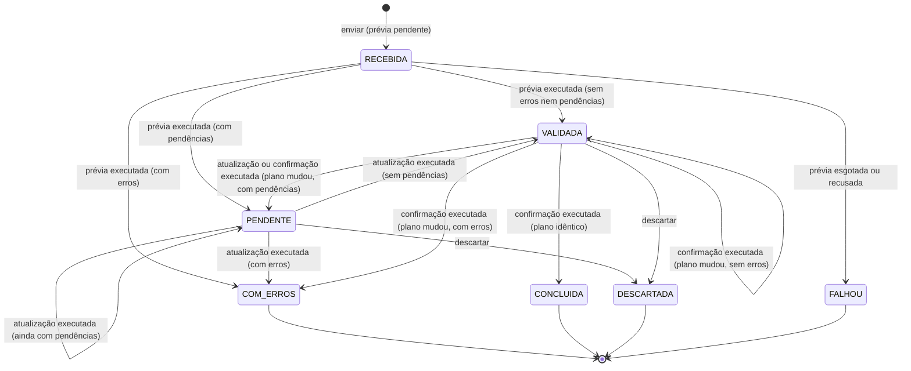

# Máquina de estados da importação

Este documento descreve o ciclo de vida de uma importação de planilha no app `imports`: os estados, os eventos que mudam o estado, as condições de cada transição e as garantias de consistência. As regras vêm da spec `openspec/specs/importacao-planilhas/spec.md`, do `design.md` da Change arquivada `2026-09-19-importar-usuarios-por-planilha` e do da Change `processar-importacao-em-segundo-plano`, que tirou a execução das linhas da requisição.

## O que é uma importação

Uma importação é o registro de um arquivo CSV ou XLSX cuja **leitura foi aceita**. Um arquivo recusado antes disso (codificação, cabeçalho, limite de linhas ou de tamanho) não vira importação e não aparece no histórico. O erro aparece só no formulário de envio.

O estado vale para a importação inteira. As linhas não têm estado próprio: cada uma guarda os valores lidos e o **plano** (ação, alvo, mudanças, avisos, pendências e erros).

## Situação e operação pendente

A importação tem duas informações separadas:

- **`status`**, a situação, é o único estado de negócio: o que o plano diz sobre a importação;
- **`operation`**, a operação pendente (`PREVIA`, `ATUALIZACAO`, `CONFIRMACAO` ou nenhuma), é a execução técnica que o worker ainda vai fazer sobre essa situação.

Pedir uma operação não muda a situação: uma importação em confirmação continua `VALIDADA`. "Em processamento" é só um selo calculado de `operation`, e não uma situação. A `CheckConstraint` `import_operation_matches_status` impede no banco as combinações que contradizem a situação:

| `operation` | Situações permitidas |
|---|---|
| nenhuma | qualquer uma, exceto `RECEBIDA` |
| `PREVIA` | só `RECEBIDA` |
| `ATUALIZACAO` | `VALIDADA` ou `PENDENTE` |
| `CONFIRMACAO` | só `VALIDADA` |

O aviso de demora também não é estado: a tela o calcula de `requested_at` e `IMPORT_STALE_AFTER` a cada exibição.


## Estados

| Código | Rótulo | Significado | Final |
|---|---|---|---|
| `RECEBIDA` | Recebida | O arquivo foi aceito e a prévia ainda não foi gerada. Não pode ser confirmada, descartada nem excluída | Não |
| `VALIDADA` | Validada | A prévia não tem erros nem pendências e pode ser confirmada ou descartada | Não |
| `PENDENTE` | Precisa de decisão | A prévia não tem erros, mas tem pendências que dependem de decisão de usuário. Pode ter a prévia atualizada ou ser descartada, e não pode ser confirmada nem excluída | Não |
| `COM_ERROS` | Com erros | A prévia tem erros de linha ou de arquivo e não pode ser confirmada | Sim |
| `CONCLUIDA` | Concluída | A importação foi confirmada e aplicada | Sim |
| `DESCARTADA` | Descartada | A importação foi descartada sem aplicar nada | Sim |
| `FALHOU` | Falhou | A prévia nunca foi gerada: esgotou as tentativas ou foi recusada na execução. Só pode ser excluída | Sim |

Os códigos ficam em `Import.Status` (`imports/models.py`), e as operações em `Import.Operation`.


## Diagrama



Pedir uma atualização ou uma confirmação não aparece no diagrama, porque não muda a situação: só cria a operação pendente.


## Transições

| Evento | De | Quem e onde | Condição | Para | Efeito |
|---|---|---|---|---|---|
| Enviar | (nenhum) | usuário, requisição | leitura aceita | `RECEBIDA`, com `PREVIA` pendente | Grava a importação e as linhas com os valores lidos e os erros da leitura. Nada é executado |
| Prévia executada | `RECEBIDA` | worker | nenhuma | `VALIDADA`, `PENDENTE` ou `COM_ERROS`, pelo plano | Executa e desfaz as linhas, grava o plano e audita o cadastro |
| Pedir atualização | `VALIDADA`, `PENDENTE` | usuário, requisição | nenhuma operação pendente | a mesma, com `ATUALIZACAO` pendente | Nada é executado |
| Atualização executada | `VALIDADA`, `PENDENTE` | worker | nenhuma | pelo novo plano | Reexecuta e desfaz tudo. Não conta como prévia refeita e não é auditada |
| Pedir confirmação | `VALIDADA` | usuário, requisição | nenhuma operação pendente e a verificação própria aceita | `VALIDADA`, com `CONFIRMACAO` pendente | Recusado com a mensagem da verificação, sem alterar nada, quando ela recusa |
| Pedir confirmação | `PENDENTE` | usuário, requisição | nenhuma | (sem mudança) | Recusado com `ImportNeedsDecision` |
| Confirmação executada | `VALIDADA` | worker | plano idêntico | `CONCLUIDA` | Aplica todas as linhas, grava o registro criado de cada cadastro e quem confirmou e quando |
| Confirmação executada | `VALIDADA` | worker | plano diferente | `VALIDADA`, `PENDENTE` ou `COM_ERROS` | Nada é aplicado. O novo plano substitui o anterior, `revalidation_count` aumenta em 1 e o resultado é `DIVERGENCIA` |
| Confirmação recusada na execução | `VALIDADA` | worker | a verificação própria recusa, ou quem pediu está inativo | (sem mudança) | Nada é executado; o resultado é `RECUSADA`, com a mensagem |
| Operação esgotada | `RECEBIDA` | worker | tentativas no limite | `FALHOU` | Auditoria de falha |
| Operação esgotada | `VALIDADA`, `PENDENTE` | worker | tentativas no limite | (sem mudança) | O plano anterior continua valendo; o resultado é `FALHA_ATUALIZACAO` ou `FALHA_CONFIRMACAO`, com auditoria de falha |
| Descartar | `VALIDADA`, `PENDENTE` | usuário, requisição | nenhuma operação pendente | `DESCARTADA` | Grava quem descartou e quando. Nada é aplicado |
| Excluir | `COM_ERROS`, `DESCARTADA`, `FALHOU` | usuário, requisição | permissão de exclusão | (excluída) | Auditoria com o arquivo e a situação |
| Qualquer ação | qualquer uma com operação pendente | usuário, requisição | nenhuma | (sem mudança) | Recusado na hora com `ImportBusy` |
| Confirmar ou descartar | `COM_ERROS`, `CONCLUIDA`, `DESCARTADA` ou `FALHOU` | usuário, requisição | nenhuma | (sem mudança) | Recusado com `ImportNotPending` |

Qualquer usuário com a permissão da importação (`USUARIO.IMPORTAR`, no caso de usuários) pode confirmar ou descartar, qualquer que seja quem enviou. Não há regra de autoria. A execução usa as permissões de quem pediu, no momento em que roda.


## Onde cada evento acontece

| Evento | Código | Tela |
|---|---|---|
| Enviar | `Import.objects.request_preview(definition, rows, file_name, executor)` | `ImportUploadView`, modal de envio |
| Pedir atualização | `Import.request_refresh(executor)` | decisões de espaço e "Tentar novamente" do ensalamento |
| Pedir confirmação | `Import.request_confirmation(definition, executor)` | `ImportConfirmView`, POST a partir da página da prévia |
| Executar a operação pendente | `Import.execute_pending(definition)`, chamado por `imports/worker.py` | container `import_worker`, comando `process_imports` |
| Descartar | `Import.discard(definition, executor)` | `ImportDiscardView`, modal de confirmação |
| Acompanhar | `ImportStatusView`, rota `<prefixo>_status` | quadro de processamento do detalhe, por polling |

As transições são métodos do model, como as demais operações do projeto. O worker só chama `execute_pending`, que confere a pré-condição sob a trava; ele nunca grava a situação diretamente. Não há biblioteca de máquina de estados nem de filas: a fila é a própria tabela, e o worker encontra a definição pelo tipo em `imports/registry.py`, preenchido pelo `AppConfig.ready` de cada app.

## Worker

```text
transação 1 (reserva)
  pega a importação com operação pendente e next_attempt_at vencido, select_for_update(skip_locked)
  tentativas no limite? → esgota e termina
  attempts += 1; next_attempt_at = agora + intervalo
commit

transação 2 (execução)
  lock_timeout = IMPORT_LOCK_TIMEOUT
  ator: quem pediu, origem INTERFACE
  execute_pending: trava com skip_locked, confere a operação, executa a transição e encerra a operação
commit

erro inesperado → transação 3: last_error; esgota no limite
recusa de regra (ValidationError) → transação 3: encerra sem nova tentativa
```

`IMPORT_LOCK_TIMEOUT` limita só a espera pela aquisição de uma trava, e não a duração da execução. O comando chama `close_old_connections` antes de cada ciclo.


## Prévia: executar e desfazer

A prévia não simula a regra de negócio. Ela **executa as operações reais do domínio** e desfaz tudo no fim:

```text
transação do worker, com a importação RECEBIDA travada
  savepoint do domínio
    trava o que a importação vai ler (definition.lock)
    para cada linha: savepoint próprio → definition.execute_row → plano da linha
    verificações do arquivo (definition.check_file)
  rollback do savepoint do domínio
  grava o plano nas ImportRow, a situação dada por ele e o fim da operação
commit
```

As linhas rodam na ordem em que a leitura as entrega, e uma importação específica pode usar essa ordem para executar fases sem estado novo. O ensalamento executa primeiro os usuários da aba opcional `usuários - sistema`, depois os catálogos e por fim as atividades; sem a aba, não há linha de usuário e a execução começa pelos catálogos. Todas as fases ficam no mesmo savepoint, e por isso a prévia desfaz os usuários junto com o resto e a confirmação só os grava junto com o ensalamento (Change `importar-usuarios-com-o-ensalamento`).

Na fonte de planilha em grade, a importação declara as abas obrigatórias (`sheets`), cuja ausência recusa o arquivo, e as opcionais (`optional_sheets`), cuja ausência não recusa nada e cuja leitura é feita pela própria importação.

Com isso, a prévia e a confirmação usam o mesmo código, e erros que só o banco detecta (unicidade, continuidade administrativa) já aparecem na prévia. Cada linha roda num savepoint próprio para que a recusa de uma linha, inclusive por erro do banco, não interrompa as seguintes. A prévia mostra todos os erros de uma vez.

## Confirmação: o plano precisa ser idêntico

Entre a prévia e a confirmação, outra pessoa pode ter mudado os dados. Por isso a confirmação reexecuta tudo a partir dos valores gravados, com as permissões de quem confirma, e só aplica se o resultado for igual ao que foi visto:

```text
transação do worker
  trava a importação (skip_locked) e confere que está VALIDADA com a confirmação pendente
  repete a verificação própria
  savepoint
  reexecuta as linhas e as verificações do arquivo
  plano idêntico e sem erros?
    sim → mantém o savepoint e marca CONCLUIDA
    não → desfaz o savepoint, grava o novo plano e marca VALIDADA ou COM_ERROS
commit
```

**Plano idêntico** significa igualdade, em todas as linhas, de ação, alvo, mudanças, avisos e pares de coluna e código dos erros, e, no arquivo, dos códigos dos erros. A comparação é feita por `comparable()` em `imports/execution.py`. Ficam de fora as mensagens, os valores lidos e a chave do registro criado. Os valores comparados são canônicos (por exemplo, o código do perfil, e não o nome), então renomear um perfil entre a prévia e a confirmação não muda o plano.

Não há expiração: uma importação `VALIDADA` antiga só é confirmada se o plano ainda for exato.

## Garantias

- **Tudo ou nada.** A confirmação aplica todas as linhas numa única transação. Se qualquer operação falhar, nenhuma linha fica aplicada.
- **Sem confirmação dupla.** O segundo pedido encontra a operação pendente e é recusado com `ImportBusy`; a execução só roda com `CONFIRMACAO` pendente, e o mesmo commit que aplica marca `CONCLUIDA` e encerra a operação.
- **Execução única.** Dois workers não executam a mesma importação: a reserva usa `skip_locked` e adia a próxima tentativa, e a execução trava de novo com `skip_locked`.
- **Ações sem espera.** Com operação pendente, ou com a trava do worker ocupada (`nowait`), confirmar, atualizar, descartar, excluir e decidir espaço são recusados na hora.
- **Importações concorrentes.** Duas importações que atingem os mesmos registros são serializadas pelas travas de `definition.lock`. A segunda diverge e gera uma nova prévia.
- **Sem efeitos externos na prévia.** Uma importação específica não pode enviar e-mail, gravar arquivo ou chamar serviço externo durante a execução. O que precisa acontecer depois da confirmação vai para o outbox (app `outbox`), na mesma transação, e por isso é desfeito junto na prévia e na divergência.
- **Queda do worker.** O PostgreSQL desfaz a execução e solta as travas. A importação fica na situação anterior, com a operação pendente e a tentativa contada, e é executada de novo quando a próxima tentativa vencer.
- **Erro inesperado** (banco fora do ar, defeito, espera de trava acima do limite): desfaz a execução e é tentado de novo, até `IMPORT_MAX_ATTEMPTS`. Esgotado, a prévia vai a `FALHOU`; a atualização e a confirmação mantêm a situação e o plano.


## Dados gravados em cada transição

| Campo de `Import` | Quando muda |
|---|---|
| `status` | Nas transições de negócio, sempre no worker, exceto o envio e o descarte |
| `created_by`, `created_at` | No envio |
| `resolved_by`, `resolved_at` | Na confirmação concluída e no descarte. O estado diz qual dos dois aconteceu |
| `revalidation_count` | Em cada confirmação que diverge |
| `file_errors` | Na prévia e em cada execução que substitui o plano |
| `operation`, `requested_by`, `requested_at` | No pedido; `operation` volta a nenhuma no mesmo commit do resultado |
| `attempts`, `next_attempt_at` | Na reserva; zerados no fim da operação |
| `last_error` | Em cada erro inesperado; não aparece na tela |
| `outcome`, `outcome_message` | No fim de uma operação que não terminou como pedida; limpos no próximo pedido |

Cada `ImportRow` guarda os valores lidos e o plano (`action`, `target`, `changes`, `warnings`, `errors`, `pending`). No envio, `errors` guarda só os erros da leitura, que a prévia recebe de volta. O plano é substituído a cada execução, e os planos anteriores não são guardados. `created_object` só é preenchido na conclusão, porque a chave gerada na prévia desaparece no rollback.


## O que não existe nesta versão

- **Progresso e cancelamento.** A execução roda numa única transação, e o andamento não é visível a outra conexão até o commit.
- **Aviso em tempo real.** O detalhe acompanha por polling, porque a camada do Django Channels é `InMemoryChannelLayer`, que não atravessa os processos `web` e `import_worker` (D14 da Change `processar-importacao-em-segundo-plano`).
- **Atualização da prévia de uma importação `COM_ERROS`.** Os erros de linha e de arquivo só se corrigem com um arquivo novo, e `COM_ERROS` continua final. A pendência, que se resolve na tela, é a razão de `PENDENTE` existir.
- **Reenvio de uma importação `COM_ERROS` ou `FALHOU`.** Para corrigir, envia-se o arquivo de novo, o que cria uma importação nova. A anterior continua no histórico.


## Testes

- `imports/tests/test_models.py`: transições, pendências, atualização da prévia, verificação própria da confirmação, divergência com e sem erros, erro inesperado na prévia e na confirmação, estados finais, confirmações simultâneas e plano determinístico, com uma importação de teste sobre `auth.Group`.
- `imports/tests/test_worker.py`: situação e operação separadas, restrição do banco, reserva, queda entre a reserva e a execução, tentativas e esgotamento de cada operação, recusas sem nova tentativa, quem pediu desativado, `lock_timeout`, comando e concorrência com a trava ocupada.
- `imports/tests/worker.py`: auxiliares que pedem a operação e rodam o worker, usados pelos testes das importações específicas.
- `accounts/tests/test_user_import.py`: as mesmas regras aplicadas à importação de usuários.
- `accounts/tests/test_user_import_views.py`: os eventos pelas telas, com acesso, CSRF e mensagens.
