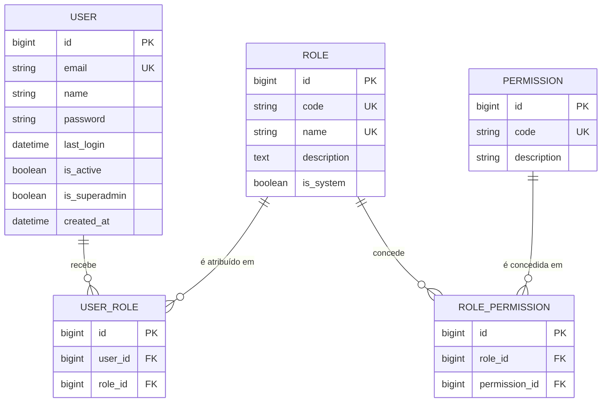

## Context

A Change `configurar-ambiente-desenvolvimento` deixou um projeto Django 5.2 no pacote `config/`, com PostgreSQL 17 via Docker Compose e nenhuma app de domínio. `INSTALLED_APPS` e `urls.py` mantêm os padrões do `startproject`, incluindo `django.contrib.admin` e a rota `/admin/`. O `migrate` dessa Change aplicou as migrations de `admin`, `auth`, `contenttypes` e `sessions` usando o usuário padrão do Django.

A proposal aprovada fixa as seguintes decisões:

- modelos próprios `User`, `Role` e `Permission`, sem `auth.Group` e `auth.Permission` do Django;
- `User ↔ Role` N:N, com exatamente um perfil por usuário nesta versão;
- `Role ↔ Permission` N:N;
- perfis do sistema `ADMINISTRADOR` e `DOCENTE`, criados pela carga e protegidos contra exclusão, e perfis personalizados criados pelo Superadmin;
- gestão de perfis (criar, editar, definir permissões e excluir) exclusiva do Superadmin;
- permissões no padrão `RECURSO.ACAO`, definidas pelo sistema, sem cadastro pela interface;
- permissões `PERFIL.*` no catálogo, reservadas ao Superadmin e não concedíveis a perfis;
- autorização pelas permissões efetivas, nunca pelo nome do perfil;
- flag `is_superadmin` no usuário, sem relação com o `is_superuser` do Django: o superadmin ativo tem acesso irrestrito e o inativo não tem acesso;
- regra de continuidade administrativa, também na retirada de permissões de um perfil, sem regra de "sempre existir um superadmin ativo";
- django-allauth, sem cadastro público;
- senha criada pelo próprio usuário via link;
- desativação lógica;
- acesso público do Visualizador sem perfil e sem autenticação.

Decisões fechadas depois da proposal e incorporadas a este design:

- a recuperação de senha entra nesta Change, pelo fluxo do django-allauth, que também atende à criação inicial da senha;
- o primeiro superadmin é criado por comando de gerenciamento;
- `is_superadmin` é controlado só por comando;
- o superadmin é protegido contra tomada de conta por administradores comuns;
- o catálogo inicial tem cinco permissões do recurso `USUARIO` e cinco do recurso `PERFIL`; a capacidade administrativa é ter todas as de `USUARIO` e não inclui as de `PERFIL`;
- a exclusividade do Superadmin na gestão de perfis é garantida por permissões reservadas (D21), e não por verificação de `is_superadmin` nas views;
- migrations de módulos futuros concedem configuração padrão somente aos perfis do sistema, uma única vez (D9).

O que o TCC fixa: RBAC0 com dois papéis sem hierarquia (2.3.4), RF04, RNF01, RNF02, django-allauth para autenticação e SMTP com Gmail para e-mail (3.3.1), testes da checagem de permissões por perfil (3.3.1), padrão MTV com regras de negócio no Model (P2) e acesso a dados só pelo ORM, com migrations (P3). Os dois papéis do TCC correspondem aos perfis do sistema. A possibilidade de criar perfis personalizados vai além do texto do TCC, e a forma de tratar essa diferença depende de decisão dos orientadores (Open Questions).

Restrições do projeto: cada Change cria só o que usa, e todos os comandos rodam via Docker (`make`).

Interessados: o autor do TCC, os orientadores, os futuros administradores do sistema no campus e os desenvolvedores das próximas Changes, que vão proteger suas funcionalidades com este mecanismo.

## Goals / Non-Goals

**Goals:**

- Identidade por e-mail com um modelo de usuário próprio, definido antes de qualquer migration que dependa do usuário.
- **Um único ponto de decisão de acesso** (`User.has_perm`), usado por views e templates, que considera, nesta ordem, usuário ativo, superadmin e permissões dos perfis.
- Invariantes (exatamente um perfil, continuidade administrativa) garantidas na camada de Model, qualquer que seja a origem da operação.
- Catálogo de permissões versionado por migrations e conferido por testes contra as constantes do código.
- Login, logout e recuperação de senha com django-allauth, usando o mesmo fluxo de recuperação para a criação inicial da senha.
- Superadmin criado e controlado só por comando, e protegido contra tomada de conta por administradores comuns.
- Gestão de perfis pelo Superadmin, protegida pela mesma autorização por permissão, com perfis do sistema protegidos, permissões reservadas e continuidade administrativa.
- Testes unitários e de integração de autenticação, autorização, gestão de perfis e continuidade.

**Non-Goals:**

- Acesso público de consulta (RF11) e permissões de outros módulos (`ESPACO`, `HORARIO`, `AGENDA`, `RESERVA`, `RELATORIO`).
- Mais de um perfil por usuário, hierarquia (RBAC1) e separação de obrigações (RBAC2).
- Tela ou comando para criar, editar ou excluir permissões do catálogo.
- Delegação da gestão de perfis a quem não é superadmin (as permissões `PERFIL.*` continuam reservadas).
- Exclusão de perfil com troca automática do perfil dos usuários vinculados.
- Cadastro público, login social, verificação de e-mail pelo allauth, e-mails secundários.
- Página "Minha conta" (o usuário editar os próprios dados ou trocar a própria senha).
- Alteração de `is_superadmin` pela interface web.
- Reenvio do e-mail de criação de senha pelo administrador (o próprio usuário usa a recuperação de senha).
- Auditoria de alterações (quem fez o quê e quando).
- Regras de autorização por objeto (por exemplo, "só a própria reserva"): não há esse caso nesta Change.
- Tailwind CSS (ver D18).
- Configuração de produção: credenciais SMTP reais, cookies `Secure`, HTTPS, hospedagem.

## Decisions

### D1. Arquitetura geral: uma app `accounts`

Identidade, perfis, permissões e autenticação ficam numa única app, `accounts`, criada na raiz do projeto ao lado de `config/`.

```text
accounts/
  models.py          User, Role, Permission, UserRole, RolePermission e os managers de User e Role
  permissions.py     catálogo de códigos (constantes), conjunto da capacidade administrativa e conjunto das permissões reservadas
  adapters.py        adapter do allauth (cadastro público fechado, usuário inativo) e disparo do link de senha
  tokens.py          gerador de token da recuperação que recusa usuário inativo (D12)
  middleware.py      PermissionMiddleware, que aplica a permissão declarada pela view (D14)
  forms.py
  utils.py           funções auxiliares da app (ex.: levar erros das operações do model para o formulário)
  views.py           página inicial, gestão de usuários e gestão de perfis
  urls.py            rotas da app, com login_required nas que exigem autenticação (D14)
  management/commands/   create_superadmin e set_superadmin (D16)
  migrations/        0001 (esquema) e 0002 (perfis do sistema, permissões iniciais e concessões iniciais)
  templates/         templates da app, sobrescritas do allauth (account/) e 403.html
  tests/
```

Fluxo de uma requisição protegida:

```text
Requisição
  → SessionMiddleware + AuthenticationMiddleware   quem é? (usuário inativo vira anônimo)
  → AccountMiddleware (allauth)
  → URL: login_required                             está autenticado? (anônimo → login com next)
  → PermissionMiddleware → request.user.has_perm("USUARIO.CRIAR")   pode executar? (senão, 403)
  → View
      ├─ Form                                                                 a entrada é válida?
      └─ métodos do User / manager (transação)                               a operação respeita as regras?
             → ORM → PostgreSQL
  → Template   (perms.USUARIO.CRIAR só mostra ou esconde elementos)
```

Alternativas consideradas:
- **Duas apps (`users` e `access_control`):** `User` referencia `Role`, e a regra de continuidade usa os dois lados, o que criaria dependência circular entre as apps sem benefício.
- **Camada de "services" separada dos models:** a Constitution (P2) atribui ao Model o encapsulamento das regras de negócio. Os métodos do model e do manager bastam para esta Change.

### D2. Modelo `User`

O `User` herda de `AbstractBaseUser` e **não** usa `PermissionsMixin`.

| Campo | Tipo | Regras |
|---|---|---|
| `id` | `BigAutoField` | padrão do projeto |
| `email` | `EmailField` | obrigatório; gravado normalizado (sem espaços nas pontas, em minúsculas); único sem diferenciar maiúsculas de minúsculas; `USERNAME_FIELD` e `EMAIL_FIELD` |
| `name` | `CharField` | obrigatório; `REQUIRED_FIELDS` |
| `password` | herdado | hash; *unusable* até o usuário definir a senha |
| `last_login` | herdado | preenchido no login |
| `is_active` | `BooleanField` | padrão `True` |
| `is_superadmin` | `BooleanField` | padrão `False` |
| `created_at` | `DateTimeField` | preenchido na criação |
| `roles` | M2M para `Role` via `UserRole` | exatamente um nesta versão (D6) |

- **Unicidade do e-mail:** o manager normaliza o e-mail, e o banco tem uma `UniqueConstraint` sobre `Lower("email")`. A normalização mantém o dado limpo. A restrição no banco protege contra gravações que não passem pelo manager e contra concorrência.
- **Sem `PermissionsMixin`:** ele adicionaria `is_superuser`, `groups` e `user_permissions`, ligados a `auth.Group` e `auth.Permission` do Django, justamente o que foi descartado. Sem ele, **o campo `is_superuser` não existe**, e isso garante estruturalmente que a regra de superadmin não depende dele. O comando `createsuperuser` do Django também deixa de ser suportado (substituído por D16).
- **Nomes:** os identificadores do código (apps, classes, campos, métodos, constantes, exceções, comandos e arquivos) ficam em inglês, e os campos que o Django e o allauth esperam mantêm o nome do framework (`email`, `password`, `last_login`, `is_active`). O que o usuário vê (rótulos, mensagens, rotas e templates) fica em português, assim como os códigos gravados como dados (códigos de perfil e de permissão, D3 e D4).
- **Comportamento no model** (detalhado nas decisões seguintes):
  - autorização: `has_perm`, `has_perms`, `has_module_perms`, `effective_permissions` (D7);
  - capacidade administrativa: `has_administrative_capability` (D10);
  - operações: `deactivate`, `reactivate`, `change_role`, `set_superadmin`, `update_details` (D10, D11, D13, D16);
  - acesso ao perfil único: `role`;
  - cadastro: manager `register` (D12).

Alternativas consideradas:
- **`AbstractUser`:** traz `username`, `first_name`/`last_name`, `is_staff`, `is_superuser` e os grupos do Django. Tudo isso contradiz as decisões da proposal.
- **Campo `citext` do PostgreSQL:** exige a extensão e `django.contrib.postgres` só para isso. A restrição sobre `Lower("email")` resolve.
- **Só normalizar na aplicação:** não protege contra gravação direta nem contra duas criações simultâneas.

### D3. Modelo `Role`

| Campo | Tipo | Regras |
|---|---|---|
| `id` | `BigAutoField` | |
| `code` | `CharField` | obrigatório; informado na criação; único; maiúsculas e `_` (`^[A-Z]+(_[A-Z]+)*$`, via `CheckConstraint`); imutável depois de criado |
| `name` | `CharField` | obrigatório; nome de exibição ("Administrador", "Docente"); gravado sem espaços nas pontas; único sem diferenciar maiúsculas de minúsculas (`UniqueConstraint` sobre `Lower("name")`) |
| `description` | `TextField` | opcional |
| `is_system` | `BooleanField` | padrão `False`; `True` só para os perfis criados pela carga (D9); nunca alterado pela interface |
| `permissions` | M2M para `Permission` via `RolePermission` | nunca inclui permissão reservada (D21) |

Há dois tipos de perfil:
- **Perfis do sistema** (`is_system = True`): `ADMINISTRADOR` e `DOCENTE`, criados pela migration de carga (D9). **Não podem ser excluídos.** O Superadmin pode alterar nome, descrição e permissões deles.
- **Perfis personalizados** (`is_system = False`): criados pelo Superadmin pela interface (D22). Podem ser editados e, se não tiverem usuários vinculados, excluídos.

Regras:
- **Criação, edição, definição de permissões e exclusão** são operações do model, feitas pela interface de gestão de perfis (D22) e protegidas pelas permissões `PERFIL.*` (D21). As migrations criam só os perfis do sistema.
- **Código imutável:** o `code` é informado na criação e nenhuma operação o altera depois. O formulário de edição não o aceita e um valor enviado é ignorado. O formato é garantido pelo banco, e a unicidade também. Como o formato só admite maiúsculas, a unicidade simples já não diferencia maiúsculas de minúsculas. O código informado fora do formato é recusado, sem conversão automática.
- **Nome único:** a unicidade sem diferenciar maiúsculas de minúsculas fica no banco, pelo mesmo motivo do e-mail do usuário (D2): protege contra gravação direta e contra concorrência.
- **`is_system`:** só a migration de carga o grava como `True`. Os formulários não declaram esse campo, e a criação pela interface sempre grava `False`.
- **O `code` só é usado** na migration de carga, nas migrations futuras que concedem configuração padrão aos perfis do sistema (D9), e na exibição. Nenhuma view, template ou regra de autorização compara `code`, `name` ou `is_system`.
- **O `is_system` só é lido** pela regra de exclusão (D22), pelas migrations e na exibição. Não participa de nenhuma decisão de acesso.
- Um perfil com usuários vinculados, ativos ou inativos, não pode ser excluído: a operação recusa (D22) e, como segunda barreira, o vínculo usa `on_delete=PROTECT` (D5).

Alternativas consideradas:
- **Proteger os perfis padrão pelo `code` (lista fixa no código):** faria a regra de negócio comparar códigos de perfil, que este design reserva à carga e à exibição. A marca `is_system` deixa a proteção explícita no dado.
- **Permitir excluir todos os perfis:** `create_superadmin` (D16) e as migrations futuras (D9) precisariam tratar a ausência de `ADMINISTRADOR` e `DOCENTE`, e os papéis descritos no TCC poderiam deixar de existir numa instalação.
- **Gerar o `code` a partir do nome:** o código ficaria dependente de um texto editável e poderia colidir de forma pouco previsível. O Superadmin informa o código e ele não muda mais.

### D4. Modelo `Permission` e formato do código

| Campo | Tipo | Regras |
|---|---|---|
| `id` | `BigAutoField` | |
| `code` | `CharField` | único; formato `RECURSO.ACAO` validado por `CheckConstraint` (`^[A-Z]+(_[A-Z]+)*\.[A-Z]+(_[A-Z]+)*$`) |
| `description` | `CharField` | texto legível para exibição |

Convenções do código:
- `RECURSO`: substantivo no singular, em português, sem acento (`USUARIO`, `PERFIL`, futuramente `ESPACO`, `RESERVA`).
- `ACAO`: verbo no infinitivo, em português, podendo ter complemento (`VISUALIZAR`, `CRIAR`, `EDITAR`, `ALTERAR_PERFIL`, `ALTERAR_PERMISSOES`).
- Exatamente dois níveis separados por ponto.
- Quando uma ação tiver escopo por dono, o escopo fica no código (`RESERVA.CANCELAR_PROPRIA`, `RESERVA.CANCELAR_QUALQUER`). Isso é uma convenção para Changes futuras e não tem uso nesta.
- `resource` e `action` são **derivados** do `code` por propriedades, não colunas.

Os códigos são dados exibidos e usados nas migrations de carga, e não identificadores do código Python. Por isso ficam em português, na linguagem do domínio, e cada código inteiro fica num idioma só, o que evita códigos mistos como `USUARIO.CREATE`. As constantes que os referenciam no código têm nomes em inglês (D8).

Alternativas consideradas:
- **Colunas `resource` e `action` separadas:** duplicam o `code` (DRY) e abrem espaço para inconsistência.
- **Códigos em inglês:** afastariam os dados exibidos e as specs da linguagem do domínio, usada nos nomes e nas descrições dos perfis e das permissões.

### D5. Tabelas intermediárias explícitas

As duas relações N:N usam models intermediários explícitos:

| Model | Campos | Restrições | `on_delete` |
|---|---|---|---|
| `UserRole` | `user`, `role` | único (`user`, `role`); único (`user`) nesta versão (D6) | `user`: `CASCADE`; `role`: `PROTECT` |
| `RolePermission` | `role`, `permission` | único (`role`, `permission`) | `role`: `CASCADE`; `permission`: `CASCADE` |



- `permission` com `CASCADE`: quando uma permissão sai do catálogo por migration, os vínculos com os perfis saem junto e não ficam registros órfãos.
- `role` com `CASCADE` em `RolePermission`: quando o Superadmin exclui um perfil personalizado sem usuários (D22), as concessões dele saem junto.
- `role` com `PROTECT` em `UserRole`: agora existe exclusão de perfil pela interface. A operação já recusa perfis com usuários vinculados, e o `PROTECT` é a garantia no banco, inclusive quando a exclusão concorre com um cadastro ou uma troca de perfil para o mesmo perfil.
- `user` com `CASCADE`: não há exclusão física pela interface. Se ela acontecer fora dela (shell), o vínculo não fica órfão.

Alternativa considerada:
- **M2M automático do Django:** não permite a restrição de unicidade por `user` (D6) nem o `PROTECT` no perfil. Também não deixa as tabelas do modelo conceitual explícitas para o diagrama de classes.

### D6. Exatamente um perfil por usuário

A regra "exatamente um" é dividida em duas garantias:

- **No máximo um:** `UniqueConstraint` sobre `UserRole.user`. É garantida pelo banco.
- **Pelo menos um:**
  - o cadastro (`User.objects.register`) exige um perfil e cria o usuário e o vínculo na mesma transação;
  - `change_role` troca o vínculo numa transação;
  - nenhuma operação remove o perfil sem colocar outro no lugar;
  - a exclusão de perfil só acontece quando nenhum usuário está vinculado a ele (D22).

A propriedade `role` do usuário devolve o único perfil vinculado.

Para liberar vários perfis no futuro: uma migration remove a restrição sobre `user`, e a propriedade `role` e os formulários são revistos. O cálculo das permissões efetivas (D7) já usa a união e não muda.

Alternativas consideradas:
- **Chave estrangeira `role` no `User`:** contradiz o N:N decidido e exigiria mudar o esquema quando os vários perfis fossem liberados.
- **Trigger no banco para "pelo menos um":** exigiria SQL escrito à mão, contra P3.

### D7. Permissões efetivas e participação do `is_superadmin`

A decisão de acesso fica em `User.has_perm(code)` e segue esta ordem:

1. **Não autenticado** (`AnonymousUser`): sem permissão. O `AnonymousUser` do Django consulta os backends, e o do allauth, derivado do `ModelBackend`, devolve falso para quem não está ativo.
2. **`is_active = False`:** sem permissão, **inclusive para superadmin**.
3. **`is_superadmin = True`:** qualquer permissão é concedida.
4. **Caso contrário:** a permissão é concedida se o código estiver na **união das permissões de todos os perfis** do usuário e **não** pertencer a `SUPERADMIN_RESERVED_PERMISSIONS` (D21).

Detalhes:
- `effective_permissions()` devolve o conjunto de códigos. É vazio para inativos. Para o superadmin ativo, é todo o catálogo presente no banco, incluindo as permissões reservadas (usado só para exibição). Para os demais, a união calculada numa consulta só, sem as permissões reservadas.
- **Permissões reservadas no passo 4:** a exclusão das reservadas é defesa em profundidade. As operações do model já impedem concedê-las a um perfil (D21). Se uma gravação direta (shell) conceder uma delas, ela continua sem efeito para quem não é superadmin. A regra compara só o código da permissão com um conjunto do catálogo, e não consulta perfil nem `is_superadmin`.
- **O resultado fica guardado na instância do usuário.** Como o `AuthenticationMiddleware` carrega o usuário a cada requisição, qualquer alteração de perfil, de permissões de um perfil (inclusive feita pelo Superadmin na gestão de perfis, D22), de superadmin ou de situação vale **a partir da próxima requisição**, sem precisar de logout. Uma alteração das permissões de um perfil vale para todos os usuários vinculados a ele.
- `has_perms(perm_list)` concede se todas forem concedidas. `has_module_perms(resource)` concede se houver alguma permissão efetiva do recurso, o que permite `` nos templates.
- **O `is_superadmin` só é lido** dentro dos métodos de autorização e da regra de continuidade (D10). Views e templates nunca o consultam para decidir acesso.
- O superadmin continua tendo exatamente um perfil (D6). O perfil só deixa de ser relevante para as decisões de acesso enquanto ele for superadmin ativo.

Alternativas consideradas:
- **Backend de autorização próprio, com `has_perm` percorrendo os backends:** sem `PermissionsMixin`, o `has_perm` do usuário não percorre backends. Implementar no model mantém um ponto único e evita o `has_perm` do `ModelBackend`, que espera `user_permissions`.
- **Guardar as permissões na sessão:** alterações só valeriam no próximo login, e uma desativação ou perda de permissão não teria efeito imediato.

### D8. Catálogo de permissões: definição e sincronização

O catálogo existe em dois lugares, com papéis diferentes:

- **Código (`accounts/permissions.py`):** constantes com os códigos, o conjunto `ADMINISTRATIVE_CAPABILITY` (D10) e o conjunto `SUPERADMIN_RESERVED_PERMISSIONS` (D21). Views e regras referenciam permissões **sempre pelas constantes**, nunca por texto solto, para evitar erro de digitação silencioso. Cada módulo futuro terá o seu próprio módulo de constantes.
- **Banco (`Permission`):** registros criados **somente por migrations de dados**, na app do módulo dono das permissões e na Change que o introduz. A mesma migration pode conceder uma configuração padrão **somente aos perfis do sistema** (D9).

Regras:
- Não existe tela, formulário ou comando para criar, editar ou excluir permissões. O Superadmin **não cria permissões**: ele só define quais permissões existentes cada perfil concede (D22).
- A concessão de permissões a perfis acontece de duas formas: pela operação de definição de permissões do Superadmin (D22) ou pela configuração padrão das migrations, aplicada só aos perfis do sistema (D9).
- Nenhuma das duas formas concede permissão reservada (D21).
- Remover uma permissão é feito por migration, que apaga o registro e, por `CASCADE`, os vínculos com os perfis, inclusive os personalizados.
- As migrations de dados usam os models históricos e os códigos escritos literalmente, sem importar as constantes, para continuarem reproduzíveis mesmo que o código mude depois.
- **Teste de consistência:** o conjunto de códigos no banco de testes, montado a partir das migrations, deve ser igual ao conjunto declarado nas constantes, e nenhum perfil criado pelas migrations concede permissão reservada. Isso detecta divergências entre as duas representações.

Catálogo inicial desta Change (**somente os recursos `USUARIO` e `PERFIL`**). As colunas `ADMINISTRADOR` e `DOCENTE` mostram a **concessão inicial feita pela carga** (D9), e não uma regra permanente: depois da instalação, o Superadmin pode alterá-la (D22).

| Código | Protege | `ADMINISTRADOR` (inicial) | `DOCENTE` (inicial) | Capacidade administrativa | Reservada ao superadmin |
|---|---|:-:|:-:|:-:|:-:|
| `USUARIO.VISUALIZAR` | listar e consultar usuários | ✔ | | ✔ | |
| `USUARIO.CRIAR` | cadastrar usuário (e disparar o e-mail de criação de senha) | ✔ | | ✔ | |
| `USUARIO.EDITAR` | alterar nome e e-mail | ✔ | | ✔ | |
| `USUARIO.ALTERAR_PERFIL` | trocar o perfil de um usuário | ✔ | | ✔ | |
| `USUARIO.ALTERAR_SITUACAO` | desativar e reativar usuário | ✔ | | ✔ | |
| `PERFIL.VISUALIZAR` | listar e consultar perfis e as permissões que concedem | | | | ✔ |
| `PERFIL.CRIAR` | criar perfil personalizado | | | | ✔ |
| `PERFIL.EDITAR` | alterar nome e descrição de um perfil | | | | ✔ |
| `PERFIL.ALTERAR_PERMISSOES` | definir as permissões concedidas por um perfil | | | | ✔ |
| `PERFIL.EXCLUIR` | excluir perfil personalizado sem usuários | | | | ✔ |

Na carga, o `DOCENTE` não recebe nenhuma permissão. As permissões dele entram nas Changes dos módulos correspondentes, como configuração padrão (D9), ou são concedidas pelo Superadmin. As permissões `PERFIL.*` não são concedidas a nenhum perfil, e só o superadmin ativo as possui (D7, D21).

A listagem de perfis para escolher o perfil de um usuário (cadastro e troca de perfil) faz parte das operações de `USUARIO.CRIAR` e `USUARIO.ALTERAR_PERFIL` e não exige `PERFIL.VISUALIZAR`.

Alternativas consideradas:
- **Sincronizar pelo código num sinal `post_migrate`** (como o Django faz com as próprias permissões): evita a duplicação, mas age de forma implícita a cada `migrate`, apaga permissões sem passo explícito e não deixa registro de quando cada permissão entrou ou saiu.
- **Fixtures carregadas com `loaddata`:** dependem de um passo manual e não rodam sozinhas nos testes nem numa instalação nova.

### D9. Criação dos perfis do sistema e migrations futuras

A migration de dados `0002`, que depende da `0001` com o esquema:

1. cria os perfis `ADMINISTRADOR` ("Administrador") e `DOCENTE` ("Docente"), com `is_system = True`;
2. cria as dez permissões de D8 (cinco de `USUARIO` e cinco de `PERFIL`);
3. concede ao `ADMINISTRADOR` as cinco permissões de `USUARIO`;
4. não concede nada ao `DOCENTE`;
5. não concede nenhuma permissão `PERFIL.*` a nenhum perfil.

- A migration é **idempotente**: busca pelo `code` antes de criar, então pode rodar de novo sem duplicar.
- Ela é **reversível** num banco sem uso: o caminho de volta remove os registros criados. Se já houver usuários vinculados aos perfis do sistema, a reversão falha pelo `PROTECT` (D5), o que é aceitável porque o rollback previsto recria o banco (Migration Plan).

**Regras para as migrations de módulos futuros:**
- criam as permissões do módulo no catálogo (D8);
- **podem** conceder uma configuração padrão dessas permissões **somente aos perfis do sistema**, localizados pelo `code` e filtrados por `is_system = True`. Esse é o uso permitido do código do perfil (D3);
- a concessão padrão acontece **uma única vez**, quando a migration é aplicada. Ela não é reaplicada em `migrate` posteriores nem por sinal automático, então não desfaz as alterações que o Superadmin fizer depois nos perfis do sistema;
- a concessão padrão só **acrescenta** as permissões novas do próprio módulo, sem retirar nem alterar concessões existentes, o que evita que uma migration retire capacidade administrativa (D10);
- **nunca** concedem permissões a perfis personalizados. O Superadmin decide se e quando esses perfis recebem as permissões novas (D22);
- **nunca** concedem permissão reservada (D21).

Isso é concessão explícita e versionada, feita pela Change que introduz a permissão, e não uma concessão implícita. O menor privilégio continua valendo: os perfis personalizados não recebem nada automaticamente.

Não cria nenhum usuário. O primeiro superadmin vem do comando de D16.

### D10. Regra de continuidade administrativa

**Invariante:** deve existir sempre pelo menos um usuário ativo com capacidade administrativa para gerenciar usuários.

**Capacidade administrativa:** usuário com `is_active = True` e (`is_superadmin = True` **ou** perfis que concedam **todas** as permissões de `ADMINISTRATIVE_CAPABILITY`). Nesta Change, esse conjunto são as cinco permissões de `USUARIO` (D8).
- O conjunto é uma lista explícita, e não "todo `USUARIO.*`", para que permissões de usuário acrescentadas no futuro não mudem a regra sem uma decisão.
- O conjunto **não inclui** as permissões `PERFIL.*`. Como elas não podem ser concedidas a perfis (D21), incluí-las faria só o superadmin ter capacidade, e a invariante passaria a exigir um superadmin ativo, o que não foi decidido.
- A capacidade pelo perfil é avaliada com as permissões que o perfil concede **no momento da avaliação**. Como o Superadmin pode alterar as permissões de qualquer perfil (D22), inclusive do `ADMINISTRADOR`, ter o perfil `ADMINISTRADOR` não garante capacidade.
- A contagem é uma consulta do ORM: usuários ativos, anotados com a quantidade de permissões distintas do conjunto, filtrados por superadmin ou quantidade completa.
- O superadmin inativo sai da contagem pelo próprio filtro de `is_active`.
- **Não existe a regra de sempre haver um superadmin ativo.** Enquanto não houver superadmin ativo, a gestão de perfis fica indisponível pela interface, mas a gestão de usuários continua garantida pela invariante (ver Risks).

**Operações verificadas:** as quatro que podem retirar capacidade:
- `User.deactivate`;
- `User.set_superadmin(False)`;
- `User.change_role`;
- `Role.set_permissions`, quando o novo conjunto **retira** do perfil alguma permissão de `ADMINISTRATIVE_CAPABILITY`. A alteração afeta todos os usuários vinculados ao perfil de uma vez (D22).

Não são verificadas, porque não retiram capacidade: reativar, cadastrar, editar nome ou e-mail de usuário, criar perfil, editar nome ou descrição de perfil, acrescentar permissões a um perfil, retirar de um perfil permissões fora de `ADMINISTRATIVE_CAPABILITY` e excluir perfil (só é possível sem usuários vinculados, D22).

**Algoritmo de cada operação verificada:**
1. abre uma transação;
2. bloqueia as linhas dos usuários ativos (`select_for_update`, ordenadas por `pk` para evitar *deadlock*);
3. aplica a alteração;
4. conta os usuários com capacidade administrativa;
5. se a contagem for zero, lança a exceção de domínio `AdministrativeContinuityViolation`, e a transação é desfeita;
6. a exceção deriva de `ValidationError`: a view a mostra como mensagem de erro, e nada é alterado.

Por que "aplicar e depois contar": a mesma verificação serve às quatro operações sem simular o efeito de cada uma. A contagem vê o estado real dentro da transação, com perfis e permissões já atualizados.

Por que o bloqueio: sem ele, dois administradores podem desativar um ao outro ao mesmo tempo. Cada transação veria a outra pessoa ainda ativa, e o sistema terminaria sem ninguém. Com o bloqueio das linhas, as duas operações rodam em sequência, e a segunda é recusada. A alteração de permissões de perfil adquire **o mesmo bloqueio, na mesma ordem**, então também fica serializada com desativações, trocas de perfil e remoções de superadmin concorrentes (por exemplo, o Superadmin retira uma permissão do perfil `ADMINISTRADOR` enquanto um administrador desativa o outro).

Alternativas consideradas:
- **Verificar antes, simulando o resultado:** repete a lógica de cada operação, e a simulação e a realidade podem divergir.
- **Isolamento `SERIALIZABLE`:** exige tratar falhas de serialização com nova tentativa em toda operação.
- **Lock consultivo do PostgreSQL:** exige SQL escrito à mão, contra P3.
- **Invariante de "sempre existir um superadmin ativo":** descartada. Tornaria a capacidade pelo perfil irrelevante e deixaria a administração do negócio dependente de um atributo do usuário que é controlado só por comando.

Limites conhecidos:
- A invariante é garantida pelas operações do model, e não por restrição no banco. `save()` ou `update()` diretos (shell) a contornam. A interface e os comandos usam só as operações, e não há `/admin` (D17).
- Uma migration que remova do catálogo uma permissão de `ADMINISTRATIVE_CAPABILITY` poderia quebrar a capacidade. Isso exige mudar as constantes e passa pelo teste de consistência (D8). As migrations de configuração padrão só acrescentam permissões (D9).
- O teste de que o `ADMINISTRADOR` concede todo o conjunto `ADMINISTRATIVE_CAPABILITY` vale **só para o estado da carga**. Em execução, a garantia vem das operações verificadas acima.

### D11. Integração do django-allauth com o `User`

- **Apps e middleware:** `allauth` e `allauth.account` em `INSTALLED_APPS`, e `allauth.account.middleware.AccountMiddleware` no `MIDDLEWARE`. Se a versão fixada exigir `django.contrib.sites`, ele é configurado junto.
- **Backend:** `AUTHENTICATION_BACKENDS` só com o backend do allauth. Ele autentica por e-mail e, por derivar do `ModelBackend`, recusa usuários inativos tanto no login quanto ao recarregar o usuário da sessão.
- **Configuração** (nomes conforme a versão fixada):
  - login só por e-mail;
  - modelo sem campo de username;
  - e-mail único;
  - verificação de e-mail desligada, porque quem cadastra é o administrador e o link de criação de senha (D12) já comprova que o usuário tem acesso ao e-mail;
  - logout só por POST;
  - recuperação de senha por link (não por código), sem login automático depois de redefinir e sem envio de e-mail para endereços não cadastrados;
  - prevenção de enumeração e limites de tentativas (login e recuperação) com os padrões do allauth.
- **Cadastro público fechado:** um adapter próprio (`ACCOUNT_ADAPTER`) responde que o cadastro não está aberto.
- **Rotas expostas:** só as views do allauth que esta Change usa (login, logout e as quatro etapas da recuperação de senha: solicitação, aviso de envio, redefinição pelo link e conclusão) são ligadas às URLs, **em vez de incluir `allauth.urls` inteiro**. O pacote completo expõe cadastro, troca e definição de senha, e principalmente a gestão de e-mails, que permitiria ao usuário adicionar e-mails secundários. O adapter fechado continua como segunda barreira.
- **`EmailAddress` do allauth:** o `User.email` é a única fonte do e-mail de login. O allauth mantém a tabela `EmailAddress`, e registros antigos poderiam continuar autenticando um e-mail já trocado. Por isso a operação `update_details` sincroniza esses registros na mesma transação (atualiza ou remove os do usuário). Um teste de integração garante que, depois da troca, o e-mail antigo não autentica.
- **Usuário inativo tentando login:** é recusado pelo backend. A mensagem exibida (genérica ou "conta desativada", o padrão do allauth quando as credenciais estão corretas) fica para a spec, e um teste fixa o comportamento.
- **Sessões:** `django.contrib.sessions` com armazenamento no banco.
  - o login troca a chave da sessão (proteção contra *session fixation*);
  - a troca de senha invalida as sessões existentes pelo *session auth hash* do Django;
  - a desativação faz a próxima requisição virar anônima.
- **Templates do allauth:** sobrescritos em `accounts/templates/account/`, em português e na base visual do projeto.

Alternativa considerada:
- **`LoginView`/`LogoutView` do Django sem allauth:** mais simples, mas contraria a escolha do TCC (3.3.1) e exigiria implementar à mão o limite de tentativas e a prevenção de enumeração.

### D12. Criação inicial e recuperação de senha pelo fluxo do allauth

Um único mecanismo, o **fluxo de recuperação de senha do django-allauth**, atende três situações:
- a criação inicial da senha, logo após o cadastro;
- o esquecimento da senha por qualquer usuário ativo, **inclusive o superadmin**;
- o e-mail de criação que expirou ou não chegou.

Não existem view, rota, token nem template de link próprios da aplicação.

**Recuperação, iniciada pelo usuário:**
1. Na tela de login, o link "Esqueci minha senha" leva à solicitação do allauth, onde o usuário informa o e-mail.
2. A resposta é **sempre a mesma**, exista ou não o e-mail (prevenção de enumeração). O e-mail só é enviado se houver um usuário **ativo** com aquele endereço. Endereços desconhecidos não recebem nada.
3. O e-mail traz o link de redefinição do allauth. O token vem do gerador do allauth, baseado no do Django:
   - **expira** em `PASSWORD_RESET_TIMEOUT` (padrão de 3 dias);
   - é de **uso único**, porque muda quando a senha muda;
   - **é invalidado** se o e-mail do usuário mudar;
   - não precisa de tabela.
4. O link abre o formulário de nova senha, que aplica os `AUTH_PASSWORD_VALIDATORS`.
5. Ao concluir, a senha é gravada, as **sessões existentes deixam de valer** (*session auth hash*), o usuário **não** é autenticado automaticamente e é levado ao login.
6. As solicitações seguem o limite de tentativas padrão do allauth.

**Criação inicial, disparada pelo cadastro:**
1. Um usuário com `USUARIO.CRIAR` envia nome, e-mail e perfil. `User.objects.register` cria, numa transação, o usuário **ativo**, com **senha inutilizável** (*unusable password*), `is_superadmin = False` e o vínculo com o perfil.
2. Depois do commit (`transaction.on_commit`), a view de cadastro dispara a mesma solicitação de recuperação para o e-mail do novo usuário, usando o **formulário público de recuperação do allauth** com a requisição atual.
3. O texto do e-mail é neutro ("defina ou redefina sua senha") e serve aos dois casos.
4. Antes de definir a senha, o login é impossível, porque a senha inutilizável nunca confere.
5. Se o envio falhar, o usuário continua cadastrado e a view avisa quem cadastrou. O próprio usuário pode pedir um novo link em "Esqueci minha senha". Não há reenvio pelo administrador.

**Comportamentos que o fluxo precisa garantir** e que os testes de integração travam (D20):
- um usuário ativo com senha inutilizável recebe o link e consegue definir a senha;
- um usuário inativo não recebe e-mail e não consegue redefinir a senha com um link emitido antes da desativação;
- um superadmin ativo recupera o acesso pelo mesmo fluxo.

Se a versão fixada do allauth não garantir algum desses pontos por padrão, o ajuste é feito no adapter ou numa subclasse do formulário ou da view do allauth, **sem criar um fluxo paralelo**.

Nenhuma operação da aplicação permite que um usuário defina, altere ou redefina a senha de outro. O único disparo feito em nome de outra pessoa é o do cadastro de um usuário novo, e o link vai para o e-mail do próprio titular (ver a proteção de superadmin em D16).

No desenvolvimento, o e-mail aparece no console (`make logs`, D19). Nos testes, fica na caixa de saída em memória do Django.

Alternativas consideradas:
- **Fluxo próprio de definição de senha com a `PasswordResetConfirmView` do Django:** duplicaria o fluxo de recuperação, com dois tokens, duas páginas e dois conjuntos de templates para a mesma tarefa.
- **Recuperação com as views de senha do Django, sem allauth:** contraria a escolha do TCC (3.3.1) e não tem limite de tentativas nem prevenção de enumeração prontos.
- **Senha provisória definida pelo administrador:** descartada pela proposal.
- **Model `Invitation` com token no banco:** acrescenta tabela, expiração e limpeza próprias sem necessidade.

### D13. Ativação e desativação de usuários

- **`deactivate()`:** `is_active = False`, com a verificação de continuidade (D10). O usuário **mantém** perfil, senha, `is_superadmin` e todas as referências de histórico. Efeitos:
  - o login é recusado (D11);
  - a sessão aberta deixa de valer na próxima requisição;
  - as permissões efetivas ficam vazias, inclusive se for superadmin (D7);
  - o usuário deixa de contar para a continuidade (D10);
  - não recebe e-mail de recuperação, e um link emitido antes da desativação é recusado (D12).
- **`reactivate()`:** `is_active = True`, sem verificação de continuidade. Perfil, senha e superadmin voltam a valer como estavam.
- **Interface:** ações de desativar e reativar por POST com CSRF, com confirmação, protegidas por `USUARIO.ALTERAR_SITUACAO`.
- **Sem exclusão física:** não há view nem operação de exclusão. Recomendação às Changes futuras: chaves estrangeiras para `User` usam `PROTECT`, o que impede apagar usuários com histórico mesmo fora da interface.

### D14. Verificações de autorização na aplicação

- **Autenticação na URL:** toda rota que exige usuário autenticado é declarada com `login_required(...)` no `urls.py`. O anônimo é redirecionado para o login (`LOGIN_URL`) com `next`.
- **Permissão por middleware:** a view declara a permissão exigida no atributo `permission_required`, com a constante do catálogo, e não contém lógica de acesso. O `accounts.middleware.PermissionMiddleware` lê esse atributo no `process_view`, depois da resolução da URL e antes da view, e chama `request.user.has_perm`. Sem a permissão, lança `PermissionDenied`, respondido com **403** e o template `403.html` amigável.
  - a verificação acontece antes da view, portanto **para todos os métodos HTTP**, inclusive POST;
  - vale igualmente para views em classe (atributo da classe) e em função (atributo da função);
  - rede de segurança: se uma rota com permissão ficar sem `login_required`, o middleware redireciona o anônimo para o login em vez de deixá-lo chegar à view.
- **Sem mixins de acesso** (`LoginRequiredMixin`, `PermissionRequiredMixin`): a autenticação fica visível na tabela de rotas e a autorização num único ponto, o que reduz a manutenção. As views ficam só com a lógica da operação.
- **Templates** usam `perms.USUARIO.CRIAR` (o `PermWrapper` do Django chama `has_perm("USUARIO.CRIAR")`) **só para mostrar ou esconder** links e botões. Esconder não substitui a verificação da view.
- **Proibido** em views e templates: decidir acesso pelo `code`, `name` ou `is_system` do perfil, ou pelo `is_superadmin`.
- **Gestão de perfis:** as views declaram as constantes `PERFIL.*` em `permission_required`, verificadas pelo mesmo middleware. Como essas permissões são reservadas (D21), só o superadmin ativo passa, sem nenhuma verificação de `is_superadmin` na view. Um usuário com todas as permissões de `USUARIO` recebe 403 nessas rotas.
- **Regras por objeto:** nenhuma permissão por objeto nesta Change, e o parâmetro `obj` de `has_perm` é ignorado. As restrições que dependem do alvo são regras de negócio do model, e não permissões: o e-mail de superadmin (D16) e a exclusão de perfil do sistema ou com usuários (D22).

Rotas previstas e proteção (caminhos indicativos):

| Rota | Função | Acesso |
|---|---|---|
| `contas/login/` | login (allauth) | pública |
| `contas/logout/` | logout (allauth) | autenticado, POST |
| `contas/senha/recuperar/` | solicitação de recuperação (allauth) | pública |
| `contas/senha/recuperar/enviado/` | aviso de envio (allauth) | pública |
| `contas/senha/redefinir/<chave>/` | nova senha pelo link (allauth) | pública, exige chave válida |
| `contas/senha/redefinir/concluido/` | conclusão (allauth) | pública |
| `inicio/` | página inicial após o login | autenticado |
| `usuarios/` | lista de usuários | `USUARIO.VISUALIZAR` |
| `usuarios/novo/` | cadastro | `USUARIO.CRIAR` |
| `usuarios/<id>/editar/` | nome e e-mail | `USUARIO.EDITAR`; e-mail de superadmin só por superadmin ativo (D16) |
| `usuarios/<id>/perfil/` | troca de perfil | `USUARIO.ALTERAR_PERFIL` |
| `usuarios/<id>/desativar/`, `usuarios/<id>/reativar/` | situação | `USUARIO.ALTERAR_SITUACAO`, POST |
| `perfis/` | lista de perfis | `PERFIL.VISUALIZAR` |
| `perfis/<id>/` | consulta do perfil e das permissões que concede | `PERFIL.VISUALIZAR` |
| `perfis/novo/` | criação de perfil personalizado | `PERFIL.CRIAR` |
| `perfis/<id>/editar/` | nome e descrição | `PERFIL.EDITAR` |
| `perfis/<id>/permissoes/` | definição das permissões concedidas | `PERFIL.ALTERAR_PERMISSOES`; continuidade (D10) |
| `perfis/<id>/excluir/` | exclusão | `PERFIL.EXCLUIR`, POST; recusada para perfil do sistema ou com usuários (D22) |

A raiz `/` fica livre para a consulta pública de disponibilidade (RF11), que é de outra Change. A página `inicio/` é mínima e existe porque o login precisa de um destino. Ela só mostra os atalhos permitidos ao usuário.

Cada ação sensível tem sua própria rota e permissão, em vez de um formulário único com campos condicionais. Assim, cada view verifica exatamente uma permissão.

### D15. Separação entre autenticação, autorização e regras de negócio

| Camada | Pergunta | Componentes | Não faz |
|---|---|---|---|
| **Autenticação** | Quem é você? | allauth (login, logout, recuperação e criação inicial de senha, limites de tentativas), sessões, backend | não decide o que o usuário pode fazer |
| **Autorização** | Você pode executar isto? | `User.has_perm` e permissões efetivas, `login_required` nas URLs, `PermissionMiddleware`, `perms` nos templates | não altera dados nem conhece as invariantes |
| **Regras de negócio** | Esta operação é válida? | operações do `User`, do `Role` e dos managers, restrições do banco, exceções de domínio (continuidade, perfil protegido, perfil em uso, permissão reservada) | só considera **quem** executa quando a própria regra é sobre o executor (proteção de superadmin, D16), recebendo-o explicitamente; valem igualmente para views, comandos e shell |
| **Apresentação** | Como mostrar? | forms e templates | não protege nada; só reflete as outras camadas |

Exemplos:
- Um administrador sem `USUARIO.ALTERAR_SITUACAO` tenta desativar alguém: é barrado na **autorização** (403) e a regra de negócio nem é executada.
- Um superadmin tenta desativar o último usuário com capacidade administrativa: passa pela autorização e é barrado pela **regra de negócio**, com mensagem de erro.
- Um administrador comum com `USUARIO.EDITAR` tenta trocar o e-mail de um superadmin: passa pela autorização (tem a permissão) e é barrado pela **regra de negócio** de proteção do superadmin.
- Um usuário inativo nem chega à autorização: a **autenticação** já o trata como anônimo. Mesmo assim, `has_perm` também recusa usuários inativos, como defesa em profundidade.
- Um administrador com todas as permissões de `USUARIO` abre a criação de perfil: é barrado na **autorização** (403), porque `PERFIL.CRIAR` é reservada.
- O Superadmin tenta excluir o perfil `DOCENTE`: passa pela autorização e é barrado pela **regra de negócio** de perfil do sistema.
- O Superadmin retira `USUARIO.EDITAR` do perfil `ADMINISTRADOR`: passa pela autorização e pela **regra de negócio** de continuidade, porque ele mesmo, ativo, mantém a capacidade. A verificação de continuidade da operação `Role.set_permissions` continua existindo e recusa a alteração quando ela é aplicada sem nenhum superadmin ativo e retiraria a capacidade do último usuário que a tem pelo perfil (por exemplo, por uma chamada à operação fora da interface). Ver D10 e D22.

### D16. Superadmin: criação, controle por comando e proteção

**Criação do primeiro superadmin: comando `create_superadmin`** (executado com `make manage cmd="create_superadmin"`):
- pede no terminal e-mail e nome, e a senha **duas vezes, sem eco** (`getpass`), validada pelos `AUTH_PASSWORD_VALIDATORS`;
- recusa e-mail já cadastrado, com mensagem indicando o comando `set_superadmin`;
- cria, numa transação e pelo manager (com normalização do e-mail), o usuário ativo com `is_superadmin = True` e perfil `ADMINISTRADOR`, que sempre existe por ser perfil do sistema (D3);
- não envia e-mail e não depende da interface web nem de cadastro público.

Quem roda o comando é o próprio superadmin que está sendo criado. Ele define a própria senha, e a instalação funciona antes de o envio de e-mail estar configurado.

**Controle de `is_superadmin`: comando `set_superadmin`**, que recebe o e-mail do usuário e uma entre duas opções, conceder ou remover:
- conceder marca `is_superadmin = True`;
- remover usa a operação `set_superadmin(False)` do model e passa pela **regra de continuidade** (D10). Se for recusada, o comando termina com erro e nada muda.

**Na interface web**, nenhum formulário, view ou operação lê ou grava `is_superadmin` para alterá-lo:
- os formulários declaram explicitamente os campos aceitos, e `is_superadmin` nunca está entre eles;
- o cadastro sempre cria `is_superadmin = False`.

O superadmin continua sendo uma característica do usuário, e não um perfil nem uma permissão. Além da manutenção, ele é o responsável pela configuração dos perfis (D22), que exerce pelas permissões reservadas `PERFIL.*` (D21), às quais só ele tem acesso pela regra de acesso irrestrito (D7).

**Proteção do superadmin contra tomada de conta.** Um administrador comum (usuário que não é superadmin) não pode executar sobre um superadmin as operações que permitiriam assumir a conta:

| Operação sobre um usuário com `is_superadmin = True` | Executor sem superadmin | Executor superadmin ativo |
|---|---|---|
| Alterar o e-mail | **bloqueado** | permitido |
| Definir, alterar ou redefinir a senha | **não existe** na aplicação para nenhum usuário (D12) | não existe (usa a própria recuperação) |
| Remover `is_superadmin` | **não existe** na interface; só comando | só comando |
| Alterar o nome | permitido | permitido |
| Trocar o perfil | permitido, com continuidade (D10) | permitido, com continuidade |
| Desativar / reativar | permitido, com continuidade (D10) | permitido, com continuidade |

Por que só o e-mail precisa de bloqueio explícito:
- o e-mail é a identidade de login **e** o destino do link de recuperação;
- quem trocasse o e-mail de um superadmin para um endereço próprio e pedisse a recuperação assumiria a conta;
- nome, perfil e situação não dão acesso à conta. O perfil nem afeta o acesso de um superadmin ativo (D7), e uma desativação indevida é revertida por quem tem `USUARIO.ALTERAR_SITUACAO`, com a continuidade garantindo que sempre existe alguém assim. Enquanto o superadmin estiver desativado, e se não houver outro ativo, a gestão de perfis fica indisponível pela interface até a reativação (ver Risks).

**Onde a proteção é garantida:**
- a operação `update_details` do model recebe explicitamente o executor;
- se o e-mail mudar, o alvo tiver `is_superadmin = True` (ativo ou não) e o executor não for superadmin ativo, ela lança `SuperadminOnlyOperation` (derivada de `ValidationError`), e nada é alterado;
- a regra fica no model para valer em qualquer view atual ou futura;
- a view de edição, além disso, mostra o e-mail como somente leitura nesse caso, o que é apenas apresentação.

Alternativas consideradas:
- **Bloquear toda edição de superadmin por administradores comuns:** mais restritivo do que a segurança exige e impediria correções simples, como o nome.
- **Permitir a troca de e-mail com confirmação no endereço antigo:** protege, mas acrescenta um fluxo de confirmação inteiro sem necessidade nesta versão.
- **Marcar superadmin pela interface:** qualquer usuário com permissão de gestão poderia conceder acesso irrestrito (escalonamento de privilégio).
- **O comando `create_superadmin` enviar o link de recuperação:** exigiria e-mail funcionando e uma URL base configurada já na instalação.

### D17. Remoção do `/admin` do Django

`django.contrib.admin` sai de `INSTALLED_APPS` e a rota `admin/` sai de `config/urls.py`. `django.contrib.auth` continua, porque fornece `AbstractBaseUser`, hashers, middleware e views de senha.

Motivos:
- o admin autoriza por `is_staff`, `is_superuser` e `auth.Permission` do Django, o que criaria **um segundo sistema de autorização**, contrário ao ponto único de D7;
- ele grava com `save()` direto, contornando as operações que garantem as invariantes (D6, D10);
- o `User` não tem `is_staff` nem `is_superuser`, então o admin nem funcionaria sem adaptações.

A manutenção fica com a própria interface, os comandos de gerenciamento e `make shell`.

Alternativa considerada:
- **Manter o admin só no desenvolvimento:** exigiria mapear `is_staff` e as permissões de módulo, e haveria risco de ele ficar ativo em produção por engano.

### D18. Interface sem Tailwind nesta Change

Os templates usam o sistema de templates do Django, com um template base mínimo em `accounts/templates/`, mensagens pelo `django.contrib.messages` e HTML semântico. O Tailwind CSS (P8) fica para uma Change própria, porque traz ferramenta de build e decisões de identidade visual que não pertencem a identidade e acesso. O template base é o ponto em que essa Change vai atuar depois.

Alternativa considerada:
- **Configurar o Tailwind aqui:** aumenta o escopo e mistura duas decisões independentes na mesma revisão.

### D19. Dependências e configurações

**Dependência nova:** `django-allauth`, na versão estável mais recente compatível com o Django 5.2, fixada com `==` no `requirements.txt`, sem extras (sem login social). A imagem é reconstruída depois da alteração.

**`config/settings.py`:**

| Configuração | Valor |
|---|---|
| `INSTALLED_APPS` | remove `django.contrib.admin`; adiciona `accounts`, `allauth` e `allauth.account`, com `accounts` antes do allauth para que seus templates sobrescrevam os dele |
| `MIDDLEWARE` | adiciona `allauth.account.middleware.AccountMiddleware` |
| `AUTH_USER_MODEL` | `accounts.User` |
| `AUTHENTICATION_BACKENDS` | backend do allauth |
| `LOGIN_URL` / `LOGIN_REDIRECT_URL` | login do allauth / `home` (rota `inicio/`) |
| logout (allauth) | só POST, com redirecionamento para o login |
| allauth | login por e-mail, sem username, e-mail único, verificação desligada, adapter com cadastro fechado, recuperação de senha por link, sem login automático após redefinir, sem e-mail para endereços não cadastrados, limites e prevenção de enumeração padrão |
| `AUTH_PASSWORD_VALIDATORS` | os atuais, com o validador de similaridade comparando `email` e `name` |
| `PASSWORD_RESET_TIMEOUT` | padrão do Django (3 dias), usado pelo link de criação e de recuperação |
| `EMAIL_BACKEND` | lido de `DJANGO_EMAIL_BACKEND` |
| `EMAIL_HOST`, `EMAIL_PORT`, `EMAIL_HOST_USER`, `EMAIL_HOST_PASSWORD`, `EMAIL_USE_TLS`, `DEFAULT_FROM_EMAIL` | lidos do ambiente, opcionais, usados com o backend SMTP (Gmail, conforme o TCC) |

**`compose.yaml`:** `DJANGO_EMAIL_BACKEND` com padrão `django.core.mail.backends.console.EmailBackend` e `DEFAULT_FROM_EMAIL` com um valor de desenvolvimento, seguindo o formato `${VAR:-padrão}` já adotado. As credenciais SMTP não têm padrão e vêm do `.env` quando necessárias.

**`config/urls.py`:** remove `admin/`; inclui as rotas de `accounts` e as views selecionadas do allauth (D11, D14).

**`README.md`:** criação do primeiro superadmin e controle de `is_superadmin` pelos comandos, gestão de perfis pelo superadmin (incluindo a revisão dos perfis personalizados depois de cada módulo novo), onde ver os e-mails no desenvolvimento e variáveis para SMTP.

**`Makefile`:** sem alterações. `make manage`, `make test` e `make reset-db` já cobrem o necessário.

### D20. Estratégia de testes

Princípios:
- todos os testes rodam no PostgreSQL via `make test`;
- o banco de testes aplica as migrations, então perfis do sistema e permissões da `0002` existem como em uma instalação real;
- os testes de autorização por perfil usam **usuários que não são superadmin**, e o superadmin tem testes próprios, para que o acesso irrestrito não mascare permissões faltando;
- as asserções sobre as concessões de `ADMINISTRADOR` e `DOCENTE` valem **só para o estado da carga** e ficam em `test_catalog.py`; os demais testes criam o estado de que precisam pelas operações do model;
- os e-mails são verificados na caixa de saída em memória do Django;
- o ORM não é substituído por *mocks*.

| Arquivo | Tipo | O que verifica |
|---|---|---|
| `test_models.py` | unitário | e-mail normalizado; unicidade sem diferenciar maiúsculas e minúsculas pela restrição do banco; senha inutilizável no cadastro; cadastro sem perfil recusado; segundo perfil recusado pela restrição; formato inválido de código de `Permission` e `Role` recusado; nome de perfil repetido com outra caixa recusado pela restrição; perfil com usuários não pode ser apagado pelo `PROTECT` |
| `test_catalog.py` | unitário | códigos no banco = constantes do código; conjunto reservado contido no catálogo e disjunto de `ADMINISTRATIVE_CAPABILITY`; **estado da carga**: `ADMINISTRADOR` e `DOCENTE` existem com `is_system = True`, `ADMINISTRADOR` concede todo o conjunto `ADMINISTRATIVE_CAPABILITY`, `DOCENTE` sem permissões, nenhum perfil concede permissão reservada |
| `test_authorization.py` | unitário | anônimo sem permissões; inativo sem permissões (com e sem perfil); permissões vindas do perfil; permissão fora do perfil negada; superadmin ativo com qualquer código, inclusive reservado; superadmin inativo sem acesso; um perfil com outro `code` e as mesmas permissões dá o mesmo resultado (independência do nome); permissão reservada gravada diretamente num perfil não é concedida a quem não é superadmin; alteração de permissões pela operação do perfil refletida numa nova instância do usuário, para todos os usuários do perfil |
| `test_continuity.py` | unitário | desativar, remover superadmin, trocar perfil do último usuário com capacidade e retirar do perfil dele uma permissão de `ADMINISTRATIVE_CAPABILITY` são bloqueados e nada muda; as mesmas operações são permitidas quando há outro usuário com capacidade, inclusive um superadmin ativo; superadmin inativo não conta; capacidade por perfil, sem superadmin, conta, inclusive por perfil personalizado; retirar permissões fora do conjunto e acrescentar permissões não são verificados; reativar não é verificado |
| `test_roles.py` | unitário | criação com código, nome e descrição; perfil novo sem permissões; criação com permissões escolhidas; código fora do formato, código repetido, nome vazio e nome repetido com outra caixa recusados; `is_system` sempre `False` na criação; edição de nome e descrição sem mudar o código; código enviado na edição ignorado; definição do conjunto de permissões; permissão reservada recusada na criação e na definição, sem alteração parcial; exclusão de perfil personalizado sem usuários remove as concessões; exclusão de perfil do sistema recusada; exclusão com usuário ativo e com usuário só inativo recusadas; perfis do sistema com nome e permissões editáveis |
| `test_role_views.py` | integração | para cada rota de perfis de D14: anônimo redirecionado ao login com `next`; usuário com todas as permissões de `USUARIO`, sem superadmin, recebe 403 e nada muda; superadmin ativo com perfil `DOCENTE` acessa e executa; formulário de permissões não oferece permissões reservadas; POST com permissão reservada recusado com erro; exclusão só por POST, com confirmação; POST sem token CSRF recusado com 403; recusas de negócio (perfil do sistema, perfil em uso, nome repetido) mostram erro sem alterar dados; alteração de permissões vale na próxima requisição de um usuário do perfil com sessão aberta |
| `test_authentication.py` | integração | login por e-mail (com maiúsculas no campo); senha errada recusada; usuário inativo recusado; usuário sem senha definida recusado; logout por POST; GET no logout não encerra a sessão; cadastro público indisponível; rotas de gestão de e-mail do allauth inexistentes; sessão aberta perde validade após a desativação; e-mail antigo não autentica após a troca |
| `test_password.py` | integração | cadastro dispara o e-mail de recuperação para o novo usuário; usuário com senha inutilizável define a senha pelo link e faz login; link reutilizado recusado; chave adulterada recusada; link invalidado após troca de e-mail; senha fraca recusada; recuperação para e-mail cadastrado envia link; para e-mail desconhecido, mesma resposta e nenhum e-mail; usuário inativo não recebe e-mail; link emitido antes da desativação não redefine; **superadmin recupera o acesso**; sessões antigas perdem validade após redefinir; sem login automático |
| `test_superadmin_protection.py` | unitário e integração | administrador comum não altera o e-mail de um superadmin (ativo ou inativo), pelo model e pela view, e nada muda; administrador comum altera o nome de um superadmin; superadmin ativo altera o e-mail de outro superadmin; formulários web ignoram `is_superadmin` enviado no POST; cadastro sempre cria `is_superadmin = False` |
| `test_user_views.py` | integração | para cada rota de D14: anônimo redirecionado ao login com `next`; autenticado sem permissão recebe 403; com permissão recebe 200 ou executa; superadmin com perfil `DOCENTE` acessa; violação de continuidade pela view mostra erro sem alterar dados; ações de situação só aceitam POST |
| `test_commands.py` | integração | `create_superadmin` cria usuário ativo, superadmin, com perfil `ADMINISTRADOR` e senha utilizável, inclusive depois de o nome e as permissões do `ADMINISTRADOR` terem sido alterados; e-mail repetido e senha fraca recusados; `set_superadmin` concede e remove; remover do último usuário com capacidade é recusado pela continuidade |

O teste de conexão existente em `config/tests.py` continua como está.

### D21. Permissões reservadas ao superadmin

As permissões `PERFIL.*` controlam quem define o que cada perfil pode fazer. Se um perfil pudesse concedê-las, quem as tivesse poderia conceder a si mesmo, pelo próprio perfil, qualquer permissão do catálogo. Por isso elas são **reservadas**.

- **Conjunto:** `SUPERADMIN_RESERVED_PERMISSIONS` em `accounts/permissions.py`, com as cinco permissões `PERFIL.*` de D8. É uma lista explícita, como `ADMINISTRATIVE_CAPABILITY`.
- **Regra de negócio:** nenhuma permissão reservada pode ser concedida a um perfil, seja ele do sistema ou personalizado. As operações `Role.objects.create_role` e `Role.set_permissions` (D22) recusam o conjunto inteiro se ele contiver uma permissão reservada, lançando `ReservedPermissionNotGrantable` (derivada de `ValidationError`), e nada é alterado.
- **Migrations:** não concedem permissões reservadas (D9), e o teste de catálogo confere isso no estado da carga (D20).
- **Autorização:** o superadmin ativo as possui pela regra de acesso irrestrito (D7, passo 3). Para os demais usuários, o passo 4 de D7 as ignora mesmo se estiverem gravadas num perfil, como defesa em profundidade.
- **Interface:** o formulário de permissões de perfil não as lista. Um POST que as inclua é recusado pela regra de negócio.
- **Relação com `is_superadmin`:** a exclusividade é obtida sem ler `is_superadmin` fora do ponto único de decisão (D7). O superadmin continua não sendo permissão, e nenhuma permissão representa o superadmin.
- **Relação com a continuidade:** as reservadas não fazem parte de `ADMINISTRATIVE_CAPABILITY` (D10).
- **Delegação futura:** liberar uma permissão `PERFIL.*` para perfis exige retirá-la do conjunto reservado numa Change própria, com decisão explícita sobre escalonamento de privilégio.

Alternativas consideradas:
- **Verificar `is_superadmin` nas views de perfis:** criaria um segundo ponto de decisão de acesso, contra D7 e D14.
- **Regra de negócio que recebe o executor e recusa quem não é superadmin, sem permissões `PERFIL.*`:** a view não teria permissão a verificar, e a negação viria da regra de negócio com mensagem de erro, e não da autorização com 403 (D15).
- **Permissões `PERFIL.*` concedíveis a perfis:** permitiria escalonamento total de privilégio, como descrito acima.
- **Marca `is_reserved` como coluna de `Permission`:** a reserva é uma decisão do código, versionada junto com as constantes, e não um dado editável. A lista no código segue o padrão de `ADMINISTRATIVE_CAPABILITY`.

### D22. Gestão de perfis pelo Superadmin

Operações no model (P2), todas numa transação e todas usadas pelas views de D14:

| Operação | Permissão da view | Regras |
|---|---|---|
| `Role.objects.create_role(code, name, description, permissions=())` | `PERFIL.CRIAR` | código obrigatório, no formato e único; nome obrigatório e único sem diferenciar maiúsculas de minúsculas; `is_system = False`; permissões só as informadas, **nenhuma por padrão**; nenhuma reservada (D21) |
| `role.update_details(name, description)` | `PERFIL.EDITAR` | não recebe `code` nem `is_system`; nome obrigatório e único; vale também para perfis do sistema |
| `role.set_permissions(permissions)` | `PERFIL.ALTERAR_PERMISSOES` | recebe o **conjunto final**; grava a diferença; nenhuma reservada (D21); verificação de continuidade quando retira permissão de `ADMINISTRATIVE_CAPABILITY` (D10); vale também para perfis do sistema |
| `role.delete_role()` | `PERFIL.EXCLUIR` | recusada se `is_system = True` (`SystemRoleProtected`) ou se houver qualquer usuário vinculado, ativo ou inativo (`RoleInUse`); sem usuários, remove o perfil e, por `CASCADE`, as concessões |

As exceções derivam de `ValidationError`: a view as mostra como mensagem de erro, e nada é alterado. A mensagem de `RoleInUse` informa quantos usuários estão vinculados e orienta a trocar o perfil deles antes (operação de `gestao-usuarios`, com a sua própria permissão e a continuidade).

**Listagem e consulta** (`PERFIL.VISUALIZAR`): a lista mostra código, nome, se é do sistema e a quantidade de usuários vinculados. A consulta mostra também a descrição e as permissões concedidas, agrupadas por recurso (propriedade `resource` de D4). A lista de usuários vinculados não é exibida aqui, para não duplicar a gestão de usuários.

**Formulários:**
- declaram explicitamente os campos aceitos; `is_system` nunca está entre eles, e `code` só está no de criação;
- o formulário de permissões lista o catálogo sem as reservadas, agrupado por recurso, com a descrição de cada permissão;
- a exclusão é uma ação por POST com CSRF, após confirmação, no mesmo padrão da desativação de usuários (D13).

**Efeito das alterações:**
- alterar as permissões de um perfil muda as permissões efetivas de **todos** os usuários vinculados a ele, a partir da próxima requisição de cada um (D7), sem logout;
- usuários inativos vinculados ao perfil não ganham acesso, porque não têm permissões efetivas (D7);
- alterar nome ou descrição não muda nenhuma decisão de acesso (D3).

**Perfis do sistema:** podem ter nome, descrição e permissões alterados, inclusive ficando sem permissão alguma, sempre sujeitos à continuidade. Só a exclusão e o código são protegidos. Como o Superadmin que executa a operação pela interface é um usuário ativo com capacidade administrativa, a continuidade não o impede de retirar permissões do `ADMINISTRADOR`. Nesse caso, a gestão de usuários passa a depender dos superadmins ativos e de outros perfis que tenham o conjunto completo.

**Concorrência:**
- exclusão concorrente com um cadastro ou uma troca de perfil para o mesmo perfil: a operação de exclusão verifica os vínculos, e o `PROTECT` (D5) recusa no banco o caso que escape dessa verificação. O cadastro ou a troca que perca a corrida para uma exclusão já concluída falha pela chave estrangeira e mostra erro;
- duas alterações de permissões concorrentes no mesmo perfil: ambas adquirem o bloqueio de D10, então rodam em sequência, e a última grava o seu conjunto final;
- dois perfis criados ao mesmo tempo com o mesmo código ou nome: as restrições de unicidade do banco recusam o segundo.

**Escalonamento de privilégio na atribuição de perfis (pendente):** com perfis personalizados, quem tem `USUARIO.CRIAR` ou `USUARIO.ALTERAR_PERFIL` pode atribuir a qualquer usuário, inclusive a si mesmo ou a uma conta nova com um e-mail que controla, um perfil que concede permissões que ele não tem. Esta Change **ainda não decide** se isso continua permitido ou se haverá restrição. Enquanto não houver decisão, o comportamento documentado nas specs é o atual: o cadastro e a troca de perfil aceitam qualquer perfil existente. Ver Risks e Open Questions.

Alternativas consideradas:
- **Formulário único para dados e permissões:** misturaria duas permissões numa view (contra D14) e aplicaria a continuidade a alterações de nome.
- **Excluir perfil trocando automaticamente o perfil dos usuários vinculados:** seria uma troca de perfil em massa, com a própria permissão de `gestao-usuarios` e a continuidade envolvidas. Fica fora desta Change.
- **Desativação lógica de perfil:** sem usuários vinculados, não há histórico a preservar, e não há auditoria nesta Change. A exclusão física é suficiente.
- **Perfil novo herdando as permissões de um perfil modelo:** conflita com o menor privilégio decidido. O Superadmin escolhe as permissões explicitamente.

## Risks / Trade-offs

- **[Banco de desenvolvimento já migrado com `auth.User`]** A troca de `AUTH_USER_MODEL` depois das migrations de `auth` e `admin` gera histórico inconsistente. → Recriar o banco com `make reset-db` antes do primeiro `migrate` desta Change (Migration Plan). Não há dados de produção.
- **[Invariantes contornáveis por gravação direta]** `save()`/`update()` no shell ignoram D6 e D10. → Remoção do `/admin` (D17); interface e comandos usam só as operações do model; a restrição de "no máximo um perfil" está no banco.
- **[Constantes e migrations divergirem]** Uma permissão pode existir no código e não no banco, ou o contrário. → Teste de consistência do catálogo (D8, D20).
- **[Migration futura retirar a capacidade do `ADMINISTRADOR`]** → As migrations de configuração padrão só acrescentam permissões e só aos perfis do sistema (D9); remover uma permissão do catálogo exige mudar as constantes e passa pelo teste de consistência (D8); o teste de que o `ADMINISTRADOR` concede o conjunto `ADMINISTRATIVE_CAPABILITY` vale para o estado da carga (D20).
- **[Superadmin retirar permissões de gestão de usuários do `ADMINISTRADOR` ou de outro perfil]** A continuidade aceita, porque o próprio Superadmin ativo mantém a capacidade, mas os administradores pelo perfil perdem o acesso na próxima requisição. → Consequência aceita: a configuração dos perfis é responsabilidade do Superadmin. A tela de permissões mostra quantos usuários estão vinculados ao perfil antes de salvar.
- **[Corrida entre operações de continuidade]** → Bloqueio das linhas dos usuários ativos na transação (D10), também na alteração de permissões de perfil. Não há teste automatizado de concorrência, porque testes com threads tendem a ser instáveis. O bloqueio é verificado por revisão.
- **[Permissão reservada concedida a um perfil por gravação direta]** Um `save()` no shell poderia vincular `PERFIL.*` a um perfil. → A operação do model recusa (D21); o `has_perm` ignora permissões reservadas para quem não é superadmin (D7); teste de catálogo e teste de autorização (D20).
- **[Escalonamento de privilégio pela atribuição de perfis]** Quem tem `USUARIO.CRIAR` ou `USUARIO.ALTERAR_PERFIL` pode atribuir um perfil que concede permissões que ele não tem, inclusive a si mesmo ou a uma conta nova com e-mail que controla. Antes dos perfis personalizados, só o `ADMINISTRADOR` tinha essas permissões e concedia todo o catálogo de `USUARIO`, então o risco não aparecia. → **Sem mitigação decidida.** O ponto está em Open Questions. Até a decisão, a concessão dessas duas permissões a um perfil equivale, na prática, a permitir atribuir qualquer perfil.
- **[Gestão de perfis indisponível sem superadmin ativo]** Um administrador comum pode desativar o único superadmin ativo, e não há regra de sempre existir um superadmin ativo (D10). → Risco aceito: a gestão de usuários continua garantida pela continuidade; quem tem `USUARIO.ALTERAR_SITUACAO` pode reativar o superadmin; o comando `set_superadmin` concede superadmin a outro usuário.
- **[Perfis personalizados sem as permissões de um módulo novo]** Depois de um módulo novo, só os perfis do sistema recebem a configuração padrão (D9). → Consequência aceita do menor privilégio. O README orienta o Superadmin a revisar os perfis personalizados depois de cada módulo novo.
- **[Perfil excluído durante um cadastro ou troca de perfil]** → Verificação de vínculos na exclusão, `PROTECT` e chave estrangeira no banco (D5, D22); a operação que perde a corrida mostra erro e nada fica inconsistente.
- **[Divergência com o TCC sobre "dois papéis"]** Perfis personalizados vão além do texto das Seções 2.3.4 e 3.3.1, e a Constitution determina que o TCC prevalece. → Pendente de decisão dos orientadores (Open Questions). Os perfis do sistema preservam os dois papéis do TCC em toda instalação.
- **[Registros `EmailAddress` do allauth fora de sincronia]** Um e-mail antigo continuaria autenticando. → Sincronização em `update_details` e teste de integração (D11).
- **[Rotas do allauth expondo fluxos indesejados]** → Inclusão seletiva das views, em vez de `allauth.urls` (D11), e teste de que as rotas de cadastro e de gestão de e-mail não existem.
- **[Nomes das configurações do allauth mudam entre versões]** → Versão fixada com `==`, configurações conferidas contra a documentação dessa versão e comportamento travado pelos testes de integração.
- **[Superadmin mascara falhas de permissão]** → Testes de perfil sempre com usuários que não são superadmin (D20).
- **[Tomada da conta de um superadmin por administrador comum]** Trocar o e-mail do superadmin e pedir a recuperação. → Troca de e-mail de superadmin restrita a superadmin ativo no model (D16); nenhuma operação controla a senha de outro usuário; `is_superadmin` só por comando.
- **[Administrador comum desativar um superadmin]** Não é tomada de conta, mas interrompe o acesso dele. → Risco aceito: a continuidade garante outro usuário com capacidade, que pode reativá-lo; o comando e o shell continuam disponíveis.
- **[Fluxo de recuperação do allauth não atender, por padrão, senha inutilizável ou usuário inativo]** → Comportamentos travados por testes de integração (D12, D20); se necessário, ajuste por adapter ou subclasse do allauth, sem fluxo paralelo.
- **[Falha no envio do e-mail de criação de senha]** O usuário fica cadastrado sem conseguir entrar. → Aviso a quem cadastrou; o próprio usuário pede novo link em "Esqueci minha senha" (D12).
- **[Limite de tentativas da recuperação atingido por cadastros em sequência]** Vários cadastros seguidos, do mesmo IP, disparam várias solicitações. → A view trata o limite como falha de envio e avisa; o usuário usa a recuperação depois; os limites são configuráveis se isso se mostrar frequente.
- **[Único superadmin esquece a senha]** → Recuperação pelo fluxo do allauth (D12); em último caso, `set_superadmin` em outro usuário ou o shell.
- **[`DOCENTE` sem funcionalidades até as próximas Changes]** → Consequência aceita da estrutura progressiva. A página `inicio/` informa o usuário.

## Migration Plan

1. Recriar o banco de desenvolvimento (`make reset-db`), porque o `AUTH_USER_MODEL` muda e o `admin` sai.
2. Adicionar `django-allauth` ao `requirements.txt` e reconstruir a imagem (`make up`).
3. Criar a app `accounts`, os models e a migration `0001`. Configurar `AUTH_USER_MODEL` **antes** do primeiro `migrate`.
4. Criar a migration de dados `0002` (perfis do sistema com `is_system = True`, as dez permissões de `USUARIO` e `PERFIL` e as concessões iniciais, sem nenhuma permissão reservada concedida).
5. Ajustar `settings.py`, `urls.py` e `compose.yaml` (D19).
6. Rodar `make migrate` e `make test`.
7. Criar o primeiro superadmin (`make manage cmd="create_superadmin"`) e validar login, cadastro com e-mail no console, criação da senha pelo link, recuperação de senha, proteção do e-mail de superadmin e desativação.
8. Com o superadmin, validar a gestão de perfis: criar um perfil personalizado sem permissões, conceder permissões de `USUARIO`, conferir que as permissões `PERFIL.*` não são oferecidas, atribuir o perfil a um usuário e ver o efeito na próxima requisição dele, tentar excluir o perfil em uso e o perfil `DOCENTE` (ambos recusados), trocar o perfil do usuário e excluir o perfil personalizado. Com um usuário `ADMINISTRADOR` sem superadmin, conferir 403 nas rotas de perfis.

**Rollback:** reverter os commits da Change e recriar o banco (`make reset-db`). Só o ambiente de desenvolvimento é afetado.

## Open Questions

As decisões sobre recuperação de senha, primeiro superadmin, controle de `is_superadmin`, proteção do superadmin, catálogo inicial, gestão de perfis, perfis do sistema, permissões reservadas e continuidade na alteração de permissões de perfil estão fechadas em D3, D8, D9, D10, D12, D16, D21 e D22.

**Questões pendentes de decisão** (não fechadas por este design):

A. **Escalonamento de privilégio na atribuição de perfis.** Um usuário com `USUARIO.CRIAR` ou `USUARIO.ALTERAR_PERFIL` pode atribuir um perfil que concede permissões que ele mesmo não tem (D22, Risks). Falta decidir se:
   - ele continua podendo atribuir qualquer perfil; ou
   - haverá alguma restrição que o impeça de atribuir um perfil com permissões superiores às suas.

   Impacto a considerar na decisão: uma restrição pelas permissões do executor pode impedir administradores de cadastrar docentes quando, nos módulos futuros, o perfil `DOCENTE` conceder permissões que o administrador não tenha. A decisão pode alterar os requisitos de cadastro e de troca de perfil da spec `gestao-usuarios`, que hoje aceitam qualquer perfil existente, e a frase dessa spec sobre a operação não depender do perfil do alvo nem de hierarquia. Até lá, as specs descrevem o comportamento atual e sinalizam o ponto como pendente.

B. **Alinhamento com o TCC sobre "dois papéis".** O TCC (2.3.4 e 3.3.1) descreve dois papéis autenticados, e esta Change permite perfis personalizados além dos perfis do sistema. A Constitution determina que o TCC prevalece em caso de divergência. Depende de decisão dos orientadores se o texto do TCC será revisto ou se a funcionalidade será ajustada. Este design não altera o texto do TCC.

Pontos menores ficam com um padrão adotado por este design, que as specs seguem até decisão contrária:

1. **Mensagem para usuário inativo no login:** o comportamento padrão do allauth.
2. **Limites de tentativas de login e de recuperação de senha:** os padrões do allauth.
3. **Duração da sessão e opção "lembrar-me":** os padrões do Django e do allauth.
4. **Validade do link de criação e de recuperação de senha:** 3 dias (`PASSWORD_RESET_TIMEOUT`).
5. **Desativar a si mesmo** quando existem outros usuários com capacidade administrativa: permitido, limitado só pela continuidade.
6. **Página "Minha conta"** (trocar a própria senha logado, ver os próprios dados): fora desta Change. A troca de senha é feita pela recuperação.
