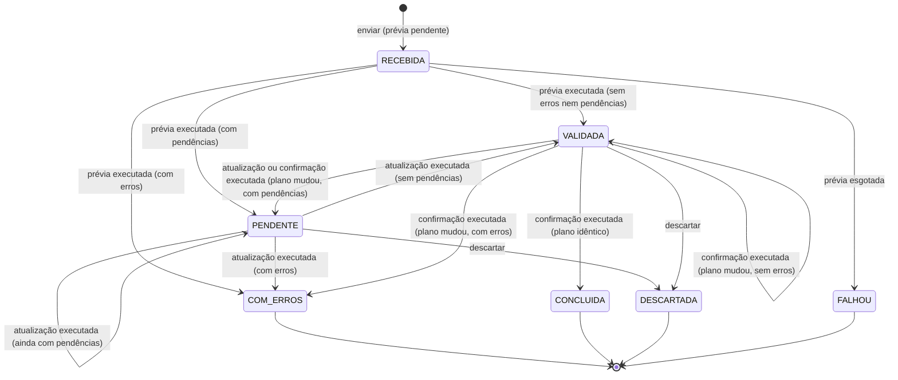

## Context

### Como o fluxo funciona hoje

O motor de importação fica no app `imports`, e cada importação específica é uma `ImportDefinition` (`accounts/imports.py`, `schedule/imports.py`). O ciclo de vida está documentado em `imports/README.md` e é implementado por operações do model `Import`, sem biblioteca de máquina de estados.

| Etapa | Onde começa | Operação | O que faz |
|---|---|---|---|
| Envio | `ImportUploadView.form_valid` | `ImportUploadForm.clean` → `source.read` | Lê o CSV ou o XLSX inteiro em memória e confere a estrutura. Recusa vira erro do formulário, sem importação |
| Prévia | `ImportUploadView.form_valid` | `Import.objects.preview` | Numa transação: savepoint, `run()` executa todas as linhas com as operações reais do domínio, rollback do savepoint, grava `Import` e `ImportRow` com o plano, auditoria `CRIAR` |
| Correção (decisão) | `SpaceDecisionView`, `SpaceWithdrawView` | `SpaceDecision.objects.decide/withdraw` e `refresh_after_decision` | Grava a decisão numa transação própria e, quando não resta pendência ou a importação estava `VALIDADA`, chama `Import.refresh` na mesma requisição |
| Reprocessamento | `refresh_after_decision`, `SpaceRefreshView` | `Import.refresh` | Trava a importação, reexecuta as linhas gravadas num savepoint desfeito e substitui o plano e a situação |
| Confirmação | `ImportConfirmView.post` | `Import.confirm` | Trava a importação, `check_confirmation`, reexecuta tudo; plano idêntico mantém o savepoint e marca `CONCLUIDA`, plano diferente desfaz e grava o novo plano |
| Descarte e exclusão | `ImportDiscardView`, `ImportDeleteView` | `Import.discard`, `Import.remove` | Transações curtas, sem executar linhas |

Estados atuais (`Import.Status`): `VALIDADA`, `PENDENTE` (Change `manipulacao-dos-espacos`), `COM_ERROS`, `CONCLUIDA`, `DESCARTADA`. O erro inesperado não tem estado: na prévia a importação não é criada, na confirmação e na atualização ela fica como estava. Correção de erro de linha não existe: envia-se um arquivo novo. A "correção" possível dentro de uma importação é a decisão de espaço que resolve uma pendência.

Persistência: `Import` guarda a situação, o arquivo, quem enviou e quem resolveu, `revalidation_count` e `file_errors`; `ImportRow` guarda os valores lidos e o plano. O arquivo não é guardado: os valores das linhas fazem as vezes dele.

### O que depende da requisição

Só a leitura do arquivo (`UploadedFile`), o usuário executor (`request.user`), o ator da auditoria (definido pelo middleware com IP e navegador) e as mensagens do `django.contrib.messages`. `run()`, `preview`, `refresh` e `confirm` recebem tudo por parâmetro. A execução já pode rodar fora do HTTP sem mudar o contrato das importações específicas.

### Medição

Feita em 07/10/2026 no container `web`, numa transação desfeita, com um superadmin como executor:

| Planilha | Linhas | Leitura | Prévia | Consultas | Pico de memória |
|---|---|---|---|---|---|
| `planilha_example.xlsx` | 1.706 | 2,2 s | 23,8 s | mais de 9.000 | 95 MB |
| `planilha_example_sugerida_corrigida.xlsx` | 1.843 | 0,5 s | 27,2 s | 53.114 | 29 MB |

Cerca de 29 consultas por linha: cada linha abre um savepoint e resolve curso, turma, disciplina, faixa, docentes e alocação com consultas próprias (`schedule/imports.py`, `execute_activity`). O custo é de tempo e de idas ao banco, e não de memória.

### Problemas encontrados

**Precisam ser resolvidos (motivo desta Change)**

| # | Problema | Evidência |
|---|---|---|
| P1 | Prévia, atualização e confirmação do ensalamento levam de 25 a 30 s dentro da requisição | medição acima; três requisições desse tamanho no fluxo normal |
| P2 | Resultado incerto quando o proxy ou o navegador corta a resposta: a operação pode ter terminado ou não, e o usuário não tem onde ver | `ImportConfirmView` só informa o resultado pela mensagem da resposta |
| P3 | Uma transação de 30 s trava as alocações do semestre e os usuários da planilha durante a requisição, ocupando um processo do servidor web | `ScheduleImport.lock`, `select_for_update` sem `skip_locked` |
| P4 | Ao tirar a execução da requisição, faltam: registro de que há uma operação em execução, separado da situação, proteção contra ações concorrentes nessa situação, recuperação depois de queda do worker e limite de tentativas | não há `PROCESSANDO` nem `FALHOU`; `lock_pending` espera a trava sem limite |

**Interessantes, mas fora da primeira versão**

| Melhoria | Por que pode esperar |
|---|---|
| Percentual de progresso | a execução roda numa única transação; o progresso gravado nela não é visível a outra conexão até o commit, e gravá-lo por outra conexão exige uma segunda conexão por worker. "Em processamento desde 14:30" resolve o feedback |
| Cancelamento | a operação enfileirada pode ser descartada depois que terminar; cancelar uma transação em curso exige sinalização entre processos |
| Redução do N+1 por linha e cache de catálogos | otimização de 27 s para menos; com o worker, o tempo deixa de afetar a tela |
| Transações em lotes | quebraria o "tudo ou nada" e a comparação de planos, que são garantias centrais da spec |
| Guardar o arquivo e ler no worker | a leitura leva de 0,5 a 2,2 s e já respeita os limites; guardar o arquivo contraria a spec atual |
| Aviso pelo canal de notificações ao terminar | `InMemoryChannelLayer` não atravessa processos; exigiria Redis para o canal |

### Infraestrutura atual

`compose.yaml` tem `web` (runserver), `worker` (`process_outbox`), `db` (PostgreSQL 17) e `tailwind`. O projeto já tem um worker próprio sobre o PostgreSQL: o outbox (`outbox/worker.py`) usa `select_for_update(skip_locked=True)`, uma transação por envio, tentativas com intervalos crescentes e `FALHOU` no limite. O `design.md` da Change `enviar-emails-por-outbox` recusou Celery com Redis por "duas dependências e um container a mais". O repositório não tem configuração de produção.

## Goals / Non-Goals

**Goals**

- Nenhuma requisição executa linhas de importação.
- O usuário pode fechar o navegador: a operação continua e o resultado fica no detalhe.
- Toda operação pedida termina num estado conhecido, mesmo com queda do worker ou da aplicação.
- Nenhuma confirmação é aplicada duas vezes, e nenhuma ação concorrente altera uma importação em processamento.
- Manter a situação como estado de negócio: nenhuma situação existente muda de significado.
- Preservar `execution.py`, `definitions.py`, o plano, a comparação de planos, as importações específicas e a garantia "tudo ou nada".

**Non-Goals**

- Tornar a execução mais rápida.
- Progresso, cancelamento e aviso em tempo real.
- Mudar a leitura do arquivo ou guardá-lo.

### Medição depois da implementação

Feita em 07/10/2026 com `planilha_example_sugerida_corrigida.xlsx` (1.843 linhas), num banco de conferência vazio e numa transação desfeita:

| Etapa | Onde | Tempo |
|---|---|---|
| Envio: leitura do arquivo e pedido da prévia | requisição | 0,19 s |
| Verificação própria no pedido de confirmação | requisição | 0,04 s |
| Prévia | worker | 9,6 s |

A requisição deixou de depender do tamanho da planilha. O tempo da prévia no worker é menor que o da medição anterior só porque o banco estava vazio; o custo por linha não mudou, e reduzi-lo continua fora do escopo.

## Revisão arquitetural de 07/10/2026

A primeira versão deste documento punha `PROCESSANDO` em `Import.status` durante a atualização da prévia e a confirmação, e guardava em `previous_status` a situação para onde voltar. A revisão recusou esse desenho, porque ele mistura o estado de negócio com o estado técnico da execução:

- **Uma importação em confirmação continua sendo `VALIDADA`.** O plano não mudou e nada foi aplicado. Trocar a situação por `PROCESSANDO` esconde esse fato de quem lê a situação.
- **A situação é lida fora do motor.** `panel/indicators.py` (`OPEN_IMPORT_STATUSES`) conta as importações de ensalamento abertas. `schedule/views.py` (quadro de espaços) decide `ready`, `is_open` e `refresh_failed` pela situação. `SpaceDecisionManager` (`schedule/models.py`) aceita decisões em `VALIDADA` e `PENDENTE`. Com `PROCESSANDO`, a importação sumiria do painel durante a confirmação e o quadro perderia o estado. O motivo seria só a forma de execução, sem nenhuma regra nova.
- **`previous_status` só existia para desfazer essa sobrescrita.** Era uma segunda cópia do estado de negócio, guardada fora da situação, que podia divergir dela.

A correção abaixo (D2, D3, D7) mantém a situação como estado de negócio e põe a execução em campos próprios, ligados à situação por uma restrição do banco.

## Decisions

### D1. Fila no PostgreSQL, com um worker próprio, no padrão do outbox

Alternativas avaliadas:

| Critério | PostgreSQL + worker próprio | Celery + Redis | Celery + RabbitMQ | RQ, Huey ou Dramatiq + Redis | `django-tasks` (backend de banco) ou Procrastinate |
|---|---|---|---|---|---|
| Infraestrutura nova | um container com a imagem atual | Redis e um container | RabbitMQ e um container | Redis e um container | um container e uma dependência |
| Aderência | mesmo padrão do outbox, já testado e documentado | estranho ao projeto, recusado no outbox | idem | idem | razoável; `django.tasks` só chega no Django 6, e o projeto está no 5.2 |
| Enfileirar na mesma transação | sim: o pedido é gravado no mesmo commit da requisição | não: exige `on_commit`, e uma queda entre o commit e a publicação perde a tarefa | idem | idem | sim |
| Estado da execução | campos da própria importação | duplicado entre o resultado do Celery e `Import` | idem | idem | duplicado na tabela da biblioteca |
| Execução única | trava da importação | `acks_late` entrega pelo menos uma vez; a trava no banco continua necessária | idem | idem | trava da biblioteca |
| Retry | tentativas e intervalos em configuração, como no outbox | nativo | nativo | nativo | nativo |
| Monitoramento | os campos da execução, o admin e o log | Flower | painel do RabbitMQ | painéis próprios | consultas à tabela |
| Escala | vários workers concorrentes; o volume é de poucas importações por semestre | alta | alta | alta | média |

**Conclusão técnica.** Fica o worker próprio. O fato de o outbox já existir não é o motivo. O motivo é que nenhum broker dispensa o que esta Change precisa no banco:

- a trava da importação, para a execução única;
- os campos da execução, para a tela;
- a recuperação de pedido sem tarefa. Com Celery, uma queda entre o commit e a publicação deixa uma operação pendente sem tarefa, e isso exige uma varredura no banco de qualquer forma.

Com o PostgreSQL como fila, o pedido e a tarefa são a mesma linha, gravada no mesmo commit. O Celery passaria a valer a pena com volume ou variedade de tarefas que o projeto não tem: dezenas de tipos, agendamentos periódicos, filas com prioridade.

Threads no processo web foram descartadas: morrem com o processo, não têm recuperação e competem com as requisições. Channels workers foram descartados porque o canal é `InMemoryChannelLayer`.

### D2. Situação de negócio e operação pendente

`Import.status` continua sendo o único estado de negócio. A execução fica em campos próprios. Não há model de tarefa, e não há uma segunda máquina de estados: o estado da execução é só "existe operação pendente ou não", mais os metadados das tentativas.

| Campo | Natureza | Finalidade |
|---|---|---|
| `status` | estado de negócio | o que o plano da importação diz; ganha `RECEBIDA` e `FALHOU` (D7) |
| `operation` | controle da execução | `PREVIA`, `ATUALIZACAO` ou `CONFIRMACAO` quando há operação pendente, e nulo quando não há. É o único sinal de "em processamento" |
| `requested_by`, `requested_at` | controle da execução e auditoria | quem pediu, cujas permissões a execução usa, e desde quando a operação espera |
| `attempts` | controle técnico | tentativas da operação pendente; zerado no próximo pedido |
| `next_attempt_at` | controle técnico | quando a operação pode ser pega; também serve de prazo da reserva (D4) |
| `last_error` | metadado técnico | erro resumido da última tentativa, até 500 caracteres, como `describe_error` do outbox; não aparece na tela |
| `outcome`, `outcome_message` | resultado para o usuário | código (`DIVERGENCIA`, `RECUSADA`, `FALHA_ATUALIZACAO`, `FALHA_CONFIRMACAO`) e texto do resultado da última operação que não terminou como pedida; mostrado no detalhe até o próximo pedido. A falha tem um código por operação porque `operation` volta a nenhuma no fim, e o quadro de espaços oferece "Tentar novamente" só depois da falha da atualização. Na `FALHOU`, o texto vai em `outcome_message`, sem código |

`previous_status` não existe: a situação não é trocada durante a operação, e por isso não há nada para restaurar. Um histórico de tentativas não é guardado, como no outbox.

**Invariante, garantida por `CheckConstraint`:**

| `operation` | Situações permitidas |
|---|---|
| nulo | qualquer uma, exceto `RECEBIDA` |
| `PREVIA` | só `RECEBIDA` |
| `ATUALIZACAO` | `VALIDADA` ou `PENDENTE` |
| `CONFIRMACAO` | só `VALIDADA` |

Com a restrição, as duas dimensões não podem se contradizer no banco. Uma importação final nunca tem operação pendente, uma `RECEBIDA` sempre tem a prévia pendente, e uma confirmação pendente só existe sobre uma importação `VALIDADA`. Um índice parcial em `next_attempt_at` com `operation IS NOT NULL` serve à fila.

### D3. Cada transição continua sendo operação do model; o worker só a chama

As transições ficam em `imports/models.py`, como hoje. A requisição chama um método de pedido, e o worker chama um único método de execução, `Import.execute_pending(definition)`. É esse método que escolhe a operação. `imports/worker.py` não grava `status` nem nenhum campo de negócio.

| Operação | Pedido (requisição, transação curta) | Execução (worker, `execute_pending`) |
|---|---|---|
| Prévia | `Import.objects.request_preview(definition, rows, file_name, executor)`: cria `Import` `RECEBIDA` com `operation = PREVIA` e as `ImportRow` só com os valores lidos | trava, confere `RECEBIDA` e `PREVIA`, `run()` num savepoint desfeito, `replace_plan`, situação pelo plano (`status_of`), auditoria `CRIAR` |
| Atualização da prévia | `Import.request_refresh(executor)`: trava, confere `VALIDADA` ou `PENDENTE` e nenhuma operação pendente | trava, confere a pré-condição de novo, corpo atual de `refresh` |
| Confirmação | `Import.request_confirmation(definition, executor)`: trava, confere `VALIDADA`, recusa `PENDENTE` com `ImportNeedsDecision`, roda `check_confirmation` | trava, confere de novo, `check_confirmation`, corpo atual de `confirm` |

Toda execução confere a pré-condição da transição sob a trava, exatamente como `lock_pending` faz hoje, e a regra não muda por o código estar no worker. Toda execução termina limpando `operation` no mesmo commit que grava o resultado de negócio. As regras preservadas são:

- o plano idêntico para concluir;
- a pendência impedindo a confirmação;
- a verificação própria;
- o "tudo ou nada";
- a auditoria;
- as permissões do executor, nas linhas e em `check_confirmation`.

O worker encontra a definição pelo tipo gravado em `imports/registry.py`, que cada app preenche no `AppConfig.ready`, como os tratadores do outbox. Um tipo sem definição registrada esgota a operação, com o motivo em `last_error`.

A primeira prévia passa a gravar as linhas antes do plano, com os erros da leitura de cada linha em `ImportRow.errors`. A prévia os devolve à execução (`as_source(with_reader_errors=True)`), para que uma célula obrigatória vazia continue sendo erro da linha, como na leitura. Uma definição que leia a importação em curso (`definition.execution(importation)`) passa a recebê-la também na primeira prévia. O ensalamento só a usa para ler decisões, que não existem nesse momento, e isso é coberto por teste.

**Quem pediu foi desativado antes da execução.** `User.has_perm` devolve falso para usuário inativo. Executar assim levaria uma confirmação válida a `COM_ERROS`, com erros de permissão em todas as linhas, um resultado que hoje é impossível, porque um usuário inativo não faz requisição. Então `execute_pending` confere `requested_by.is_active` antes de executar:

- inativo na confirmação ou na atualização: limpa a operação com `outcome = RECUSADA` e a situação não muda;
- inativo na prévia: a importação vai a `FALHOU` com a mesma mensagem.

Uma permissão retirada entre o pedido e a execução vale na execução, como vale hoje para quem confirma uma prévia de outra pessoa.

### D4. Worker: reserva e execução em transações separadas

`imports/worker.py`, `process_next()`:

```text
transação 1 (reserva, milissegundos)
  pega a importação com operation não nula e next_attempt_at vencido, select_for_update(skip_locked)
  attempts já no limite? → esgotamento (D6), na mesma transação; fim
  attempts += 1; next_attempt_at = agora + intervalo da próxima tentativa
commit

transação 2 (execução)
  SET LOCAL lock_timeout = IMPORT_LOCK_TIMEOUT (espera por trava; não limita a execução)
  acting_as(Actor(user=requested_by, origin=INTERFACE))
  Import.execute_pending(definition)
    trava a importação com skip_locked; ocupada ou sem operação → nada a fazer
    executa a transição de negócio (D3) e limpa operation, attempts e next_attempt_at
commit

exceção na transação 2 (rollback) → transação 3: last_error e log (D6)
```

O que a separação garante:

| Momento | O que está no banco | Consistente? |
|---|---|---|
| depois do pedido | situação de negócio anterior (ou `RECEBIDA`) e operação pendente | sim, a restrição de D2 vale |
| depois da reserva | o mesmo, com `attempts` contado e `next_attempt_at` no futuro | sim; o adiamento impede que outro worker pegue a mesma importação entre as duas transações |
| durante a execução | o mesmo; a trava da linha está com o worker | sim; leituras veem o estado anterior, pelo MVCC |
| depois do commit da execução | o resultado de negócio e nenhuma operação pendente, juntos | sim |
| depois de uma falha | o estado anterior intacto, com `last_error` | sim |

A situação de negócio só muda no commit da transação 2, junto com o resultado. Não existe janela com resultado gravado e operação ainda pendente, nem o contrário. A tentativa é contada antes da execução para que uma queda do processo também a consuma. Uma falha que derruba sempre o processo (falta de memória) para no limite, em vez de repetir para sempre.

O comando `process_imports` chama `close_old_connections()` antes de cada ciclo, para descartar uma conexão quebrada por reinício do PostgreSQL. O `process_outbox` não faz isso e depende do reinício do container. Depois, o comando repete `process_next` até não haver operação vencida, espera `IMPORT_POLL_INTERVAL` segundos e para entre uma operação e outra com SIGTERM e SIGINT, com `--once`. Uma exceção fora do tratamento de uma operação encerra o processo, e o `restart: unless-stopped` o recria. Roda no container `import_worker`, separado do `worker` do outbox, para que uma confirmação de 30 s não atrase e-mails.

### D5. Ações durante uma operação pendente são recusadas sem esperar

`lock_pending` passa a travar com `select_for_update(nowait=True)` e a recusar com `ImportBusy` quando há operação pendente ou quando a trava está ocupada. A mensagem é "Esta importação está em processamento e não aceita outra ação até ele terminar. Confira o resultado no detalhe." O mesmo vale para `remove` e para `SpaceDecisionManager.decide` e `withdraw`.

A recusa vale também para a operação pendente que ainda não foi pega. Uma decisão gravada enquanto a atualização está na fila seria lida pela execução e não causaria erro. Mas uma decisão gravada durante a execução ficaria fora do plano gravado, com a importação `VALIDADA`. Recusar nos dois casos é a regra mais simples sem transição inválida.

| Cenário | O que acontece | Transição inválida possível? |
|---|---|---|
| A. Atualização pendente e o usuário decide um espaço | `decide` encontra `operation` não nula e recusa com `ImportBusy`; a decisão não é gravada | não |
| B. Confirmação pendente e o usuário confirma de novo | `request_confirmation` recusa com `ImportBusy` | não |
| C. Operação pendente e o usuário pede outra (atualizar, descartar, excluir) | recusada com `ImportBusy`; a restrição de D2 recusaria no banco uma segunda operação ou um descarte com operação pendente | não |
| D. Dois workers na mesma importação | `skip_locked` na reserva entrega a importação a um só, e o adiamento de `next_attempt_at` a tira da fila até a execução; na execução, o `skip_locked` de novo descarta a corrida que sobrar | não |
| E. Worker executando e o usuário altera uma decisão | a trava está com o worker; `nowait` recusa na hora, sem esperar 30 s | não |
| Duas importações do mesmo semestre | `definition.lock` serializa as duas no worker, como hoje na requisição | não |

As travas só garantem que duas transações não atuam juntas. Quem garante que a transição é válida é a pré-condição conferida sob a trava (D3) e a restrição do banco (D2). A ordem das travas continua sendo importação e depois os registros de `definition.lock`. As ações do usuário só travam a importação, então não há ciclo de espera novo.

### D6. Erros: recusa de regra, erro temporário e esgotamento

| Tipo | Exemplo | Efeito na situação | Efeito na execução |
|---|---|---|---|
| Recusa de regra numa linha | `ValidationError` do model, erro do banco numa linha | o plano tem o erro, e a situação é `COM_ERROS` pelo plano, como hoje | operação concluída |
| Recusa da verificação própria | `check_confirmation` recusa no worker | nenhuma; continua `VALIDADA` | operação limpa, `outcome = RECUSADA` com a mensagem |
| Erro inesperado com tentativa restante | banco indisponível, defeito, `lock_timeout` | nenhuma | `last_error`; nova tentativa em `next_attempt_at` |
| Erro inesperado esgotado | o mesmo erro em todas as tentativas | prévia: `RECEBIDA` para `FALHOU`; atualização e confirmação: nenhuma | operação limpa, `outcome = FALHA_ATUALIZACAO` ou `FALHA_CONFIRMACAO` |

A máquina de estados não distingue erro temporário de definitivo: a diferença está em `attempts`, e só o esgotamento chega à situação, e só na prévia. O erro de regra de negócio nunca produz `FALHOU`, porque já tem estado próprio (`COM_ERROS`). Os valores padrão são `IMPORT_MAX_ATTEMPTS = 3` e `IMPORT_RETRY_DELAYS = 30,120`, repetindo o último. O esgotamento registra log `ERROR` e auditoria de falha. Cada falha temporária registra log `WARNING`.

### D7. Máquina de estados

**Atual**

| De | Evento | Quem dispara | Onde | Regra | Para |
|---|---|---|---|---|---|
| (nenhum) | enviar | usuário | requisição | estrutura aceita | `VALIDADA`, `PENDENTE` ou `COM_ERROS` pelo plano |
| `VALIDADA`, `PENDENTE` | atualizar a prévia | usuário (decisão ou "Tentar novamente") | requisição | nenhuma | pelo novo plano |
| `VALIDADA` | confirmar | usuário | requisição | sem pendência, verificação própria, plano idêntico | `CONCLUIDA`, ou pelo novo plano na divergência |
| `VALIDADA`, `PENDENTE` | descartar | usuário | requisição | nenhuma | `DESCARTADA` |
| `COM_ERROS`, `DESCARTADA` | excluir | usuário | requisição | permissão de exclusão | (excluída) |

**Proposta**

| De | Evento | Quem dispara | Onde | Regra | Para |
|---|---|---|---|---|---|
| (nenhum) | enviar | usuário | requisição | estrutura aceita | `RECEBIDA`, com a prévia pendente |
| `RECEBIDA` | prévia executada | worker | fora da requisição | a mesma de hoje | `VALIDADA`, `PENDENTE` ou `COM_ERROS` pelo plano |
| `RECEBIDA` | prévia esgotada, ou quem pediu está inativo | worker | fora da requisição | tentativas no limite | `FALHOU` |
| `VALIDADA`, `PENDENTE` | pedir atualização | usuário | requisição | nenhuma operação pendente | a mesma, com atualização pendente |
| `VALIDADA`, `PENDENTE` | atualização executada | worker | fora da requisição | a mesma de hoje | pelo novo plano |
| `VALIDADA` | pedir confirmação | usuário | requisição | nenhuma operação pendente, sem pendência, verificação própria | `VALIDADA`, com confirmação pendente |
| `VALIDADA` | confirmação executada | worker | fora da requisição | verificação própria e plano idêntico, como hoje | `CONCLUIDA`, ou pelo novo plano na divergência |
| `VALIDADA`, `PENDENTE` | atualização ou confirmação esgotada, recusada ou de usuário inativo | worker | fora da requisição | nenhuma | a mesma, com `outcome` |
| `VALIDADA`, `PENDENTE` | descartar | usuário | requisição | nenhuma operação pendente | `DESCARTADA` |
| `COM_ERROS`, `DESCARTADA`, `FALHOU` | excluir | usuário | requisição | permissão de exclusão | (excluída) |



Pedir uma atualização ou uma confirmação não é transição de situação: só cria a operação pendente. As transições de negócio de hoje são as mesmas, com as mesmas regras, e só passam a ser efetivadas pelo worker.

**`RECEBIDA` é estado de negócio.** Hoje a importação nasce com o plano. Agora ela existe no histórico antes de ter plano, e "arquivo aceito, prévia ainda não gerada" é um fato sobre a importação: não pode ser confirmada, descartada nem excluída. Esse fato continua verdadeiro com o worker parado, e não se confunde com um worker executando. O nome é diferente de `PROCESSANDO` de propósito, para não ser lido como estado técnico. "Em processamento" é um rótulo derivado de `operation`, e não uma situação.

**`FALHOU` é estado de negócio, restrito a `RECEBIDA`.** É o desfecho final de uma importação que nunca teve prévia. Ela fica no histórico e só pode ser excluída. O detalhe técnico do erro fica em `last_error`. Na atualização e na confirmação, a falha não chega à situação, porque o plano anterior continua válido. Isso já é o comportamento de hoje ("na confirmação, a importação continua `VALIDADA`").

**Worker morre durante uma operação.** A situação de negócio fica a anterior (`RECEBIDA`, `VALIDADA` ou `PENDENTE`), com a operação ainda pendente e a tentativa contada. A importação volta à fila quando `next_attempt_at` vencer.

### D8. Auditoria e ator no worker

O worker define o ator com `requested_by` e a origem `INTERFACE`, porque a ação foi pedida pela tela. O IP e o navegador não chegam ao worker e ficam vazios. Os registros das operações de domínio continuam com a origem `IMPORTACAO`, por `acting_from_import` dentro de `run()`.

O registro `CRIAR` da importação continua sendo gravado ao fim da prévia, e não no pedido. Os metadados da importação específica (`audit_metadata`, com a mudança de período do ensalamento) só existem depois da execução.

**Aviso em tempo real que não chega a partir do worker.** `User.change_role` chama `notices.events.announce`, que avisa pelo canal no `on_commit`. Executado no worker, o aviso vai para o `InMemoryChannelLayer` do processo do worker e não chega ao navegador. A notificação continua gravada no mesmo commit da confirmação e aparece na próxima página. Nenhuma regra funcional nem transição depende do aviso, porque `notices/realtime.py` o define como "uma camada sobre o estado gravado, e não a fonte dele". É uma limitação de entrega, registrada como melhoria futura (canal entre processos).

### D9. Telas

- **Envio**: depois do pedido, redireciona para o detalhe com "Arquivo planilha.xlsx enviado. A prévia está em processamento."
- **Confirmar**: redireciona para o detalhe com "Confirmação da importação do arquivo planilha.xlsx em processamento." O texto de divergência sai da resposta e vai para o `outcome`.
- **Selo**: o da situação de negócio, como hoje (`RECEBIDA` tem o selo "Recebida"). Com operação pendente, o detalhe e a lista acrescentam o selo "Em processamento".
- **Detalhe com operação pendente**:
  - o selo "Em processamento", sem frase com a operação e a hora do pedido (retirada a pedido do autor em 07/10/2026);
  - sem os controles de confirmar, descartar, excluir e decidir;
  - na prévia, as linhas ainda não têm plano e a tabela não é mostrada;
  - na atualização e na confirmação, o plano atual aparece como está.
- **Demora**: com o pedido feito há mais de `IMPORT_STALE_AFTER` segundos, o quadro acrescenta "O processamento está demorando mais que o esperado. Ele continua sendo executado em segundo plano." e "O sistema pode continuar sendo usado. Volte a esta tela depois para consultar o resultado." (D13)
- **Acompanhamento** (por polling, e não pelo Django Channels; D14):
  - o quadro faz `hx-get` a cada `IMPORT_STATUS_POLL_SECONDS` (padrão 3) para a rota nova `<prefixo>_status`;
  - a rota responde 204 enquanto há operação pendente e `HttpResponseClientRefresh` quando ela termina;
  - sem JavaScript, o quadro mostra o controle "Atualizar página".
- **Resultado**: `outcome` aparece no topo do detalhe:
  - `DIVERGENCIA`, com a mensagem atual de divergência;
  - `RECUSADA`, com a mensagem da verificação ou da desativação;
  - `FALHA_CONFIRMACAO` e `FALHA_ATUALIZACAO`, com "A confirmação não foi concluída por uma falha do sistema. Nada foi aplicado. Confirme de novo." (ou "A atualização da prévia não foi concluída..." na atualização).
- **Conclusão**: a mensagem de conclusão da importação específica (`concluded_message`) aparece como mensagem do `django.contrib.messages`, como nas demais telas, e não como aviso fixo no detalhe. O worker não tem requisição, então a rota de andamento registra a mensagem na consulta que percebe a importação `CONCLUIDA` e pede o recarregamento, e a página a mostra uma vez. Quem abre o detalhe depois vê a situação "Concluída".
- **`FALHOU`**: selo "Falhou" e "A prévia não foi gerada por uma falha do sistema. Envie o arquivo de novo."
- **Painel e quadro de espaços**: continuam lendo a situação de negócio, sem mudança de regra. O quadro de espaços passa a esconder os controles com operação pendente. A condição de "Não foi possível atualizar a prévia." passa a ser `outcome = FALHA_ATUALIZACAO`, e não a inferência atual (`PENDENTE` sem nome pendente).

Os textos seguem a seção 9 das convenções e o glossário, e passam pelas varreduras do app `ui`. A tela segue `ui/components/` e as referências visuais pedidas antes de cada tela.

### D10. Observabilidade

| O usuário precisa saber | Onde vê | Dado |
|---|---|---|
| que a importação foi iniciada | mensagem do envio e detalhe | `RECEBIDA`, `operation`, `requested_at` |
| que está sendo processada | selo e quadro do detalhe, atualizados sozinhos | `operation` |
| que está demorando mais que o esperado | quadro do detalhe | aviso calculado de `requested_at` e `IMPORT_STALE_AFTER`, sem nada gravado |
| que houve erro | detalhe | `outcome` de falha ou `FALHOU` |
| que precisa de decisão | selo "Precisa de decisão" | `PENDENTE` |
| que terminou e espera confirmação | selo "Validada" | `VALIDADA` sem operação |
| que foi concluída | selo e resumo | `CONCLUIDA`, `resolved_at` |

Todo dado vem do banco, e nada depende da página ficar aberta. Fechar o navegador não afeta a operação, e voltar ao detalhe mostra o estado atual. Quem administra o sistema vê `attempts` e `last_error` no admin do Django e nos logs do logger `imports`. Percentual de progresso, linhas processadas e histórico de tentativas não são guardados.

### D11. Falhas do worker em cada ponto

Em todos os casos, o PostgreSQL desfaz a transação aberta e solta as travas quando a conexão termina. Uma conexão que só para de responder é detectada pelo keepalive do sistema operacional, que demora mais.

| Ponto da queda (processo encerrado, OOM, deploy, reinício do container ou da máquina, perda de conexão) | Situação | Operação | Retoma? | Duplica? |
|---|---|---|---|---|
| antes da reserva | a anterior | pendente, vencida | sim, na próxima procura | não |
| durante a reserva | a anterior | pendente, `attempts` sem mudança | sim | não |
| entre a reserva e a execução | a anterior | pendente, tentativa contada | sim, quando `next_attempt_at` vencer | não |
| durante a execução | a anterior; tudo desfeito, inclusive domínio e outbox | pendente, tentativa contada | sim | não; o efeito só existe no commit, junto com a limpeza da operação |
| depois do commit da execução | a nova | concluída | não precisa | não; a pré-condição falha, porque não há operação |
| durante o registro da falha (transação 3) | a anterior | pendente, tentativa contada, sem `last_error` | sim | não |
| exceção inesperada (não é queda) | a anterior | pendente, `last_error` gravado | sim, pelo intervalo | não |

**Ficar presa para sempre.** A execução pode ficar presa esperando trava (`definition.lock` atrás de uma sessão ociosa em transação): o `lock_timeout` a transforma em erro e nova tentativa. A operação pode ficar pendente para sempre só se nenhum worker estiver rodando, e nesse caso ela volta a andar quando o worker voltar, sem ação manual. O aviso de demora (D13) torna essa situação visível. Não é preciso watchdog, comando de recuperação nem retomada manual. Uma importação que esgota as tentativas sai da fila, com o `outcome` de falha ou `FALHOU`.

**Idempotência.** São quatro garantias diferentes:

- **Execução única:** um só worker executa uma importação de cada vez, pelo `skip_locked` e pelo adiamento da reserva.
- **Rollback:** o que a execução interrompida fez é desfeito pelo banco.
- **Reexecução segura:** a tentativa seguinte começa do zero e confere a pré-condição. A confirmação compara o plano com os dados atuais, então repetir depois de outra pessoa ter mudado dados dá divergência, e não aplicação errada.
- **Proteção contra pedido repetido:** o segundo pedido é recusado pela operação pendente e pela restrição.

A solução não depende só do rollback. O resultado e o fim da operação são gravados no mesmo commit, e a execução não tem efeito fora do banco, porque a spec proíbe efeito externo nas importações específicas e o outbox é gravado na mesma transação. Os avisos do `on_commit` só disparam depois do commit, uma vez.

### D12. Tempo limite

| Camada | Configuração no repositório | Efeito |
|---|---|---|
| Django | nenhuma; o Django não tem tempo limite de requisição | nenhum |
| Servidor | `runserver` no `compose.yaml`; não há Gunicorn, uWSGI nem configuração do Daphne | sem limite em desenvolvimento |
| Proxy de produção | ausente do repositório | não afeta a solução: nenhuma requisição executa linhas (D13) |
| Docker | só o `healthcheck` do `db` (5 s) | nenhum |
| PostgreSQL | sem `statement_timeout`, `lock_timeout` nem `idle_in_transaction_session_timeout` | nenhum hoje |

Em desenvolvimento nada corta a requisição de 30 s, e o problema aparece como espera, travas longas e incerteza ao fechar a aba. Em produção, o corte dependeria do proxy, que não está no repositório. Os valores padrão comuns (60 s no nginx, 30 s em vários balanceadores) ficam próximos ou abaixo do tempo medido. Com o worker, o tempo limite do proxy deixa de importar para a importação, porque as requisições que restam são transações curtas. Por isso ele não precisa ser descoberto nem ajustado nesta Change. No worker não há limite de tempo de execução. Valem só o `IMPORT_LOCK_TIMEOUT` (D13) e o tempo de parada do Docker no deploy (10 s por padrão, depois SIGKILL). O SIGKILL no meio de uma execução cai no caso "durante a execução" de D11.

### D13. Limites de tempo e aviso de demora

Dois valores de configuração, independentes, lidos do ambiente como os do outbox (`DJANGO_IMPORT_LOCK_TIMEOUT` e `DJANGO_IMPORT_STALE_AFTER`), em segundos:

| Configuração | Padrão | Significado | O que **não** é |
|---|---|---|---|
| `IMPORT_LOCK_TIMEOUT` | 60 | tempo máximo que uma operação espera pela aquisição de uma trava (`SET LOCAL lock_timeout` na transação de execução). Esgotado, a espera vira erro inesperado e segue as novas tentativas (D6) | não é o tempo máximo da execução. Uma execução que já tem as travas roda o tempo que precisar: hoje de 24 a 30 s, e pode passar disso |
| `IMPORT_STALE_AFTER` | 60 | tempo, contado de `requested_at`, depois do qual a tela considera que a operação está demorando mais que o esperado e mostra o aviso | não interrompe, não cancela e não altera a operação; não é gravado nem é situação |

Os dois começam com o mesmo valor por coincidência. Podem ser ajustados por ambiente, um sem o outro.

**O aviso é derivado, e não estado.** A tela calcula `agora - requested_at > IMPORT_STALE_AFTER` a cada exibição. Uma importação `VALIDADA` com `operation = CONFIRMACAO` continua exatamente assim enquanto demora. Não existe `PROCESSANDO_DEMAIS`, `TRAVADA`, `TIMEOUT` nem campo gravado para a demora. `requested_at` é o timestamp que D2 já define. Ele conta a espera na fila e a execução juntas, que é o tempo que o usuário percebe.

**Texto do aviso**, responsabilidade da aplicação, no quadro de processamento do detalhe:

> O processamento está demorando mais que o esperado. Ele continua sendo executado em segundo plano.
>
> O sistema pode continuar sendo usado. Volte a esta tela depois para consultar o resultado.

A segunda frase é a orientação opcional, reescrita sem "você", que a seção 9.1 das convenções proíbe e que a varredura do app `ui` recusa. Nenhum texto exibido sobre a execução cita worker, processo, fila, banco de dados, nova tentativa ou trava. O usuário vê só o estado da operação. Os detalhes técnicos ficam em `attempts`, `last_error` e no log.

### D14. Acompanhamento por polling, e não pelo Django Channels

Avaliado em 07/10/2026, a pedido do autor, para trocar o polling do detalhe (D9) por um evento de WebSocket.

**Infraestrutura existente.**

| Item | Como está |
|---|---|
| `CHANNEL_LAYERS` | `channels.layers.InMemoryChannelLayer` (`config/settings.py`), sem variação por ambiente |
| Dependências | `channels` e `daphne`; não há `channels_redis` nem outro backend de camada |
| Consumer e rota | `notices.consumers.NotificationsConsumer` em `ws/notificacoes/`, autenticado pela sessão (`AuthMiddlewareStack`), um grupo por usuário (`notificacoes-<id>`) |
| Padrão do evento | só avisa que algo mudou (`{'evento': 'notificacoes'}`), e a página busca o estado por HTTP autenticado; o envio sai no `transaction.on_commit` (`notices/realtime.py`) e uma falha do canal vai ao log sem desfazer nada |
| Processos | `web` e `worker` são containers separados; o `import_worker` desta Change também |
| Produção | sem configuração no repositório |

**Consequência.** O `InMemoryChannelLayer` guarda grupos e mensagens na memória do processo que o criou. O `group_send` feito no `import_worker` chegaria só à camada desse processo, onde nenhum navegador está conectado. O consumer do processo `web` nunca receberia o aviso. Esse é o mesmo motivo pelo qual o aviso de `change_role` não chega a partir do worker (D8). O worker não consegue publicar eventos para o navegador com a infraestrutura atual.

**Decisão.** O polling de D9 continua: a rota `<prefixo>_status`, consultada a cada `IMPORT_STATUS_POLL_SECONDS`, com 204 enquanto há operação pendente e `HttpResponseClientRefresh` quando ela termina. Esta Change não acrescenta Redis, outro backend de camada nem servidor de WebSocket. Trocar a camada é decisão de infraestrutura do projeto inteiro, porque também afeta as notificações.

**Caminho futuro, sem mudança nesta Change.** Com uma camada compartilhada entre processos, o polling pode ser trocado sem mexer no processamento nem na máquina de estados:

- o worker publica, no `on_commit` da transação de execução, um aviso só de mudança para um grupo da importação, no padrão de `notices`;
- o consumer só aceita entrar no grupo quem tem a permissão da importação;
- a página reage ao aviso consultando a mesma rota de andamento por HTTP.

O PostgreSQL continua sendo a fonte de verdade. A rota de andamento já é o "HTTP GET" desse fluxo, e o aviso de demora continua calculado de `requested_at`.

## Risks / Trade-offs

| Risco | Mitigação |
|---|---|
| Worker parado deixa operações pendentes | `restart: unless-stopped`, aviso de demora no detalhe, log; a operação retoma quando o worker voltar |
| A transação de 30 s continua travando as alocações do semestre, agora no worker | é o comportamento atual, fora da tela; a edição manual de uma alocação do semestre espera o fim da importação, como hoje |
| Deploy durante uma confirmação | SIGKILL depois de 10 s desfaz a execução, que é refeita pelo novo container, com uma tentativa consumida |
| Erro que sempre ocorre é tentado de novo à toa | limite de 3 tentativas e intervalos curtos |
| Recusas de regra tratadas como erro inesperado | só `ValidationError` é recusa, como na execução atual (`execute_row`); a verificação da confirmação no worker não gera tentativa |
| Testes atuais chamam `preview`, `refresh` e `confirm` e esperam a situação final | um auxiliar de teste pede a operação e roda `process_next`, mantendo as asserções |
| `nowait` recusa por trava de outra ação curta no mesmo instante | a mensagem pede para conferir o detalhe; repetir resolve |
| Permissão retirada entre o pedido e a execução | vale a permissão na execução, como em toda confirmação; usuário inativo é recusado antes (D3) |
| Aviso em tempo real de troca de perfil não chega a partir do worker (D8) | a notificação é gravada; melhoria futura |
| Perda do IP e do navegador nos registros feitos pelo worker | o executor continua registrado |

## Migration Plan

1. Migration de `imports`: situações `RECEBIDA` e `FALHOU`, campos de D2, a `CheckConstraint` e o índice parcial. As importações existentes ficam sem operação pendente e nenhuma fica `RECEBIDA`, então a restrição vale sem migration de dados. `max_length = 10` comporta os códigos novos.
2. Worker, comando e `execute_pending`, com a suíte rodando a execução de forma direta, antes de mudar qualquer tela.
3. Troca das views do motor (envio e confirmação) e do detalhe, com a rota de situação.
4. Troca das views do ensalamento (decisões e "Tentar novamente") e da condição de falha do quadro.
5. Serviço `import_worker` no `compose.yaml`, configuração nova no `settings.py` e documentação no `imports/README.md`.

Cada passo é uma etapa do `tasks.md` com a suíte passando. Para voltar atrás, basta reverter as views: as operações de execução continuam no model e podem ser chamadas na requisição.

## Decisões confirmadas pelo autor

Em 07/10/2026:

| Questão | Decisão | Onde está |
|---|---|---|
| Tempo limite de produção | não precisa ser conhecido: nenhuma requisição executa linhas, e o worker não tem limite de execução | D12 |
| Espera por trava | `IMPORT_LOCK_TIMEOUT = 60` s, só para a aquisição de trava | D13 |
| Quando avisar a demora | `IMPORT_STALE_AFTER = 60` s, contado do pedido, independente do anterior | D13 |
| Texto e responsável do aviso | o texto de D13, da aplicação, sem termos técnicos, como aviso derivado e não como situação | D9, D13 |
| Acompanhamento por WebSocket | não nesta Change: a camada é `InMemoryChannelLayer`, que não atravessa processos; o polling continua, sem infraestrutura nova | D14 |
| Dependência de `manipulacao-dos-espacos` | arquivada em 07/10/2026 como `2026-10-07-manipulacao-dos-espacos`; os deltas desta Change partem do texto arquivado | proposal |

## Open Questions

Nenhuma.
